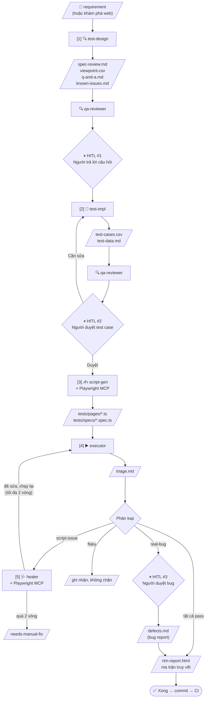

# Sơ đồ làm việc của AI agent trong dự án

> Pipeline QA gồm **5 AI agent** do **1 orchestrator** điều phối, **1 agent review (qa-reviewer) soát lại sau mỗi bước**, có **3 điểm dừng để người duyệt (HITL)**.
> Bản sơ đồ tương tác (bấm vào từng khối để xem chi tiết): [ai-agent-workflow.html](ai-agent-workflow.html)
>
> Phát triển tiếp từ repo v1 [learn-ai-automation-test](https://github.com/MyHanhYuuki/learn-ai-automation-test):
> giữ quy trình QA, nâng cấp agent bằng công cụ **Playwright MCP** để làm việc trên trình duyệt thật.

## 1. Sơ đồ cây: các thành phần

```
Dự án playwright-ai-qa-portfolio
│
├── 👤 NGƯỜI (QC tester)
│     ├── Chọn chức năng cần test, viết/cung cấp requirement
│     ├── HITL #1: trả lời câu hỏi mở của AI về requirement
│     ├── HITL #2: duyệt viewpoint + test case trước khi viết code
│     └── HITL #3: duyệt bug thật trước khi ghi vào danh sách lỗi
│
├── 🎯 ORCHESTRATOR  (/qa-orchestrator, lệnh trong Claude Code)
│     ├── Gọi từng agent theo đúng thứ tự, kiểm tra kết quả mỗi bước
│     ├── Dừng ở 3 điểm HITL chờ người duyệt
│     ├── Đếm số vòng sửa của healer (tối đa 2 vòng / test case)
│     └── Cuối cùng: ghi bug report (defects.md) + ma trận truy vết (RTM)
│
├── 🤖 5 AI AGENT  (.claude/agents/)
│     │
│     ├── [1] 🔍 test-design   phân tích yêu cầu
│     │     ├── Vào:  requirement + (tùy chọn) tự khám phá web bằng trình duyệt
│     │     └── Ra:   spec-review.md, viewpoint.csv, q-and-a.md, known-issues.md, improvements.md
│     │
│     ├── [2] 📝 test-impl     viết test case
│     │     ├── Vào:  viewpoint.csv + câu trả lời HITL #1
│     │     ├── Kỹ thuật: phân vùng tương đương, giá trị biên, bảng quyết định, chuyển trạng thái
│     │     └── Ra:   test-cases.csv, test-data.md
│     │
│     ├── [3] ✍️ script-gen    viết code test
│     │     ├── Vào:  test-cases.csv
│     │     ├── Làm:  mở web thật để kiểm tra locator rồi mới viết code (Playwright MCP)
│     │     └── Ra:   tests/pages/*.ts (Page Object), tests/specs/*.spec.ts
│     │
│     ├── [4] ▶️ executor      chạy test + phân loại
│     │     ├── Vào:  bộ test
│     │     ├── Phân loại test fail:  flaky | script-issue (test sai) | real-bug (web lỗi)
│     │     └── Ra:   run-results/*.json, triage.md
│     │
│     └── [5] 🩺 healer        sửa test sai
│           ├── Vào:  các test bị gắn nhãn script-issue
│           ├── Làm:  debug trên trình duyệt thật (Playwright MCP), sửa locator/timing/logic
│           ├── Luật: KHÔNG đụng real-bug, KHÔNG sửa kết quả mong đợi, tối đa 2 vòng
│           └── Ra:   code đã sửa, healing-log.md
│
├── 🔍 qa-reviewer  (QC Lead, chuẩn ISTQB)
│     ├── Chạy: sau mỗi bước test-design, test-impl, script-gen, executor, TRƯỚC HITL
│     ├── Làm:  soát thiếu sót, sai kỹ thuật, không nhất quán giữa các file; kiểm chứng trên web
│     └── Ra:   review-<bước>.md (chỉ báo cáo, không tự sửa)
│
├── 🔌 CÔNG CỤ
│     ├── Playwright MCP (.mcp.json): cầu nối để agent điều khiển trình duyệt thật
│     └── Playwright Test: chạy test, ghi trace, xuất báo cáo
│
└── ⚙️ GITHUB ACTIONS (CI, không phải AI): mỗi lần push tự chạy toàn bộ test
```

## 2. Sơ đồ luồng

> Hiển thị được trên GitHub. Trong VS Code cần extension *Markdown Preview Mermaid Support*.



## 3. Bảng phân vai

| Bước | Vai | Đầu vào | Đầu ra | Công cụ đặc biệt |
|---|---|---|---|---|
| 1 | 🔍 test-design | requirement | spec-review, viewpoint, câu hỏi | Trình duyệt (khám phá web) |
| 🔍 | qa-reviewer | kết quả bước vừa xong | `review-<bước>.md` | Trình duyệt (kiểm chứng) |
| ⏸ | 👤 HITL #1 | câu hỏi Open | cột Trả lời trong `q-and-a.md` | – |
| 2 | 📝 test-impl | viewpoint + Q&A | test-cases.csv, test-data.md | – |
| ⏸ | 👤 HITL #2 | test case | duyệt / góp ý | – |
| 3 | ✍️ script-gen | test-cases.csv | Page Object + spec | Trình duyệt (kiểm tra locator) |
| 4 | ▶️ executor | bộ test | run-results, triage.md | Playwright CLI |
| 5 | 🩺 healer | script-issue | code đã sửa, healing-log | Trình duyệt + debug test |
| ⏸ | 👤 HITL #3 | real-bug | duyệt bug | – |
| 6 | 🎯 orchestrator | bug đã duyệt | defects.md, rtm-report.html | – |

## 4. Nơi lưu kết quả của một lần chạy

```
qa-runs/<tên-chức-năng>/          ← mỗi chức năng một thư mục (vd: saucedemo-login)
  requirement/requirement.md       ← đầu vào
  spec-review.md                   ← [1]
  viewpoint.csv                    ← [1]
  q-and-a.md                       ← [1] đặt câu hỏi, HITL #1 trả lời (một file duy nhất)
  known-issues.md                  ← [1] bug thấy sớm + lưu ý cho bước sau
  improvements.md                  ← [1] đề xuất cải tiến (không phải bug)
  review-<bước>.md                 ← 🔍 qa-reviewer
  test-cases.csv, test-data.md     ← [2]
  run-results/run-*.json           ← [4]
  triage.md                        ← [4]
  healing-log.md                   ← [5]
  defects.md                       ← [6]
  rtm-report.html                  ← [6]
tests/                             ← code test dùng chung cả dự án
  pages/   specs/   data/   fixtures/
kb/q-and-a-archive.md              ← Q&A tích lũy, dùng lại cho chức năng sau
```

## 5. Lộ trình các bài

```
Bài 1  Cấu trúc dự án ............................ ✅ xong
Bài 2  Phân tích yêu cầu (test-design) + HITL #1 . 🔍 SauceDemo: Đăng nhập
Bài 3  Thiết kế test case (test-impl) + HITL #2 .. 📝 EP, BVA, bảng quyết định
Bài 4  Viết code test (script-gen) ............... ✍️ Page Object Model, locator
Bài 5  Chạy test & phân loại (executor) .......... ▶️ báo cáo, trace, flaky
Bài 6  Sửa test hỏng (healer) .................... 🩺 debug, giới hạn vòng sửa
Bài 7  Bug report + RTM + HITL #3 ................ 🐞 problem_user của SauceDemo
Bài 8  Chạy trọn pipeline cho chức năng mới ...... 🎯 /qa-orchestrator: Giỏ hàng → Thanh toán
Bài 9  Test API (Restful Booker) ................. 🔗
Bài 10 CI GitHub Actions + hoàn thiện README ..... ⚙️
```

## 6. Nguyên tắc

1. **Chỉ orchestrator gọi agent.** Agent không gọi nhau, chỉ trao đổi qua file.
2. **Người chốt ở 3 điểm HITL.** AI có thể sai mà trông vẫn rất đúng.
3. **Phân biệt "test sai" với "web lỗi".** Healer chỉ sửa test sai, không bao giờ sửa test cho pass để che bug.
4. **Truy vết đầy đủ:** requirement → AC → viewpoint → test case → code → kết quả → bug.
