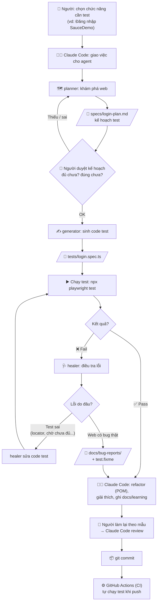

# Sơ đồ làm việc của AI agent trong dự án

> Tổng quan: dự án có những "vai" nào (người, AI agent, công cụ), mỗi vai làm gì và phối hợp với nhau ra sao.

## 1. Sơ đồ cây: các thành phần

```
Dự án playwright-ai-qa-portfolio
│
├── 👤 NGƯỜI (QC tester)
│     ├── Ra yêu cầu, chọn chức năng cần test
│     ├── Duyệt kế hoạch test và code do AI sinh ra
│     ├── Làm lại từng bước theo mẫu để hiểu
│     └── Quyết định: lỗi do test sai hay do web có bug thật
│
├── 🧑‍🏫 CLAUDE CODE (trợ lý chính, "người hướng dẫn")
│     ├── Điều phối: gọi đúng agent ở đúng bước
│     ├── Làm mẫu → giải thích → review phần người làm lại
│     ├── Refactor code (Page Object Model), viết test API
│     ├── Viết tài liệu: docs/learning/, bug report, ai-log
│     └── Quản lý git: commit, (sau này) push
│
├── 🤖 3 AI AGENT CỦA PLAYWRIGHT (.claude/agents/)
│     │
│     ├── 🗺️ planner  (lập kế hoạch)
│     │     ├── Vào: URL web + chức năng cần test
│     │     ├── Làm: mở trình duyệt, tự click khám phá web
│     │     └── Ra:  specs/<tên>-plan.md (danh sách scenario + các bước + kết quả mong đợi)
│     │
│     ├── ✍️ generator  (sinh code test)
│     │     ├── Vào: file kế hoạch trong specs/
│     │     ├── Làm: chạy thử từng bước trên web thật để chọn locator đúng
│     │     └── Ra:  tests/<tên>.spec.ts (code test Playwright)
│     │
│     └── 🩺 healer  (sửa test hỏng)
│           ├── Vào: test đang fail
│           ├── Làm: chạy lại, xem lỗi, xem trang web, tìm nguyên nhân
│           └── Ra:  code test đã sửa, HOẶC đánh dấu test.fixme nếu web có bug thật
│
├── 🔌 CÔNG CỤ AI DÙNG
│     ├── Playwright MCP (.mcp.json): cầu nối để AI điều khiển trình duyệt thật
│     └── Playwright Test: thư viện chạy test, ghi trace, xuất báo cáo
│
└── ⚙️ TỰ ĐỘNG HÓA (không phải AI)
      └── GitHub Actions (CI): mỗi lần push → tự chạy toàn bộ test → báo cáo xanh/đỏ
```

## 2. Sơ đồ luồng: một vòng làm việc

> Sơ đồ dưới đây hiển thị được trên GitHub. Trong VS Code cần cài extension
> *Markdown Preview Mermaid Support* mới xem được hình.



## 3. Bảng phân vai

| Vai | Loại | Đầu vào | Đầu ra | Dùng ở bài |
|---|---|---|---|---|
| 👤 Người (QC) | Con người | Mục tiêu test | Quyết định, duyệt, làm lại | Tất cả |
| 🧑‍🏫 Claude Code | AI trợ lý chính | Yêu cầu của người | Hướng dẫn, review, refactor, tài liệu, commit | Tất cả |
| 🗺️ planner | AI agent | URL + chức năng | `specs/*.md` | Bài 2 |
| ✍️ generator | AI agent | `specs/*.md` | `tests/*.spec.ts` | Bài 3 |
| 🩺 healer | AI agent | Test đang fail | Test đã sửa / `test.fixme` | Bài 5 |
| 🔌 Playwright MCP | Công cụ | Lệnh từ AI | Thao tác trên trình duyệt | Bài 2, 3, 5 |
| ⚙️ GitHub Actions | Tự động hóa | Code mới push | Kết quả test + báo cáo | Bài 8 |

## 4. Lộ trình các bài và agent tham gia

```
Bài 1  Cấu trúc dự án ........................ 🧑‍🏫 Claude Code              ✅ xong
Bài 2  Lập kế hoạch test SauceDemo ........... 🗺️ planner
Bài 3  Sinh code test (login, giỏ hàng) ...... ✍️ generator
Bài 4  Page Object Model (tổ chức code) ...... 🧑‍🏫 Claude Code
Bài 5  Test hỏng & test chập chờn (flaky) .... 🩺 healer
Bài 6  Tìm bug & viết bug report ............. 🩺 healer + 👤 Người
Bài 7  Test API (Restful Booker) ............. 🧑‍🏫 Claude Code
Bài 8  CI với GitHub Actions ................. ⚙️ GitHub Actions
Bài 9  Hoàn thiện README & nhật ký dùng AI ... 🧑‍🏫 Claude Code + 👤 Người
```

## 5. Vì sao vẫn cần người ở giữa?

AI làm nhanh nhưng có thể **sai mà trông vẫn rất đúng**. Người cần chốt ở 3 điểm:

1. **Duyệt kế hoạch test.** AI hay bỏ sót trường hợp biên, hoặc test những thứ không quan trọng.
2. **Phân biệt "test sai" với "web có bug".** Nếu để healer tự sửa test cho pass, có thể vô tình **che mất bug thật**.
3. **Review code sinh ra.** Kiểm tra test có thực sự kiểm tra điều cần kiểm tra không, hay chỉ chạy qua mà không có `expect`.
