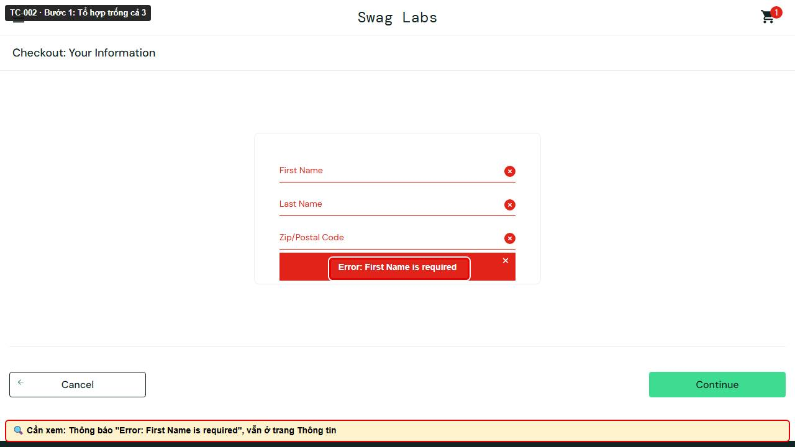
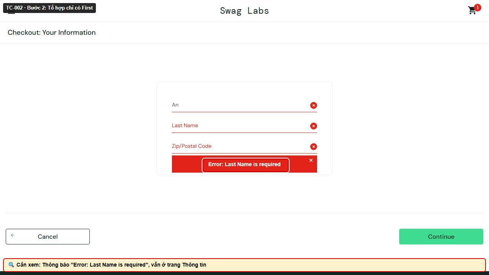
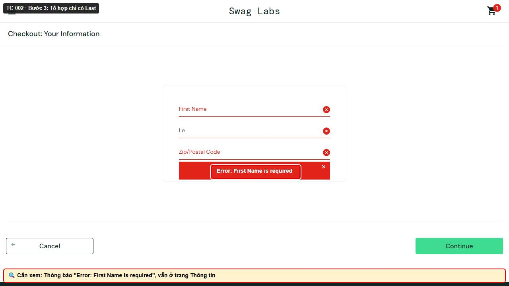
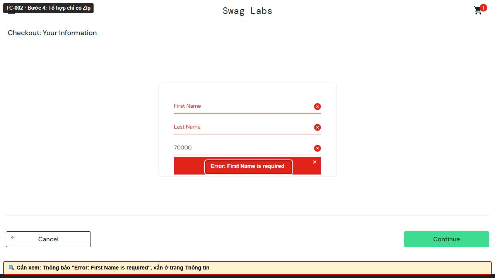
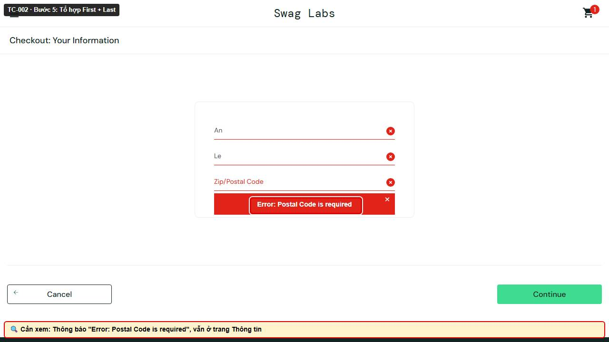
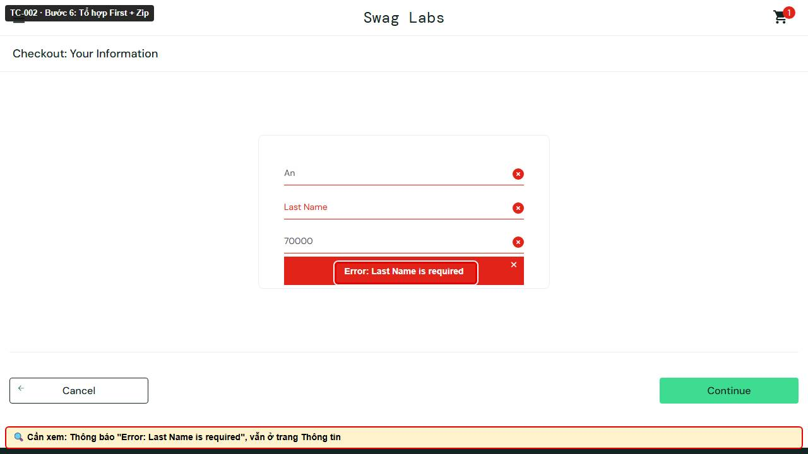
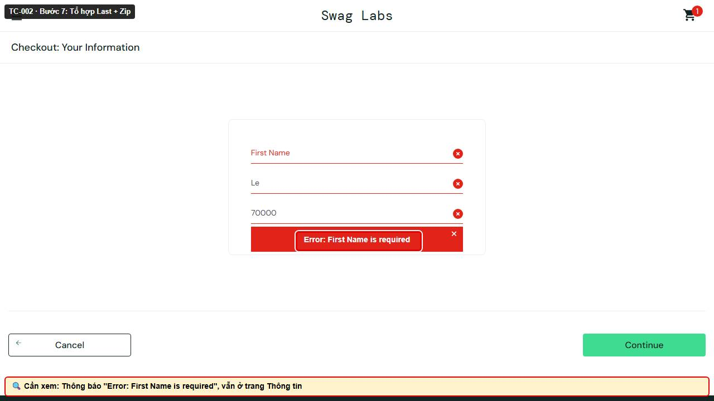

# TC-002 Thiếu ô bắt buộc: báo lỗi ô đầu tiên còn thiếu (7 tổ hợp)

- **Kết quả**: ✅ Passed
- **Nhóm**: Màn hình 1: Thông tin (/checkout-step-one.html)
- **Tags**: @AC-2 @info @smoke
- **Thời điểm**: 2026-11-26T07:11:36.744Z
- **Video**: (chỉ quay video cho test có bug hoặc kết quả bất thường)

| Bước | Thao tác | Cần xem | Ảnh |
|---|---|---|---|
| 1 | Tổ hợp trống cả 3 | Thông báo "Error: First Name is required", vẫn ở trang Thông tin |  |
| 2 | Tổ hợp chỉ có First | Thông báo "Error: Last Name is required", vẫn ở trang Thông tin |  |
| 3 | Tổ hợp chỉ có Last | Thông báo "Error: First Name is required", vẫn ở trang Thông tin |  |
| 4 | Tổ hợp chỉ có Zip | Thông báo "Error: First Name is required", vẫn ở trang Thông tin |  |
| 5 | Tổ hợp First + Last | Thông báo "Error: Postal Code is required", vẫn ở trang Thông tin |  |
| 6 | Tổ hợp First + Zip | Thông báo "Error: Last Name is required", vẫn ở trang Thông tin |  |
| 7 | Tổ hợp Last + Zip | Thông báo "Error: First Name is required", vẫn ở trang Thông tin |  |
