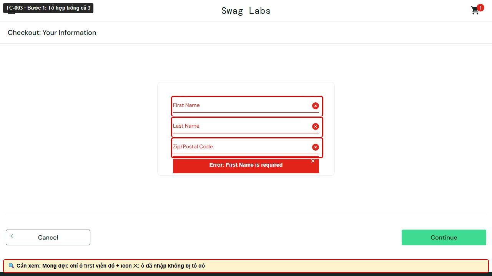
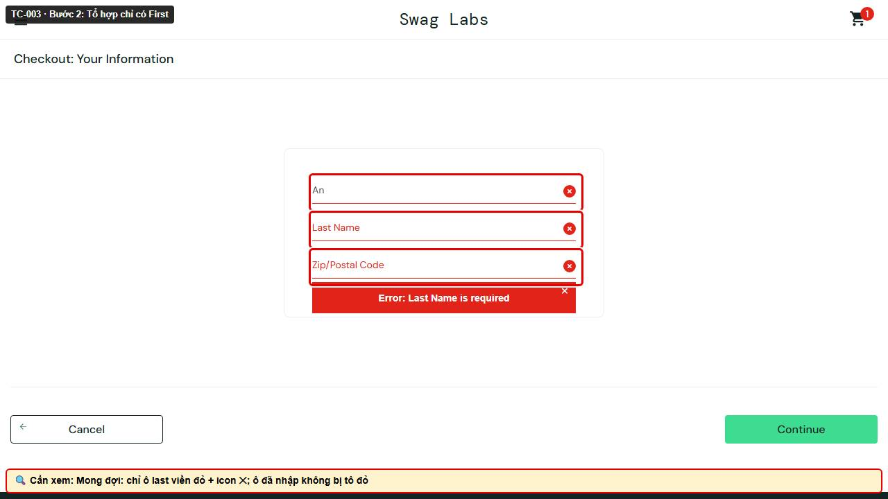
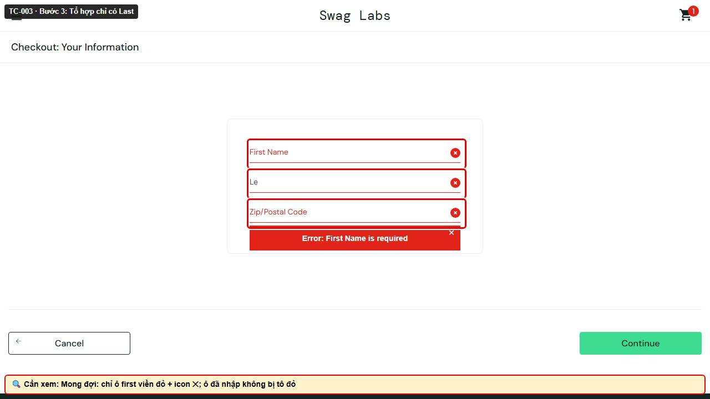
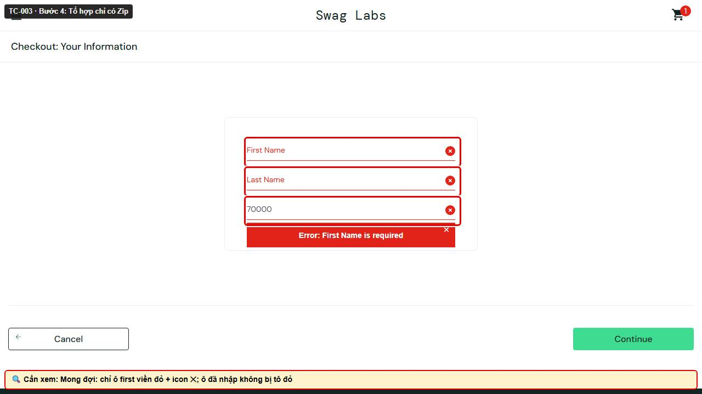
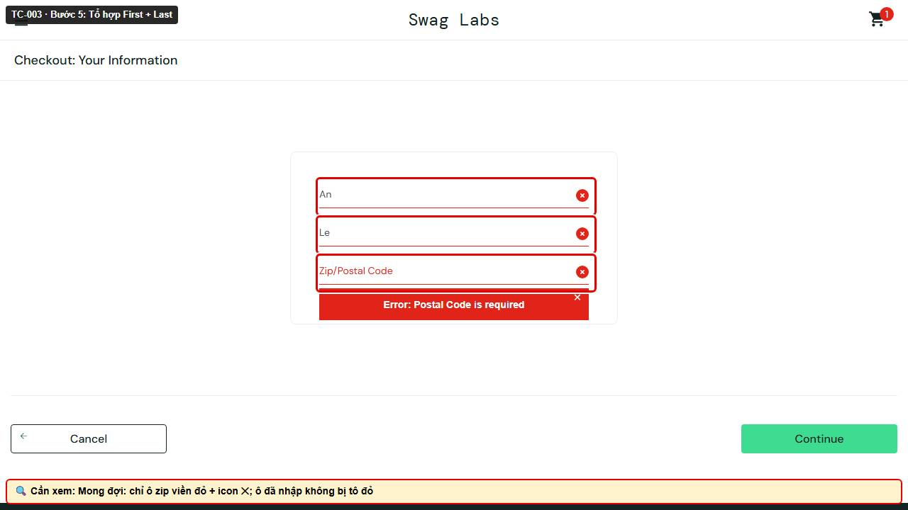
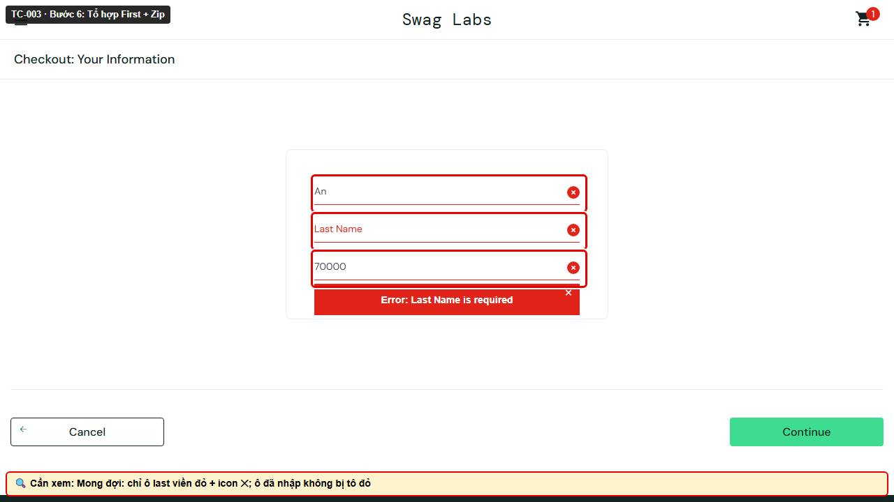
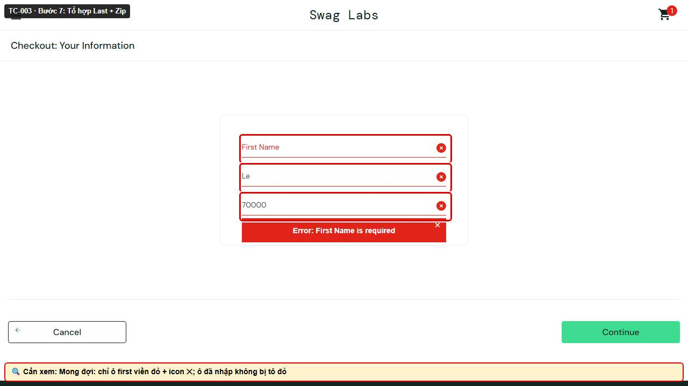

# TC-003 Thiếu ô: chỉ ô còn thiếu bị tô đỏ, ô đã nhập không bị tô đỏ

- **Kết quả**: ❌ Failed · Bug: BUG-22
- **Nhóm**: Màn hình 1: Thông tin (/checkout-step-one.html)
- **Tags**: @AC-2 @info @BUG-22
- **Thời điểm**: 2026-11-26T08:37:05.776Z
- **Video**: [video.webm](video.webm) (quay ở lần chạy ngày 2026-11-26, lần này không quay lại: EVIDENCE_KEEP_VIDEOS)

| Bước | Thao tác | Cần xem | Ảnh |
|---|---|---|---|
| 1 | Tổ hợp trống cả 3 | Mong đợi: chỉ ô first viền đỏ + icon ✕; ô đã nhập không bị tô đỏ |  |
| 2 | Tổ hợp chỉ có First | Mong đợi: chỉ ô last viền đỏ + icon ✕; ô đã nhập không bị tô đỏ |  |
| 3 | Tổ hợp chỉ có Last | Mong đợi: chỉ ô first viền đỏ + icon ✕; ô đã nhập không bị tô đỏ |  |
| 4 | Tổ hợp chỉ có Zip | Mong đợi: chỉ ô first viền đỏ + icon ✕; ô đã nhập không bị tô đỏ |  |
| 5 | Tổ hợp First + Last | Mong đợi: chỉ ô zip viền đỏ + icon ✕; ô đã nhập không bị tô đỏ |  |
| 6 | Tổ hợp First + Zip | Mong đợi: chỉ ô last viền đỏ + icon ✕; ô đã nhập không bị tô đỏ |  |
| 7 | Tổ hợp Last + Zip | Mong đợi: chỉ ô first viền đỏ + icon ✕; ô đã nhập không bị tô đỏ |  |
