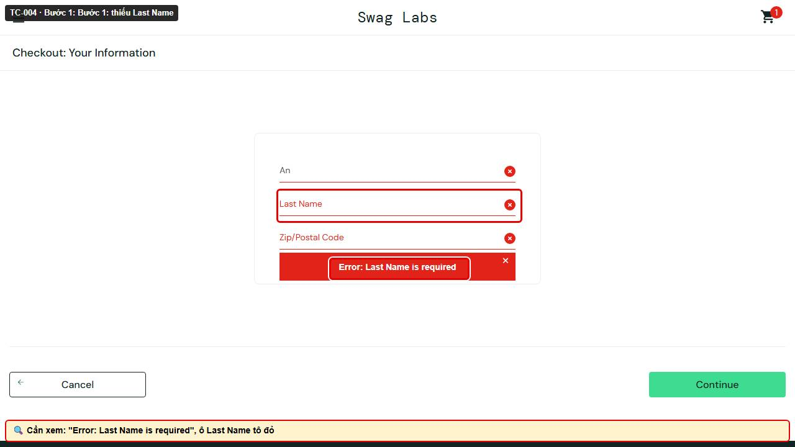
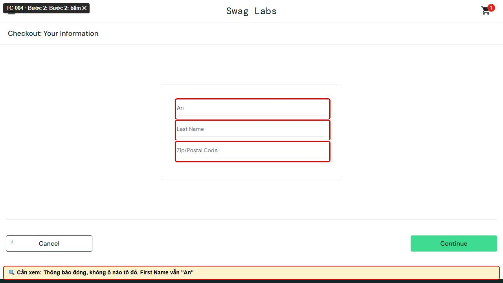
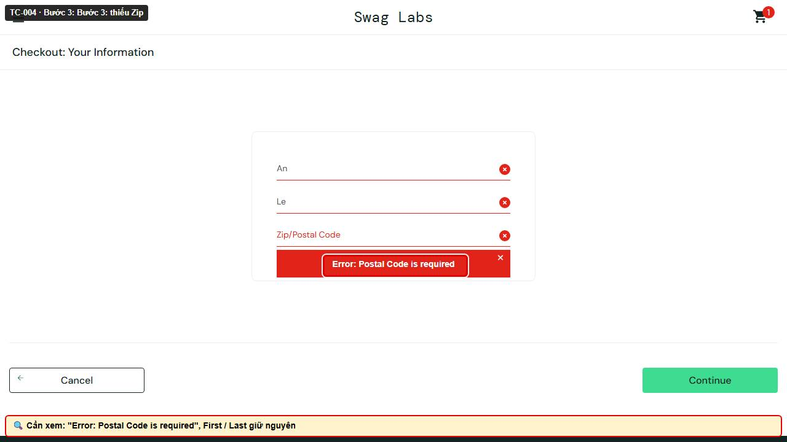

# TC-004 Nút ✕ đóng thông báo lỗi, giá trị giữ nguyên, Continue lần sau báo ô tiếp theo

- **Kết quả**: ✅ Passed
- **Nhóm**: Màn hình 1: Thông tin (/checkout-step-one.html)
- **Tags**: @AC-2 @info
- **Thời điểm**: 2026-11-26T07:11:34.068Z
- **Video**: (chỉ quay video cho test có bug hoặc kết quả bất thường)

| Bước | Thao tác | Cần xem | Ảnh |
|---|---|---|---|
| 1 | Bước 1: thiếu Last Name | "Error: Last Name is required", ô Last Name tô đỏ |  |
| 2 | Bước 2: bấm ✕ | Thông báo đóng, không ô nào tô đỏ, First Name vẫn "An" |  |
| 3 | Bước 3: thiếu Zip | "Error: Postal Code is required", First / Last giữ nguyên |  |
