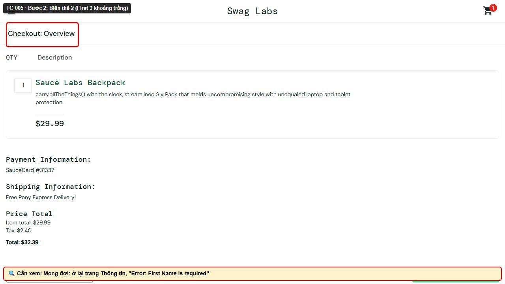
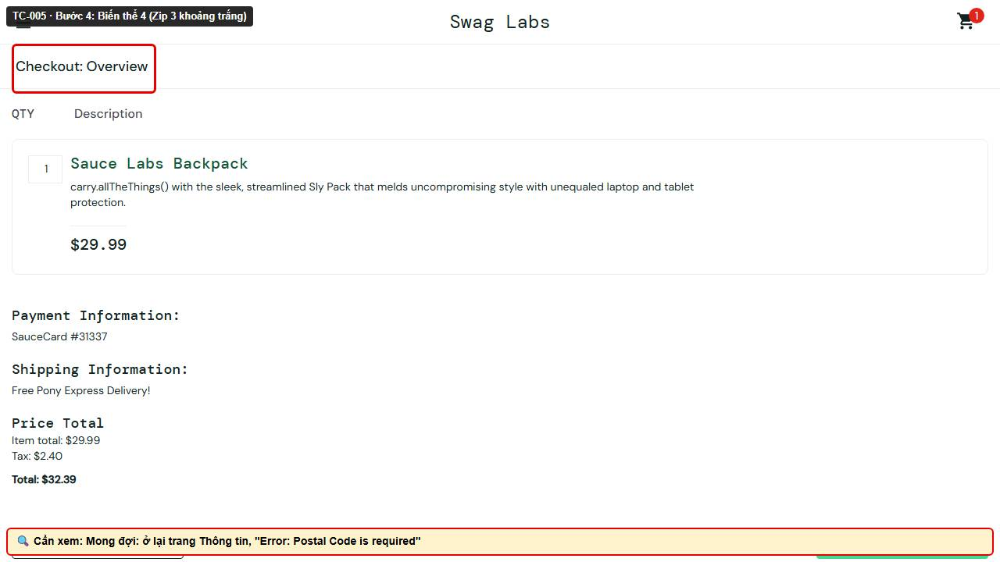
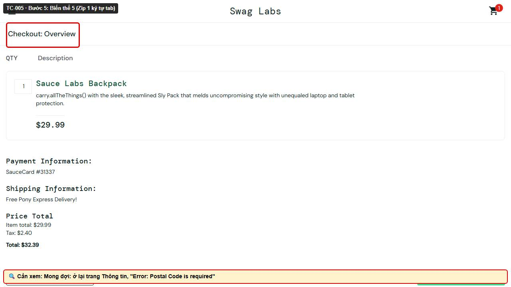

# TC-005 Ô chỉ có khoảng trắng / ký tự tab bị coi như trống

- **Kết quả**: ❌ Failed · Bug: BUG-34
- **Nhóm**: Màn hình 1: Thông tin (/checkout-step-one.html)
- **Tags**: @AC-2 @info @BUG-34
- **Thời điểm**: 2026-11-26T08:37:08.370Z
- **Video**: [video.webm](video.webm) (quay ở lần chạy ngày 2026-11-26, lần này không quay lại: EVIDENCE_KEEP_VIDEOS)

| Bước | Thao tác | Cần xem | Ảnh |
|---|---|---|---|
| 1 | Biến thể 1 (cả 3 ô 1 khoảng trắng) | Mong đợi: ở lại trang Thông tin, "Error: First Name is required" |  |
| 2 | Biến thể 2 (First 3 khoảng trắng) | Mong đợi: ở lại trang Thông tin, "Error: First Name is required" |  |
| 3 | Biến thể 3 (Last 3 khoảng trắng) | Mong đợi: ở lại trang Thông tin, "Error: Last Name is required" |  |
| 4 | Biến thể 4 (Zip 3 khoảng trắng) | Mong đợi: ở lại trang Thông tin, "Error: Postal Code is required" |  |
| 5 | Biến thể 5 (Zip 1 ký tự tab) | Mong đợi: ở lại trang Thông tin, "Error: Postal Code is required" |  |
