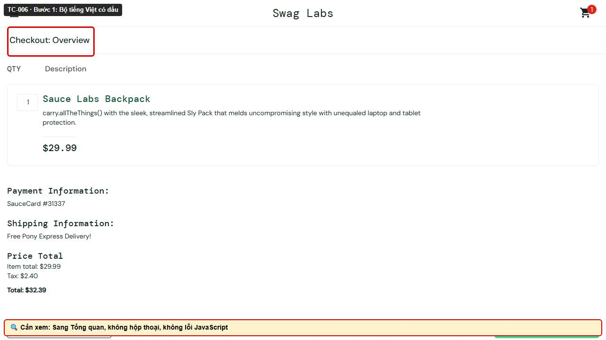
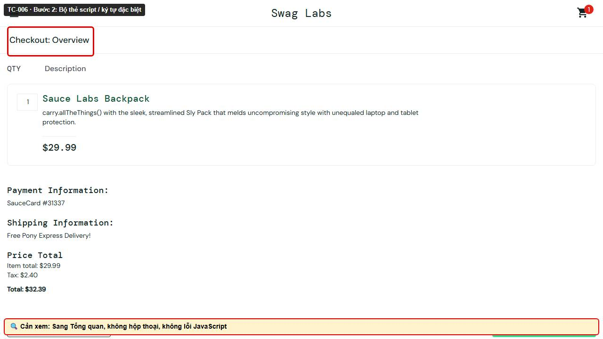
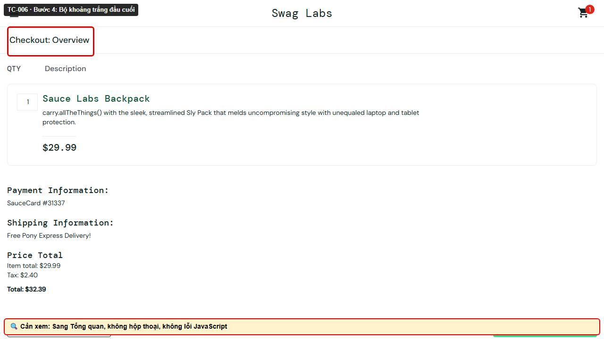
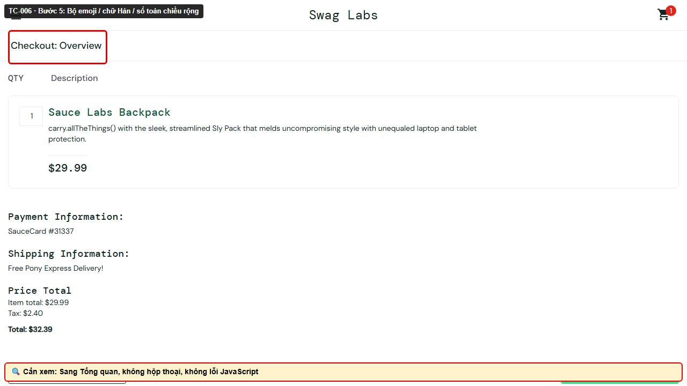

# TC-006 Giá trị hợp lệ đa dạng được nhận, sang Tổng quan, script không chạy

- **Kết quả**: ✅ Passed
- **Nhóm**: Màn hình 1: Thông tin (/checkout-step-one.html)
- **Tags**: @AC-3 @info @overview @security
- **Thời điểm**: 2026-11-26T07:11:35.664Z
- **Video**: (chỉ quay video cho test có bug hoặc kết quả bất thường)

| Bước | Thao tác | Cần xem | Ảnh |
|---|---|---|---|
| 1 | Bộ tiếng Việt có dấu | Sang Tổng quan, không hộp thoại, không lỗi JavaScript |  |
| 2 | Bộ thẻ script / ký tự đặc biệt | Sang Tổng quan, không hộp thoại, không lỗi JavaScript |  |
| 3 | Bộ số trong tên, chữ trong zip | Sang Tổng quan, không hộp thoại, không lỗi JavaScript |  |
| 4 | Bộ khoảng trắng đầu cuối | Sang Tổng quan, không hộp thoại, không lỗi JavaScript |  |
| 5 | Bộ emoji / chữ Hán / số toàn chiều rộng | Sang Tổng quan, không hộp thoại, không lỗi JavaScript |  |
