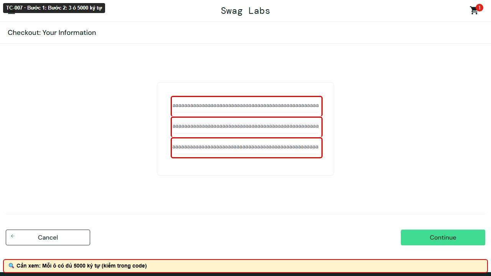
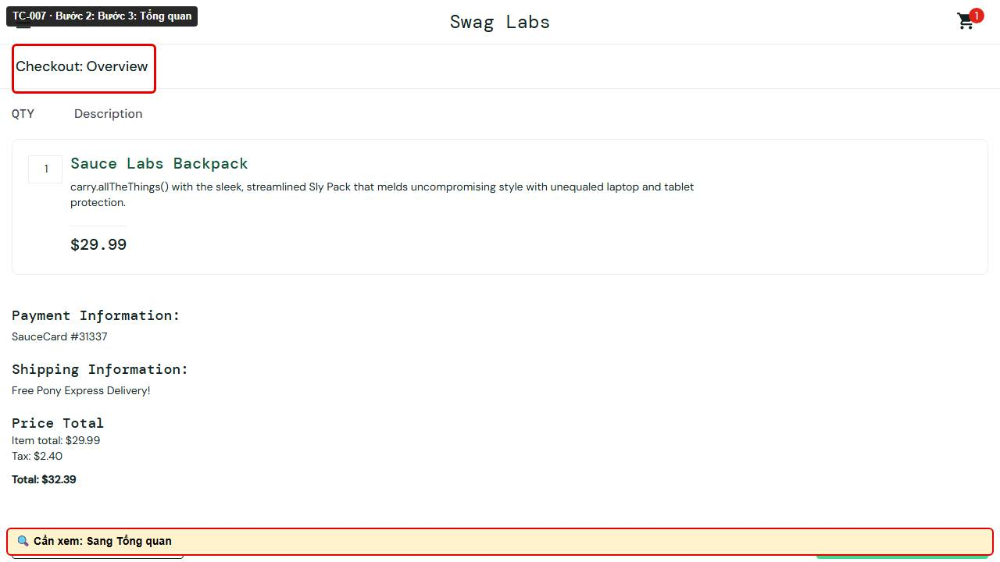

# TC-007 Chuỗi 5000 ký tự ở cả 3 ô được nhận

- **Kết quả**: ✅ Passed
- **Nhóm**: Màn hình 1: Thông tin (/checkout-step-one.html)
- **Tags**: @AC-3 @info @overview
- **Thời điểm**: 2026-11-26T07:11:34.228Z
- **Video**: (chỉ quay video cho test có bug hoặc kết quả bất thường)

| Bước | Thao tác | Cần xem | Ảnh |
|---|---|---|---|
| 1 | Bước 2: 3 ô 5000 ký tự | Mỗi ô có đủ 5000 ký tự (kiểm trong code) |  |
| 2 | Bước 3: Tổng quan | Sang Tổng quan |  |
