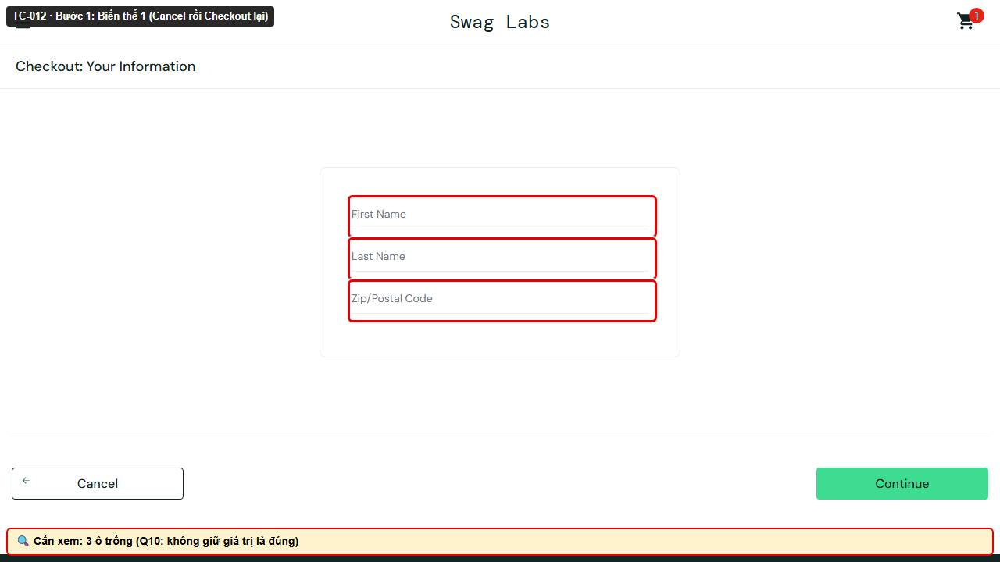
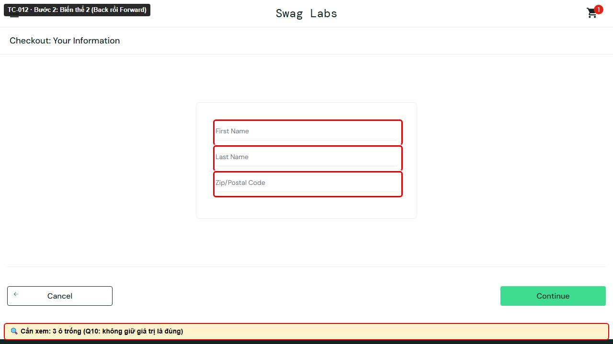
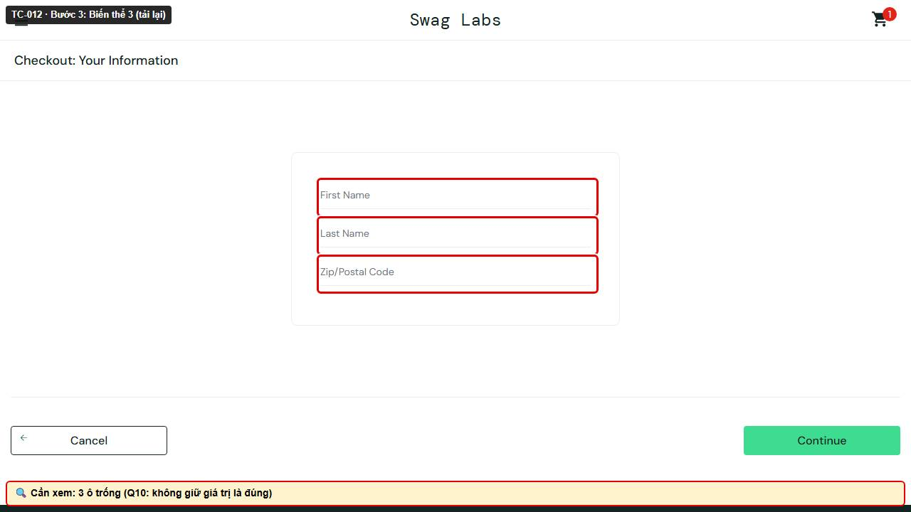

# TC-012 3 ô trống lại sau Cancel, Back / Forward, tải lại

- **Kết quả**: ✅ Passed
- **Nhóm**: Màn hình 1: Thông tin (/checkout-step-one.html)
- **Tags**: @AC-3 @info
- **Thời điểm**: 2026-11-26T07:11:39.095Z
- **Video**: (chỉ quay video cho test có bug hoặc kết quả bất thường)

| Bước | Thao tác | Cần xem | Ảnh |
|---|---|---|---|
| 1 | Biến thể 1 (Cancel rồi Checkout lại) | 3 ô trống (Q10: không giữ giá trị là đúng) |  |
| 2 | Biến thể 2 (Back rồi Forward) | 3 ô trống (Q10: không giữ giá trị là đúng) |  |
| 3 | Biến thể 3 (tải lại) | 3 ô trống (Q10: không giữ giá trị là đúng) |  |
