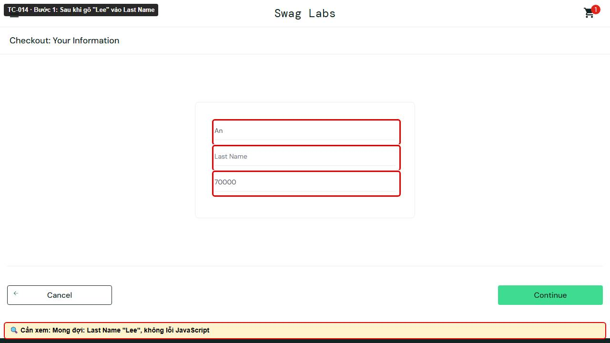

# TC-014 error_user: gõ được Last Name, không lỗi JavaScript, không gửi báo lỗi

- **Kết quả**: ❌ Failed · Bug: BUG-31
- **Nhóm**: Màn hình 1: Thông tin (/checkout-step-one.html)
- **Tags**: @AC-1 @AC-3 @info @BUG-31
- **Thời điểm**: 2026-11-26T08:36:28.797Z
- **Video**: [video.webm](video.webm) (quay ở lần chạy ngày 2026-11-26, lần này không quay lại: EVIDENCE_KEEP_VIDEOS)

| Bước | Thao tác | Cần xem | Ảnh |
|---|---|---|---|
| 1 | Sau khi gõ "Lee" vào Last Name | Mong đợi: Last Name "Lee", không lỗi JavaScript |  |

## Ghi nhận (annotation)

| Loại | Nội dung |
|---|---|
| pageerror (MSG-09?) | - [/checkout-step-one.html]: Cannot read properties of undefined (reading 'value') \| - [/checkout-step-one.html]: Cannot read properties of undefined (reading 'value') \| - [/checkout-step-one.html]: Cannot read properties of undefined (reading 'value') |
