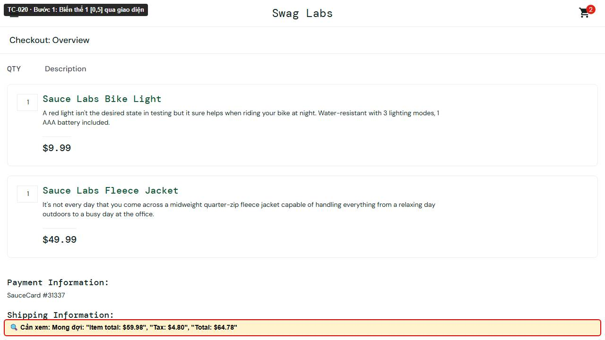
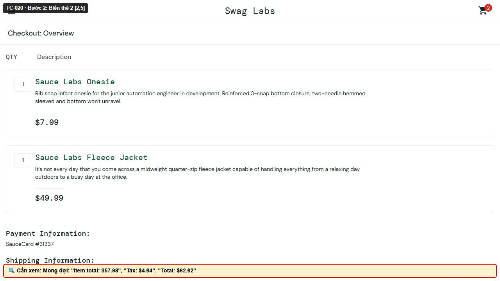
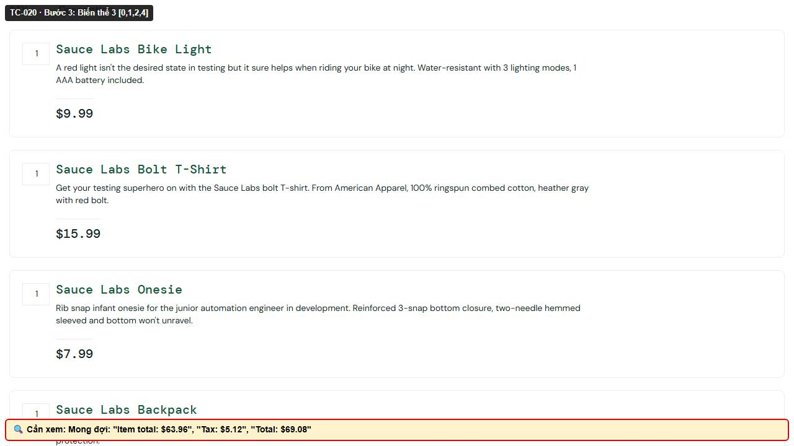
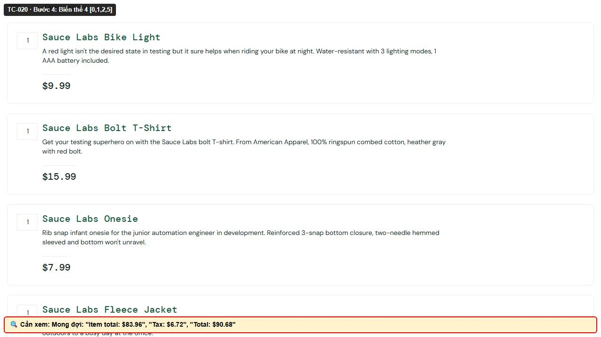
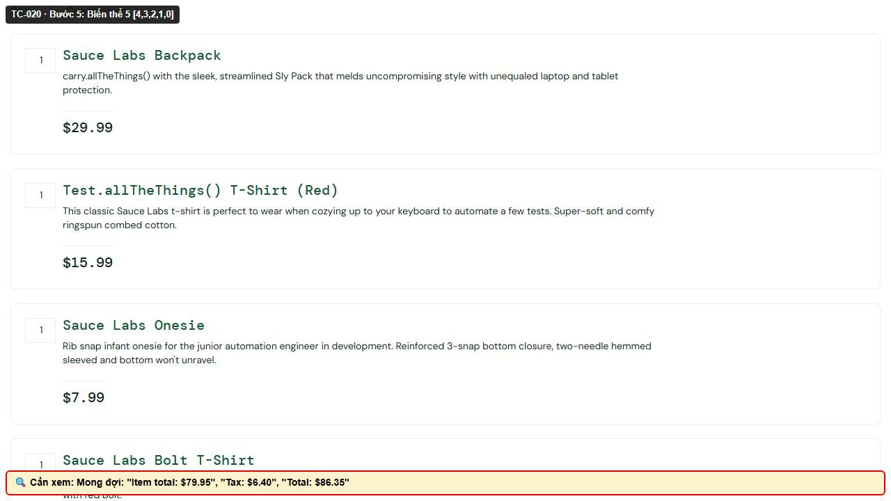
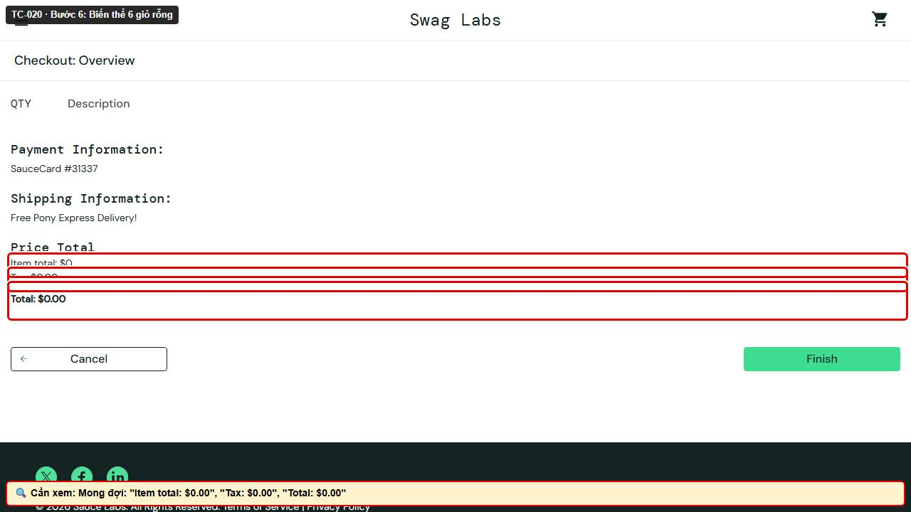
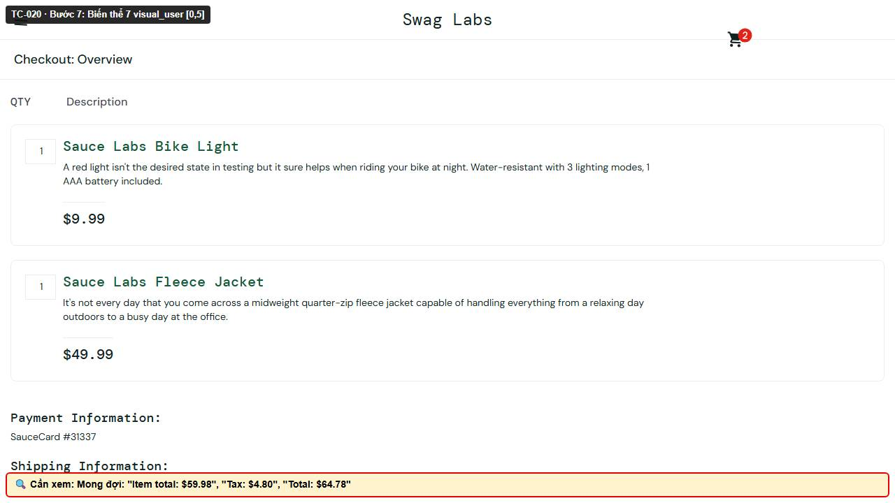
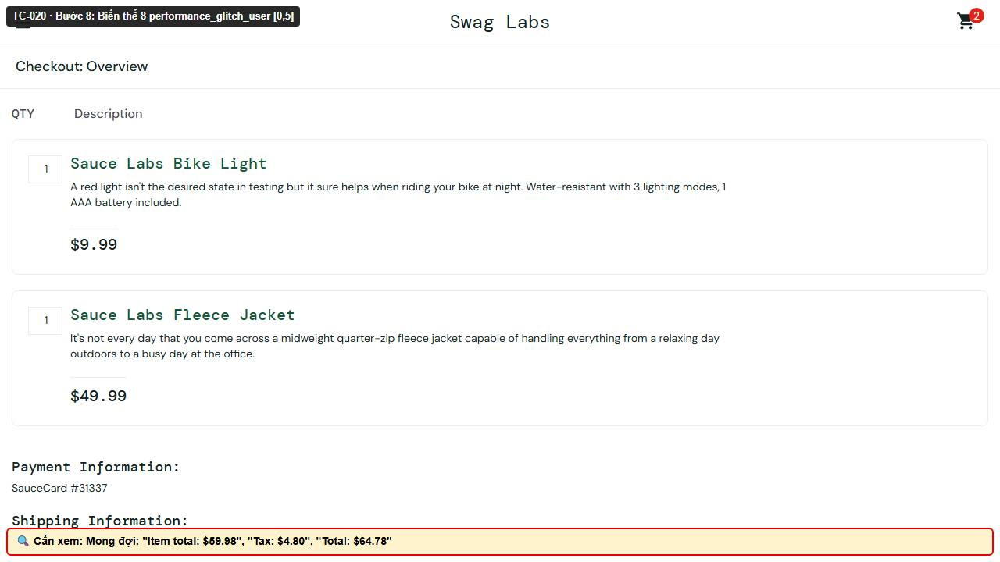
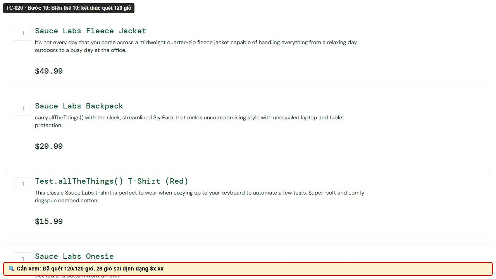
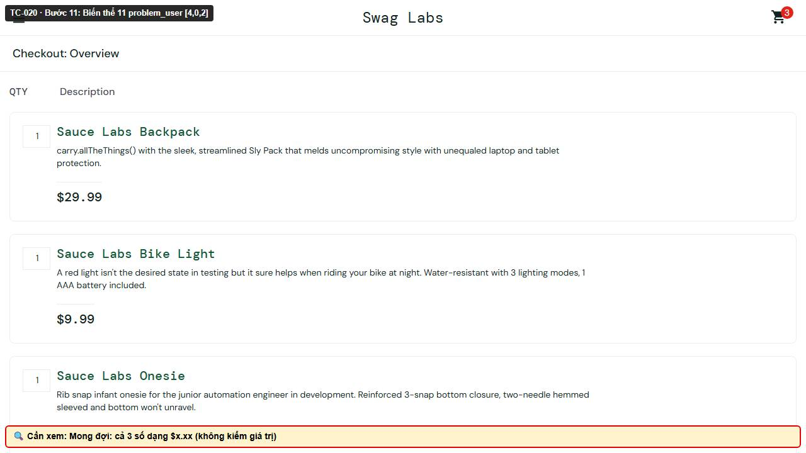

# TC-020 Số tiền luôn dạng $x.xx (giỏ gây lỗi số thực, giỏ rỗng, mọi tài khoản)

- **Kết quả**: ❌ Failed · Bug: BUG-25
- **Nhóm**: Màn hình 2: Tổng quan (/checkout-step-two.html)
- **Tags**: @AC-4 @overview @BUG-25
- **Thời điểm**: 2026-11-26T07:13:30.157Z
- **Video**: [video.webm](video.webm)

| Bước | Thao tác | Cần xem | Ảnh |
|---|---|---|---|
| 1 | Biến thể 1 [0,5] qua giao diện | Mong đợi: "Item total: $59.98", "Tax: $4.80", "Total: $64.78" |  |
| 2 | Biến thể 2 [2,5] | Mong đợi: "Item total: $57.98", "Tax: $4.64", "Total: $62.62" |  |
| 3 | Biến thể 3 [0,1,2,4] | Mong đợi: "Item total: $63.96", "Tax: $5.12", "Total: $69.08" |  |
| 4 | Biến thể 4 [0,1,2,5] | Mong đợi: "Item total: $83.96", "Tax: $6.72", "Total: $90.68" |  |
| 5 | Biến thể 5 [4,3,2,1,0] | Mong đợi: "Item total: $79.95", "Tax: $6.40", "Total: $86.35" |  |
| 6 | Biến thể 6 giỏ rỗng | Mong đợi: "Item total: $0.00", "Tax: $0.00", "Total: $0.00" |  |
| 7 | Biến thể 7 visual_user [0,5] | Mong đợi: "Item total: $59.98", "Tax: $4.80", "Total: $64.78" |  |
| 8 | Biến thể 8 performance_glitch_user [0,5] | Mong đợi: "Item total: $59.98", "Tax: $4.80", "Total: $64.78" |  |
| 9 | Biến thể 9 error_user [0,5] | Mong đợi: "Item total: $59.98", "Tax: $4.80", "Total: $64.78" |  |
| 10 | Biến thể 10: kết thúc quét 120 giỏ | Đã quét 120/120 giỏ, 26 giỏ sai định dạng $x.xx |  |
| 11 | Biến thể 11 problem_user [4,0,2] | Mong đợi: cả 3 số dạng $x.xx (không kiểm giá trị) |  |
