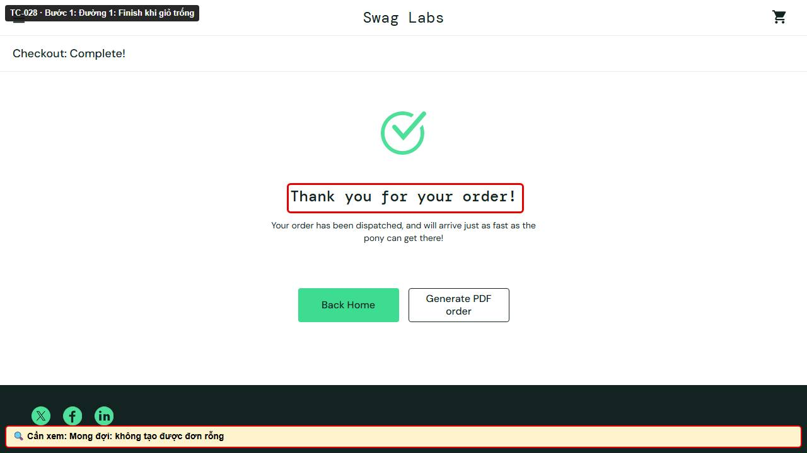
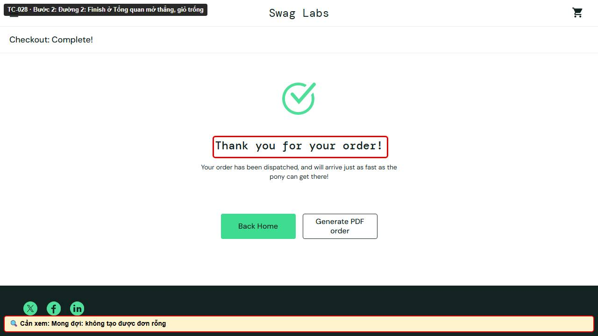

# TC-028 Tổng quan không có sản phẩm thì không đặt được đơn (giỏ trống qua Checkout, mở thẳng URL)

- **Kết quả**: ❌ Failed · Bug: BUG-24
- **Nhóm**: Màn hình 2: Tổng quan (/checkout-step-two.html)
- **Tags**: @AC-5 @overview @complete @BUG-24
- **Thời điểm**: 2026-11-26T08:36:35.393Z
- **Video**: [video.webm](video.webm) (quay ở lần chạy ngày 2026-11-26, lần này không quay lại: EVIDENCE_KEEP_VIDEOS)

| Bước | Thao tác | Cần xem | Ảnh |
|---|---|---|---|
| 1 | Đường 1: Finish khi giỏ trống | Mong đợi: không tạo được đơn rỗng |  |
| 2 | Đường 2: Finish ở Tổng quan mở thẳng, giỏ trống | Mong đợi: không tạo được đơn rỗng |  |
