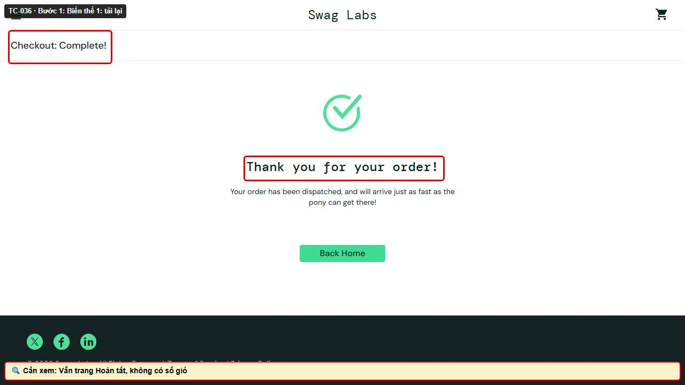
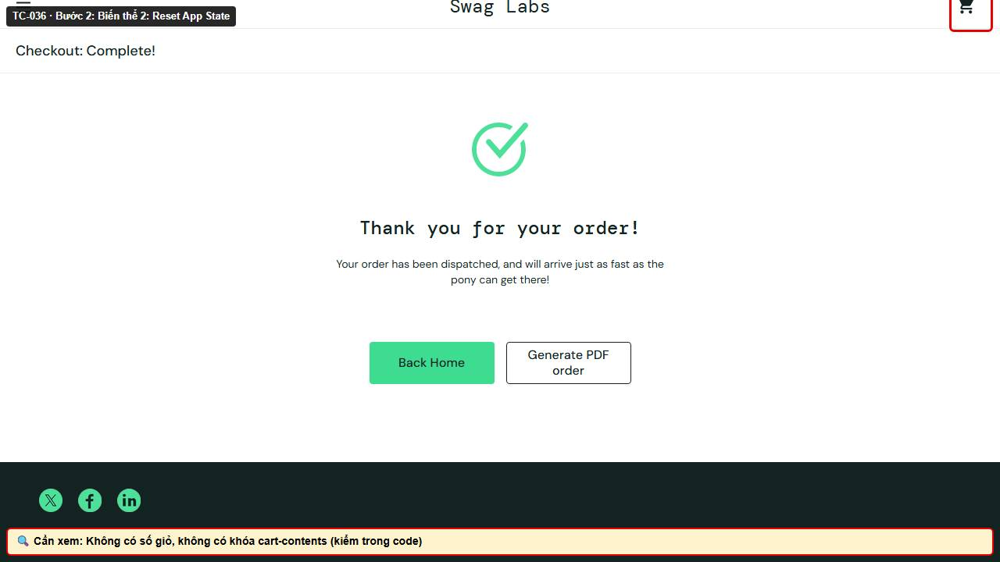
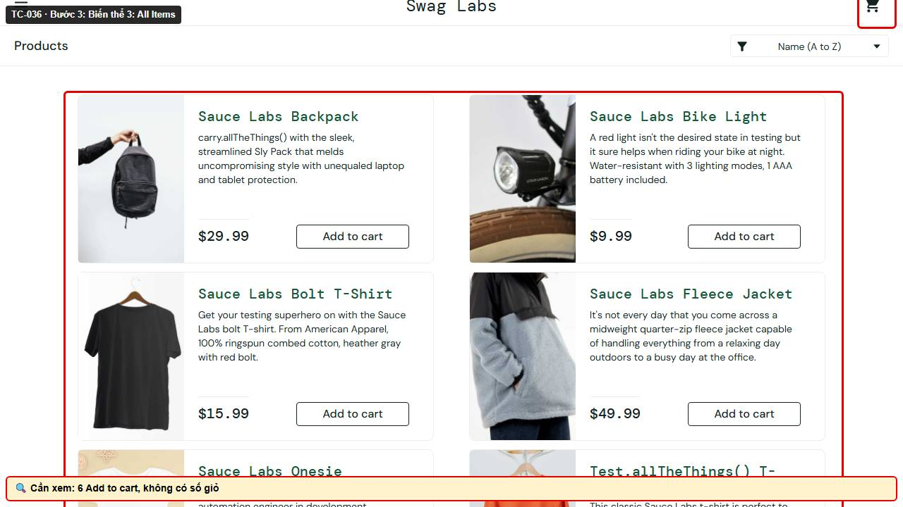
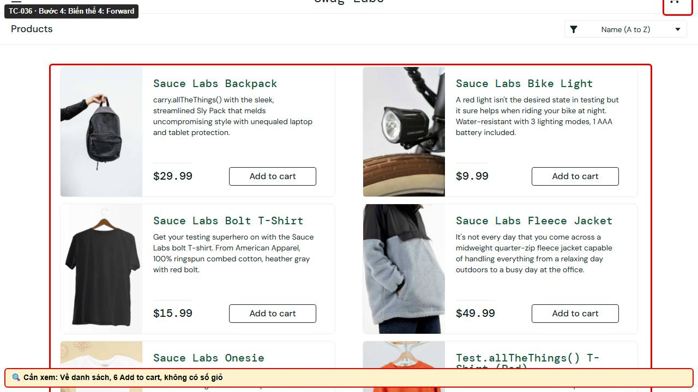

# TC-036 Hoàn tất: tải lại, Reset App State, All Items, Back / Forward sau Back Home

- **Kết quả**: ✅ Passed
- **Nhóm**: Màn hình 3: Hoàn tất (/checkout-complete.html)
- **Tags**: @AC-5 @AC-6 @complete
- **Thời điểm**: 2026-11-26T07:12:39.141Z
- **Video**: (chỉ quay video cho test có bug hoặc kết quả bất thường)

| Bước | Thao tác | Cần xem | Ảnh |
|---|---|---|---|
| 1 | Biến thể 1: tải lại | Vẫn trang Hoàn tất, không có số giỏ |  |
| 2 | Biến thể 2: Reset App State | Không có số giỏ, không có khóa cart-contents (kiểm trong code) |  |
| 3 | Biến thể 3: All Items | 6 Add to cart, không có số giỏ |  |
| 4 | Biến thể 4: Forward | Về danh sách, 6 Add to cart, không có số giỏ |  |
