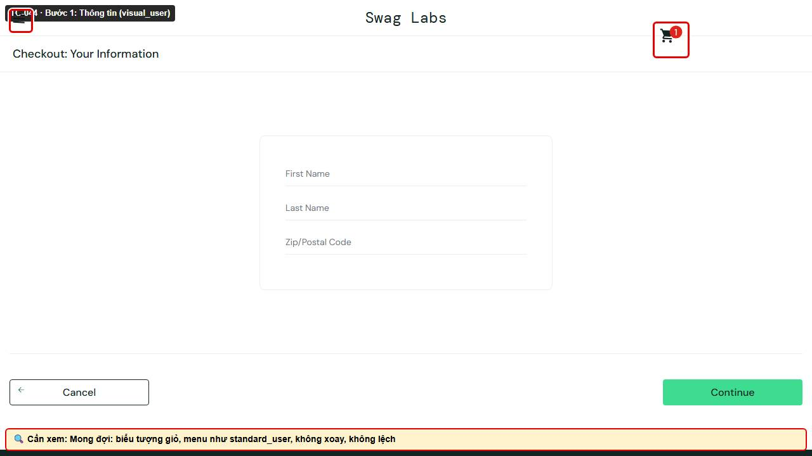
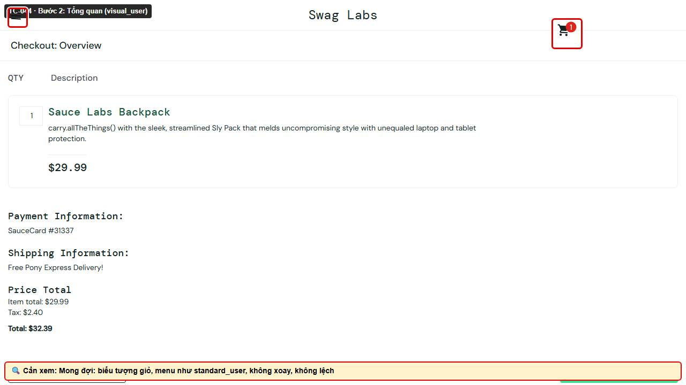
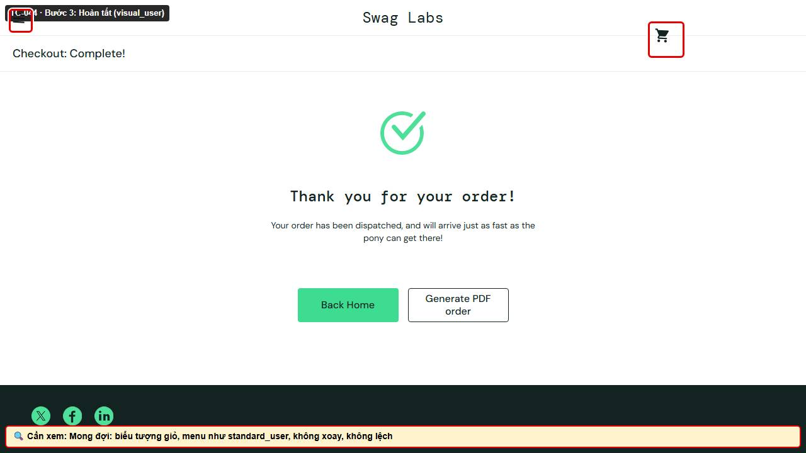

# TC-044 visual_user: bố cục 3 trang thanh toán giống standard_user

- **Kết quả**: ❌ Failed · Bug: BUG-16
- **Nhóm**: Chung: nhiều màn hình (luồng chính, kiểm soát truy cập, tài khoản, nhiều tab)
- **Tags**: @AC-1 @AC-4 @AC-5 @info @overview @complete @BUG-16
- **Thời điểm**: 2026-11-26T07:12:44.871Z
- **Video**: [video.webm](video.webm)

| Bước | Thao tác | Cần xem | Ảnh |
|---|---|---|---|
| 1 | Thông tin (visual_user) | Mong đợi: biểu tượng giỏ, menu như standard_user, không xoay, không lệch |  |
| 2 | Tổng quan (visual_user) | Mong đợi: biểu tượng giỏ, menu như standard_user, không xoay, không lệch |  |
| 3 | Hoàn tất (visual_user) | Mong đợi: biểu tượng giỏ, menu như standard_user, không xoay, không lệch |  |
