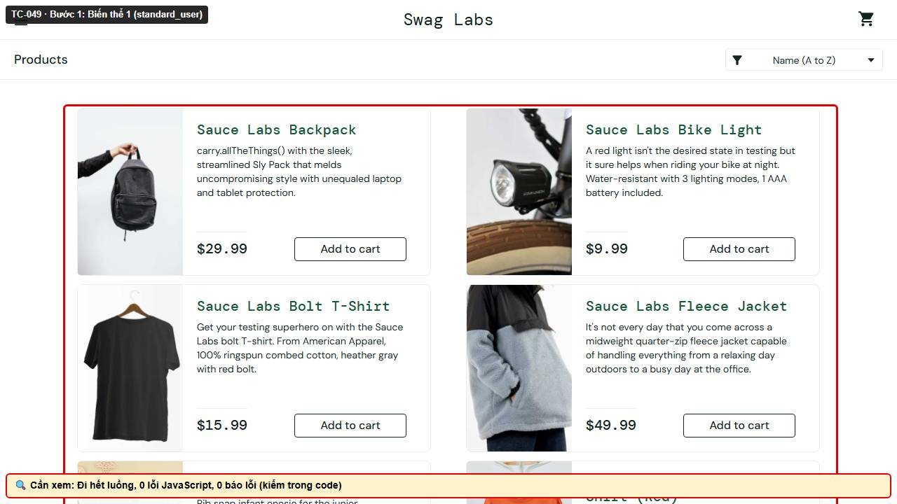
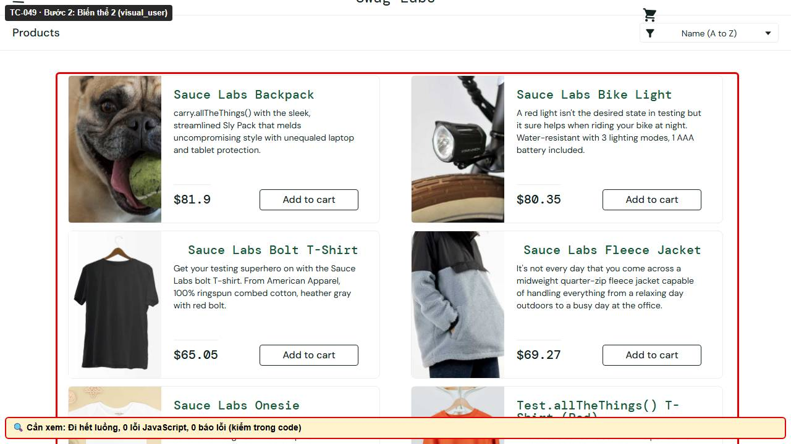
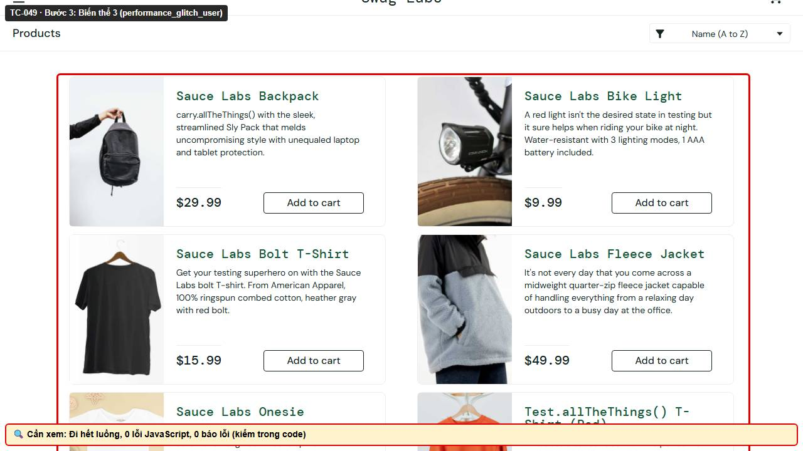
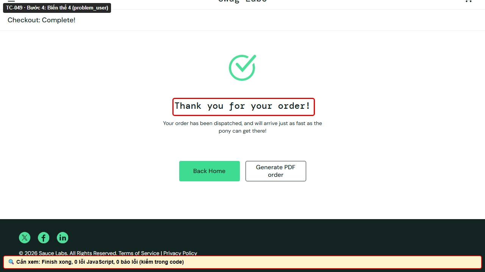
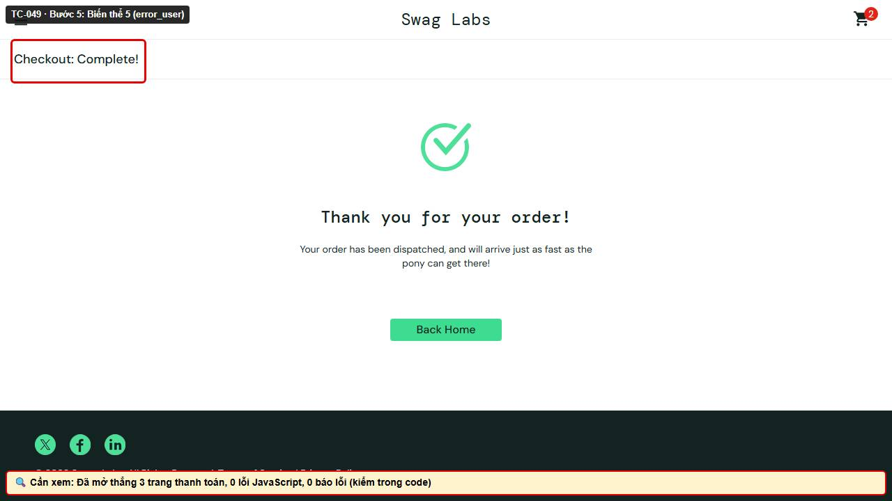

# TC-049 Không lỗi JavaScript, không gửi báo lỗi khi đi luồng thanh toán (mọi tài khoản)

- **Kết quả**: ✅ Passed
- **Nhóm**: Chung: nhiều màn hình (luồng chính, kiểm soát truy cập, tài khoản, nhiều tab)
- **Tags**: @AC-1 @AC-4 @AC-5 @info @overview @complete
- **Thời điểm**: 2026-11-26T07:13:08.416Z
- **Video**: (chỉ quay video cho test có bug hoặc kết quả bất thường)

| Bước | Thao tác | Cần xem | Ảnh |
|---|---|---|---|
| 1 | Biến thể 1 (standard_user) | Đi hết luồng, 0 lỗi JavaScript, 0 báo lỗi (kiểm trong code) |  |
| 2 | Biến thể 2 (visual_user) | Đi hết luồng, 0 lỗi JavaScript, 0 báo lỗi (kiểm trong code) |  |
| 3 | Biến thể 3 (performance_glitch_user) | Đi hết luồng, 0 lỗi JavaScript, 0 báo lỗi (kiểm trong code) |  |
| 4 | Biến thể 4 (problem_user) | Finish xong, 0 lỗi JavaScript, 0 báo lỗi (kiểm trong code) |  |
| 5 | Biến thể 5 (error_user) | Đã mở thẳng 3 trang thanh toán, 0 lỗi JavaScript, 0 báo lỗi (kiểm trong code) |  |
