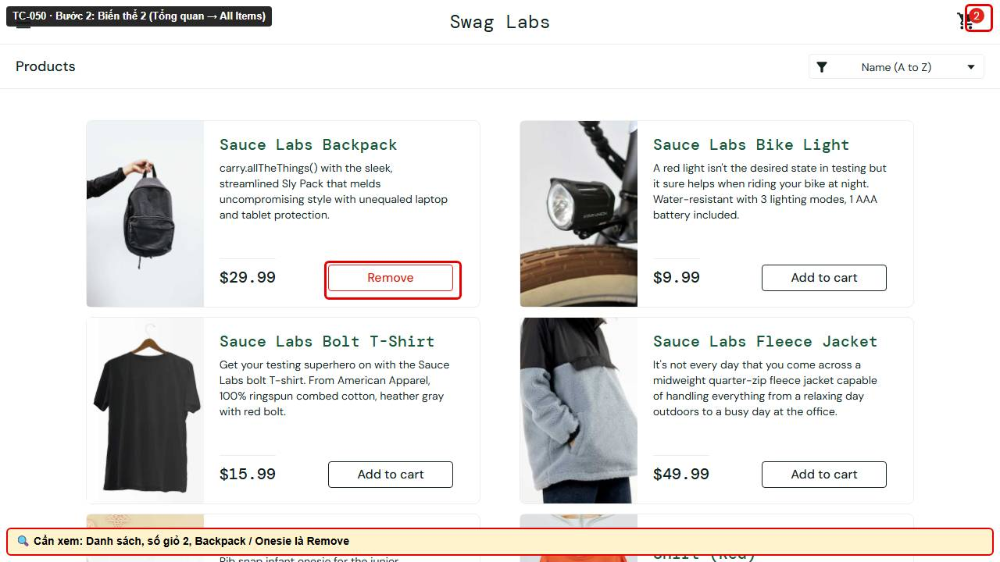
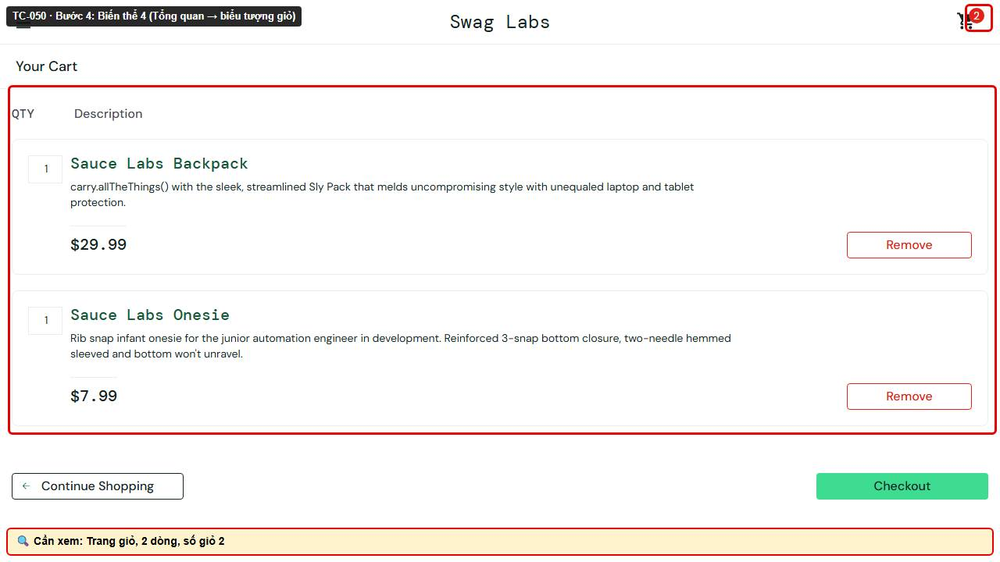

# TC-050 Rời luồng thanh toán bằng All Items và biểu tượng giỏ, giỏ giữ nguyên

- **Kết quả**: ✅ Passed
- **Nhóm**: Chung: nhiều màn hình (luồng chính, kiểm soát truy cập, tài khoản, nhiều tab)
- **Tags**: @AC-3 @AC-5 @info @overview
- **Thời điểm**: 2026-11-26T07:13:03.558Z
- **Video**: (chỉ quay video cho test có bug hoặc kết quả bất thường)

| Bước | Thao tác | Cần xem | Ảnh |
|---|---|---|---|
| 1 | Biến thể 1 (Thông tin → All Items) | Danh sách, số giỏ 2, Backpack / Onesie là Remove |  |
| 2 | Biến thể 2 (Tổng quan → All Items) | Danh sách, số giỏ 2, Backpack / Onesie là Remove |  |
| 3 | Biến thể 3 (Thông tin → biểu tượng giỏ) | Trang giỏ, 2 dòng, số giỏ 2 |  |
| 4 | Biến thể 4 (Tổng quan → biểu tượng giỏ) | Trang giỏ, 2 dòng, số giỏ 2 |  |
