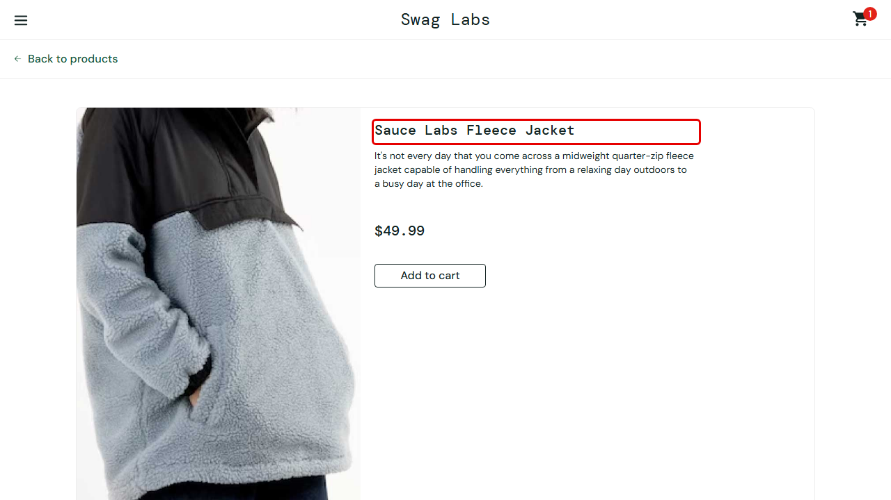
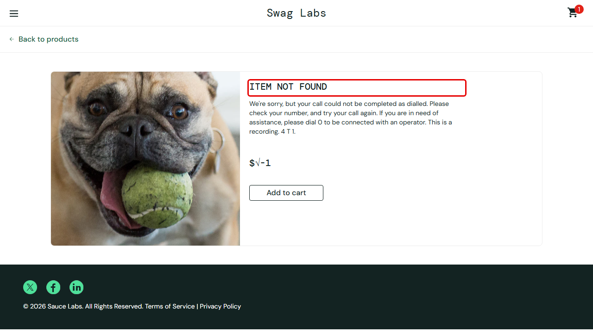

# BUG-11: tái hiện độc lập (2026-11-26)

**Biến thể SD-103: `problem_user` bấm tên sản phẩm ở Tổng quan mở sai trang chi tiết (id + 1)**

Script riêng [`tests/repro/saucedemo-checkout-screen.repro.ts`](../../../../../../tests/repro/saucedemo-checkout-screen.repro.ts) (`npm run repro -- saucedemo-checkout-screen`), **không** dùng code test: locator id / class CSS, mỗi tình huống một phiên trình duyệt mới (giỏ trống), Chromium 1280×720. Mỗi tình huống chạy 2 lần: **2/2 lần, kết quả giống nhau**. Ảnh của lần 2, khung đỏ do script vẽ để chỉ chỗ lỗi. Các bước làm bằng tay nằm trong `defects.md`.

| # | Thao tác | Kết quả thấy được | Ảnh |
|---|---|---|---|
| 1 | Giỏ chỉ có Sauce Labs Bike Light (id 0), mở `/checkout-step-two.html`, bấm **tên** sản phẩm | Mở `?id=1`: `Sauce Labs Bolt T-Shirt` |  |
| 2 | Giỏ chỉ có Sauce Labs Bolt T-Shirt (id 1), mở `/checkout-step-two.html`, bấm **tên** sản phẩm | Mở `?id=2`: `Sauce Labs Onesie` |  |
| 3 | Giỏ chỉ có Sauce Labs Onesie (id 2), mở `/checkout-step-two.html`, bấm **tên** sản phẩm | Mở `?id=3`: `Test.allTheThings() T-Shirt (Red)` |  |
| 4 | Giỏ chỉ có Test.allTheThings() T-Shirt (Red) (id 3), mở `/checkout-step-two.html`, bấm **tên** sản phẩm | Mở `?id=4`: `Sauce Labs Backpack` |  |
| 5 | Giỏ chỉ có Sauce Labs Backpack (id 4), mở `/checkout-step-two.html`, bấm **tên** sản phẩm | Mở `?id=5`: `Sauce Labs Fleece Jacket` |  |
| 6 | Giỏ chỉ có Sauce Labs Fleece Jacket (id 5), mở `/checkout-step-two.html`, bấm **tên** sản phẩm | Mở `?id=6`: `ITEM NOT FOUND` |  |

Kết luận: cả 6 sản phẩm mở trang của sản phẩm id + 1; Fleece Jacket (id 5) mở `?id=6` `ITEM NOT FOUND`. Cùng quy luật với BUG-11 ở danh sách và giỏ (SD-102).
