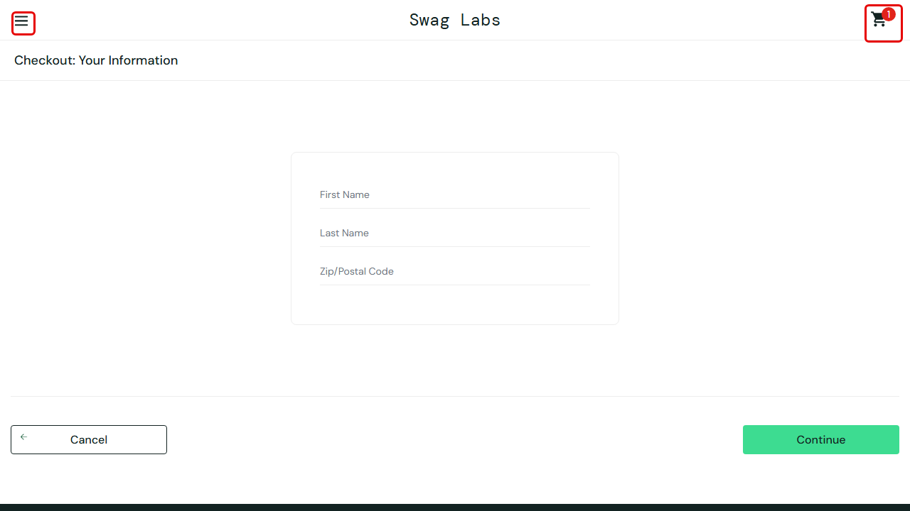
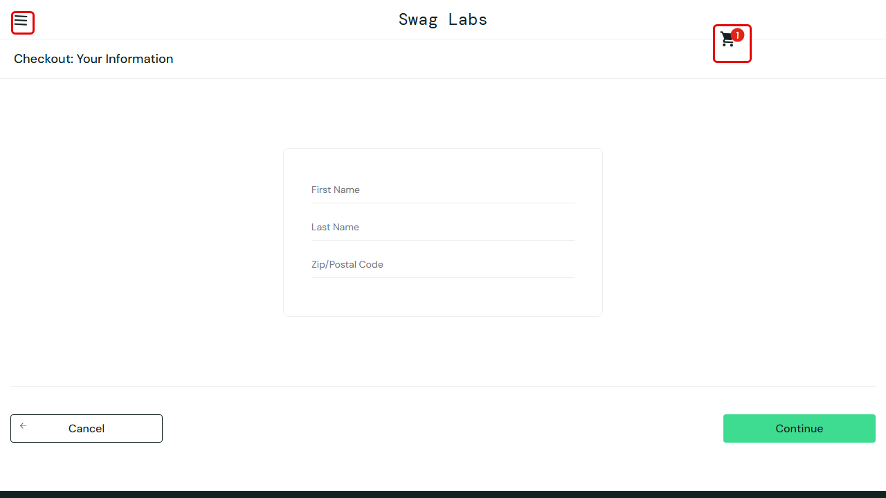
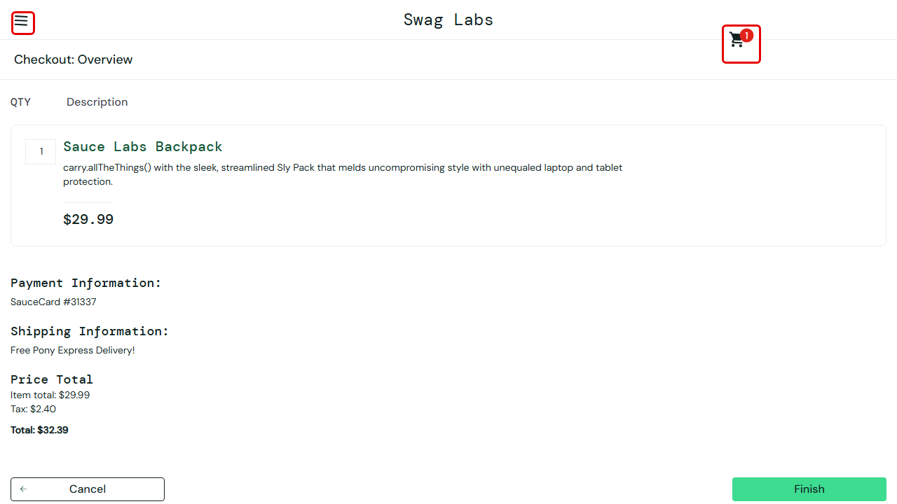
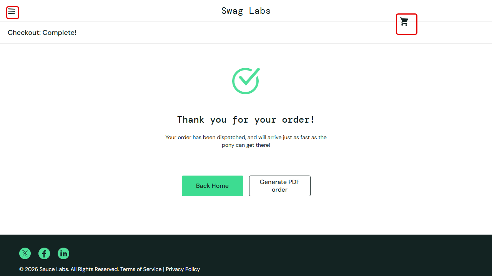

# BUG-16: tái hiện độc lập (2026-11-26)

**Biến thể SD-103: `visual_user` biểu tượng giỏ lệch và xoay, menu xoay ở cả 3 trang thanh toán**

Script riêng [`tests/repro/saucedemo-checkout-screen.repro.ts`](../../../../../../tests/repro/saucedemo-checkout-screen.repro.ts) (`npm run repro -- saucedemo-checkout-screen`), **không** dùng code test: locator id / class CSS, mỗi tình huống một phiên trình duyệt mới (giỏ trống), Chromium 1280×720. Mỗi tình huống chạy 2 lần: **2/2 lần, kết quả giống nhau**. Ảnh của lần 2, khung đỏ do script vẽ để chỉ chỗ lỗi. Các bước làm bằng tay nằm trong `defects.md`.

| # | Thao tác | Kết quả thấy được | Ảnh |
|---|---|---|---|
| 1 | `standard_user`, trang Thông tin: DevTools Console `document.querySelector('.shopping_cart_container').getBoundingClientRect()`, `getComputedStyle(…).transform` (giỏ và `.bm-icon`) | Giỏ x=1220, y=10, transform `none`; menu transform `none` |  |
| 2 | `standard_user`, trang Tổng quan: DevTools Console `document.querySelector('.shopping_cart_container').getBoundingClientRect()`, `getComputedStyle(…).transform` (giỏ và `.bm-icon`) | Giỏ x=1220, y=10, transform `none`; menu transform `none` |  |
| 3 | `standard_user`, trang Hoàn tất: DevTools Console `document.querySelector('.shopping_cart_container').getBoundingClientRect()`, `getComputedStyle(…).transform` (giỏ và `.bm-icon`) | Giỏ x=1220, y=10, transform `none`; menu transform `none` |  |
| 4 | `visual_user`, trang Thông tin: DevTools Console `document.querySelector('.shopping_cart_container').getBoundingClientRect()`, `getComputedStyle(…).transform` (giỏ và `.bm-icon`) | Giỏ x=1034, y=39, transform `matrix(0.99863, 0.052336, -0.052336, 0.99863, 0, 0)`; menu transform `matrix(0.99863, 0.052336, -0.052336, 0.99863, 0, 0)` |  |
| 5 | `visual_user`, trang Tổng quan: DevTools Console `document.querySelector('.shopping_cart_container').getBoundingClientRect()`, `getComputedStyle(…).transform` (giỏ và `.bm-icon`) | Giỏ x=1034, y=39, transform `matrix(0.99863, 0.052336, -0.052336, 0.99863, 0, 0)`; menu transform `matrix(0.99863, 0.052336, -0.052336, 0.99863, 0, 0)` |  |
| 6 | `visual_user`, trang Hoàn tất: DevTools Console `document.querySelector('.shopping_cart_container').getBoundingClientRect()`, `getComputedStyle(…).transform` (giỏ và `.bm-icon`) | Giỏ x=1034, y=39, transform `matrix(0.99863, 0.052336, -0.052336, 0.99863, 0, 0)`; menu transform `matrix(0.99863, 0.052336, -0.052336, 0.99863, 0, 0)` |  |

Kết luận: `visual_user` ở cả 3 trang: biểu tượng giỏ lệch so với `standard_user` (bảng trên) và xoay (`matrix(0.99863, 0.052336, …)` ≈ 3°), menu xoay như vậy; `standard_user` không xoay (`none`).
