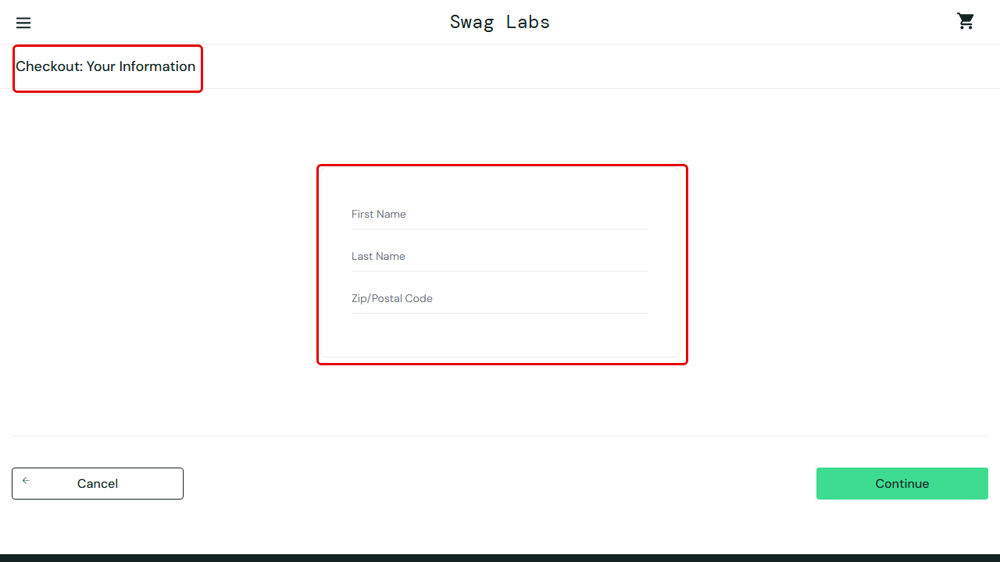

# BUG-19: tái hiện độc lập (2026-11-26)

**Biến thể SD-103: giỏ trống mở thẳng `/checkout-step-one.html` vẫn vào trang Thông tin**

Script riêng [`tests/repro/saucedemo-checkout-screen.repro.ts`](../../../../../../tests/repro/saucedemo-checkout-screen.repro.ts) (`npm run repro -- saucedemo-checkout-screen`), **không** dùng code test: locator id / class CSS, mỗi tình huống một phiên trình duyệt mới (giỏ trống), Chromium 1280×720. Mỗi tình huống chạy 2 lần: **2/2 lần, kết quả giống nhau**. Ảnh của lần 2, khung đỏ do script vẽ để chỉ chỗ lỗi. Các bước làm bằng tay nằm trong `defects.md`.

| # | Thao tác | Kết quả thấy được | Ảnh |
|---|---|---|---|
| 1 | Đăng nhập `standard_user`, giỏ trống (không có số giỏ), mở thẳng `/checkout-step-one.html` | Số giỏ (không có); ở `/checkout-step-one.html`, tiêu đề `Checkout: Your Information`, ô First Name: CÓ |  |

Kết luận: giỏ trống vẫn vào được trang Thông tin bằng URL (cùng cổng "giỏ trống không vào thanh toán" của BUG-19 ở nút Checkout).
