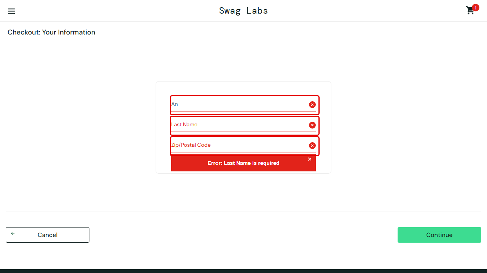
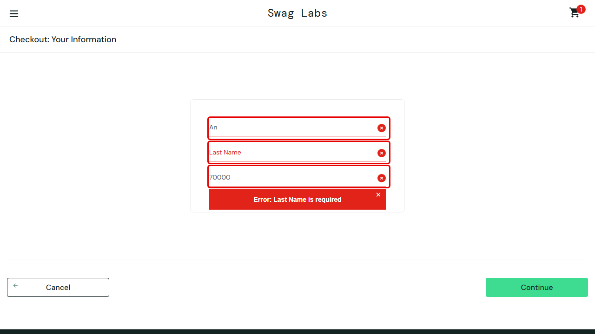
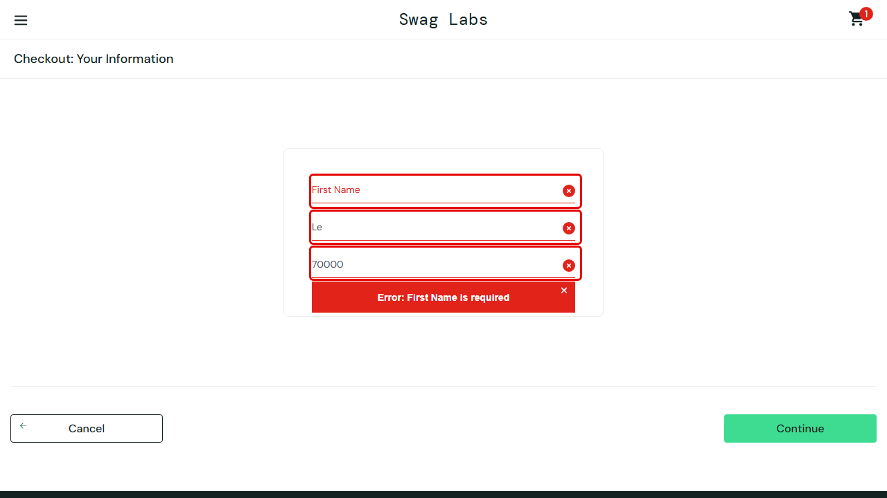

# BUG-22: tái hiện độc lập (2026-11-26)

**Thiếu một ô bắt buộc thì cả 3 ô đều bị tô đỏ, kể cả ô đã nhập đúng**

Script riêng [`tests/repro/saucedemo-checkout-screen.repro.ts`](../../../../../../tests/repro/saucedemo-checkout-screen.repro.ts) (`npm run repro -- saucedemo-checkout-screen`), **không** dùng code test: locator id / class CSS, mỗi tình huống một phiên trình duyệt mới (giỏ trống), Chromium 1280×720. Mỗi tình huống chạy 2 lần: **2/2 lần, kết quả giống nhau**. Ảnh của lần 2, khung đỏ do script vẽ để chỉ chỗ lỗi. Các bước làm bằng tay nằm trong `defects.md`.

| # | Thao tác | Kết quả thấy được | Ảnh |
|---|---|---|---|
| 1 | Trang Thông tin, nhập `An` / `(trống)` / `(trống)`, bấm Continue; DevTools: `document.querySelector('#first-name').classList`, đếm `.error_icon` trong từng `.form_group` | Thông báo `Error: Last Name is required`; First: class `error`, 1 icon; Last: class `error`, 1 icon; Zip: class `error`, 1 icon |  |
| 2 | Trang Thông tin, nhập `An` / `(trống)` / `70000`, bấm Continue; DevTools: `document.querySelector('#first-name').classList`, đếm `.error_icon` trong từng `.form_group` | Thông báo `Error: Last Name is required`; First: class `error`, 1 icon; Last: class `error`, 1 icon; Zip: class `error`, 1 icon |  |
| 3 | Trang Thông tin, nhập `(trống)` / `Le` / `70000`, bấm Continue; DevTools: `document.querySelector('#first-name').classList`, đếm `.error_icon` trong từng `.form_group` | Thông báo `Error: First Name is required`; First: class `error`, 1 icon; Last: class `error`, 1 icon; Zip: class `error`, 1 icon |  |

Kết luận: thông báo đúng ô thiếu, nhưng **cả 3 ô** đều có class `error` và 1 icon lỗi, kể cả ô đã nhập đúng.
