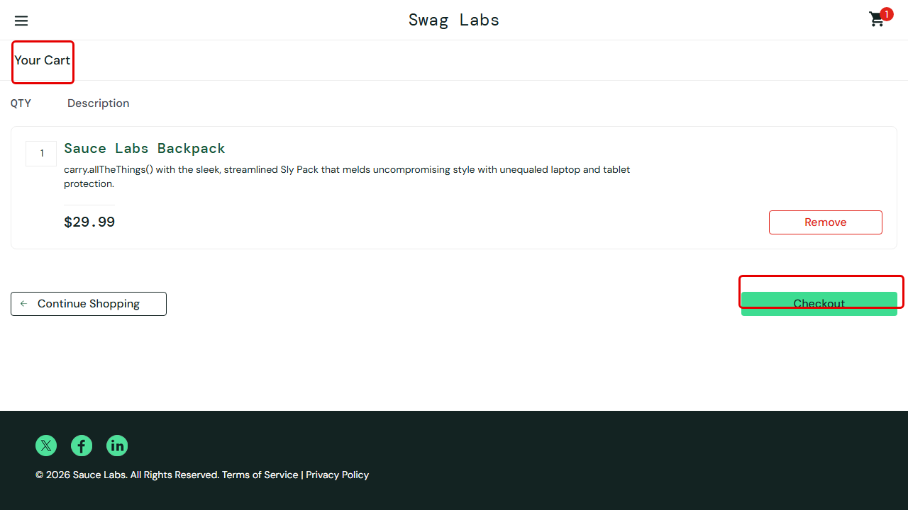
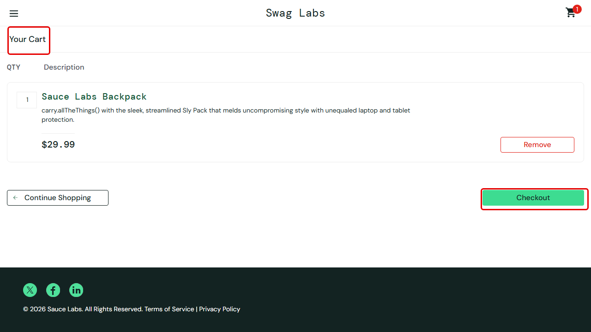

# BUG-23: tái hiện độc lập (2026-11-26)

**Nhấn Enter trong ô nhập về trang giỏ (như Cancel), không kiểm tra, không sang Tổng quan**

Script riêng [`tests/repro/saucedemo-checkout-screen.repro.ts`](../../../../../../tests/repro/saucedemo-checkout-screen.repro.ts) (`npm run repro -- saucedemo-checkout-screen`), **không** dùng code test: locator id / class CSS, mỗi tình huống một phiên trình duyệt mới (giỏ trống), Chromium 1280×720. Mỗi tình huống chạy 2 lần: **2/2 lần, kết quả giống nhau**. Ảnh của lần 2, khung đỏ do script vẽ để chỉ chỗ lỗi. Các bước làm bằng tay nằm trong `defects.md`.

| # | Thao tác | Kết quả thấy được | Ảnh |
|---|---|---|---|
| 1 | Đủ `An` / `Le` / `70000`, bấm vào ô `#first-name`, nhấn **Enter** | Ở `/cart.html`, tiêu đề `Your Cart` |  |
| 2 | Đủ `An` / `Le` / `70000`, bấm vào ô `#postal-code`, nhấn **Enter** | Ở `/cart.html`, tiêu đề `Your Cart` |  |
| 3 | 3 ô trống, bấm vào ô `#last-name`, nhấn **Enter** | Ở `/cart.html`, tiêu đề `Your Cart` |  |
| 4 | Đối chứng: đủ `An` / `Le` / `70000`, Tab tới nút **Continue**, nhấn Enter | Ở `/checkout-step-two.html`, tiêu đề `Checkout: Overview` |  |

Kết luận: Enter ở ô nào (đủ hay trống) cũng về `/cart.html` "Your Cart", không báo lỗi, không sang Tổng quan; Enter khi đang đứng ở nút Continue thì đúng (sang Tổng quan).
