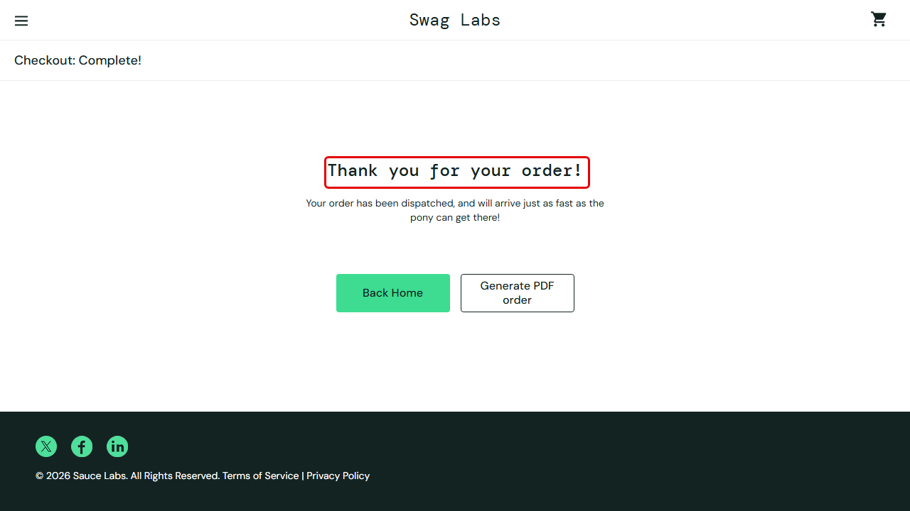
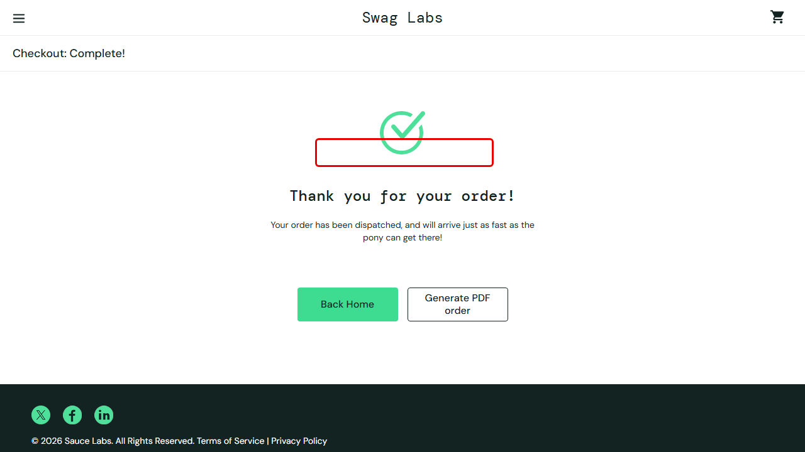
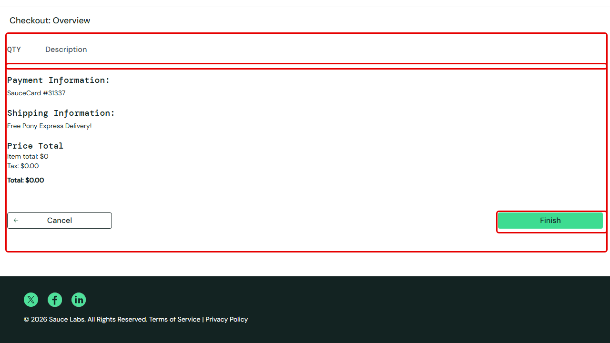
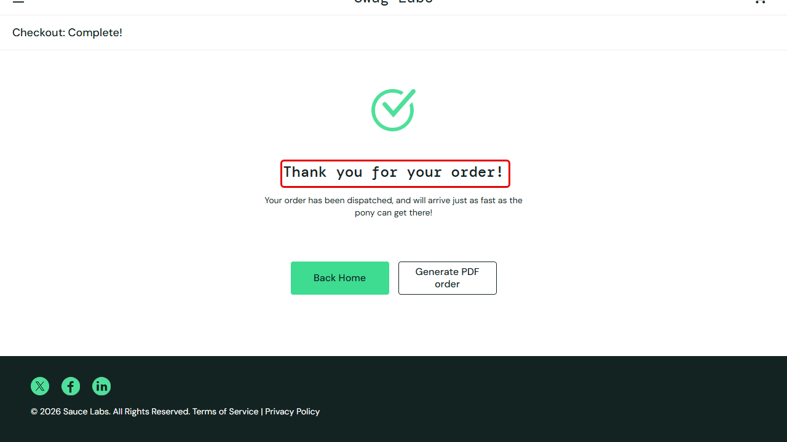

# BUG-24: tái hiện độc lập (2026-11-26)

**Đặt được đơn không có sản phẩm (Tổng quan rỗng vẫn Finish được)**

Script riêng [`tests/repro/saucedemo-checkout-screen.repro.ts`](../../../../../../tests/repro/saucedemo-checkout-screen.repro.ts) (`npm run repro -- saucedemo-checkout-screen`), **không** dùng code test: locator id / class CSS, mỗi tình huống một phiên trình duyệt mới (giỏ trống), Chromium 1280×720. Mỗi tình huống chạy 2 lần: **2/2 lần, kết quả giống nhau**. Ảnh của lần 2, khung đỏ do script vẽ để chỉ chỗ lỗi. Các bước làm bằng tay nằm trong `defects.md`.

| # | Thao tác | Kết quả thấy được | Ảnh |
|---|---|---|---|
| 1 | Đường 1: giỏ trống, mở giỏ, bấm Checkout (BUG-19 cho bấm), nhập `An` / `Le` / `70000`, Continue | Tổng quan 0 dòng sản phẩm; `Item total: $0`, `Tax: $0.00`, `Total: $0.00`; nút Finish: CÓ |  |
| 2 | Bấm Finish | Ở `/checkout-step-two.html`, "Thank you for your order!": CÓ |  |
| 3 | Đường 2: giỏ trống, mở thẳng `/checkout-step-two.html`, bấm Finish | Tổng quan 0 dòng, `Item total: $0`, `Tax: $0.00`, `Total: $0.00`; sau Finish "Thank you for your order!": CÓ |  |
| 4 | Đường 3: thêm Backpack, Onesie, đi tới Tổng quan, Finish (đơn 1), bấm **Back** của trình duyệt | Đơn 1 "Thank you…": CÓ; Back về `/checkout-step-two.html`, 0 dòng, `Item total: $0`, `Tax: $0.00`, `Total: $0.00`, nút Finish: CÓ |  |
| 5 | Bấm Finish lần 2 | "Thank you for your order!" lần 2: CÓ |  |

Kết luận: cả 3 đường đều tới Tổng quan **0 dòng sản phẩm** (`Item total: $0`, `Tax: $0.00`, `Total: $0.00`), bấm Finish vẫn hiện "Thank you for your order!": đặt được đơn rỗng.
