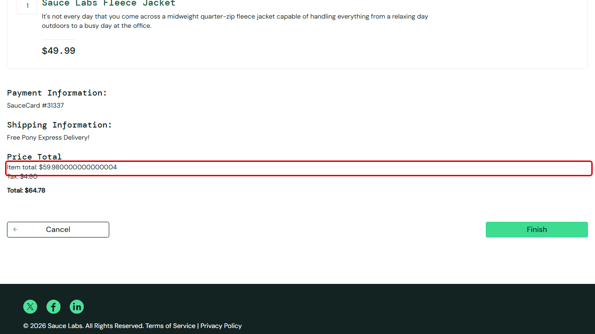
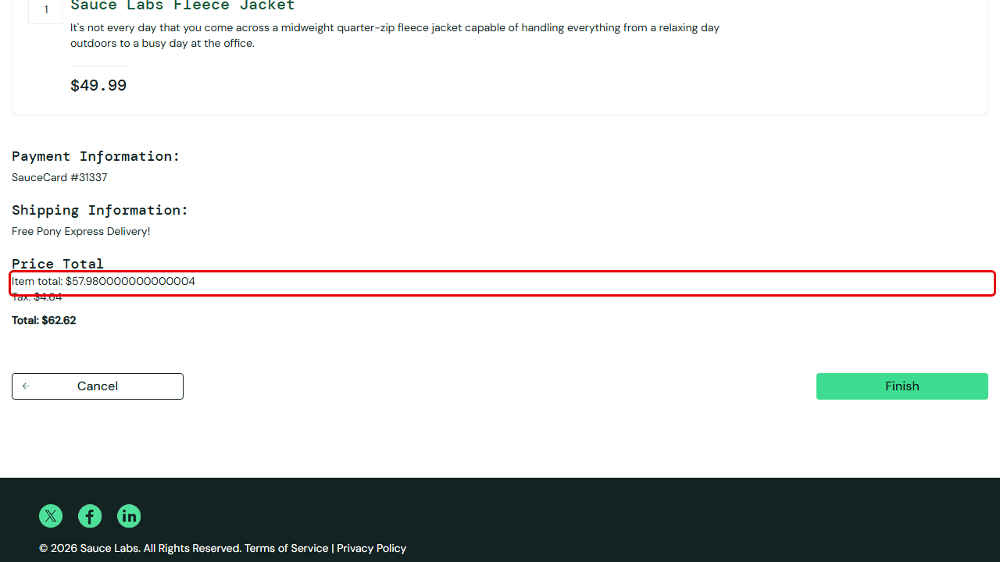
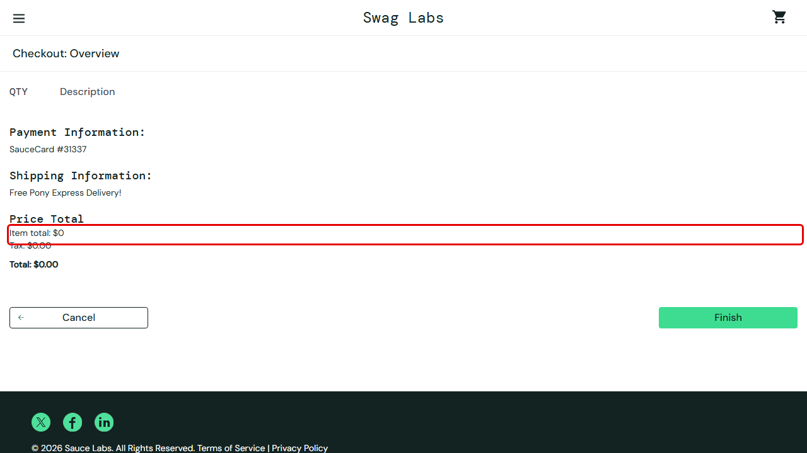

# BUG-25: tái hiện độc lập (2026-11-26)

**Item total không làm tròn / không định dạng 2 chữ số lẻ**

Script riêng [`tests/repro/saucedemo-checkout-screen.repro.ts`](../../../../../../tests/repro/saucedemo-checkout-screen.repro.ts) (`npm run repro -- saucedemo-checkout-screen`), **không** dùng code test: locator id / class CSS, mỗi tình huống một phiên trình duyệt mới (giỏ trống), Chromium 1280×720. Mỗi tình huống chạy 2 lần: **2/2 lần, kết quả giống nhau**. Ảnh của lần 2, khung đỏ do script vẽ để chỉ chỗ lỗi. Các bước làm bằng tay nằm trong `defects.md`.

| # | Thao tác | Kết quả thấy được | Ảnh |
|---|---|---|---|
| 1 | `standard_user`: danh sách bấm Add to cart ở **Bike Light** rồi **Fleece Jacket**, giỏ → Checkout → `An` / `Le` / `70000` → Continue | `Item total: $59.980000000000004`, `Tax: $4.80`, `Total: $64.78` |  |
| 2 | Bấm Finish, Generate PDF order | PDF: SHIP TO `An Le / 70000`; sản phẩm Sauce Labs Bike Light, Sauce Labs Fleece Jacket; Item total 59.98, Tax 4.80, Total 64.78 |  |
| 3 | Console `localStorage.setItem("cart-contents","[2,5]")`, giỏ → Checkout → `An` / `Le` / `70000` → Continue | `Item total: $57.980000000000004`, `Tax: $4.64`, `Total: $62.62` |  |
| 4 | Console `localStorage.setItem("cart-contents","[4,3,2,1,0]")`, giỏ → Checkout → `An` / `Le` / `70000` → Continue | `Item total: $79.94999999999999`, `Tax: $6.40`, `Total: $86.35` |  |
| 5 | Console `localStorage.setItem("cart-contents","[]")`, giỏ → Checkout → `An` / `Le` / `70000` → Continue (giỏ rỗng, BUG-19 cho vào) | `Item total: $0`, `Tax: $0.00`, `Total: $0.00` |  |
| 6 | Đối chứng: Console `localStorage.setItem("cart-contents","[4,2]")`, giỏ → Checkout → `An` / `Le` / `70000` → Continue | `Item total: $37.98`, `Tax: $3.04`, `Total: $41.02` |  |

Kết luận: Item total in số thực chưa làm tròn (`$59.980000000000004`, `$57.980000000000004`, `$79.94999999999999`), giỏ rỗng `$0`; Tax, Total vẫn 2 chữ số; PDF in `59.98` nên biên nhận khác Tổng quan; giỏ `[4,2]` đúng `$37.98`.
