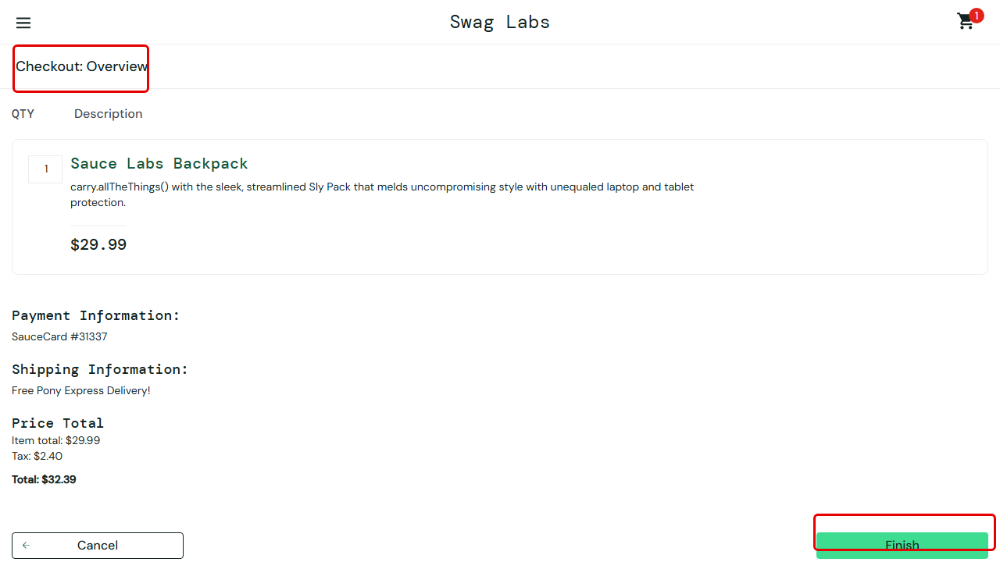
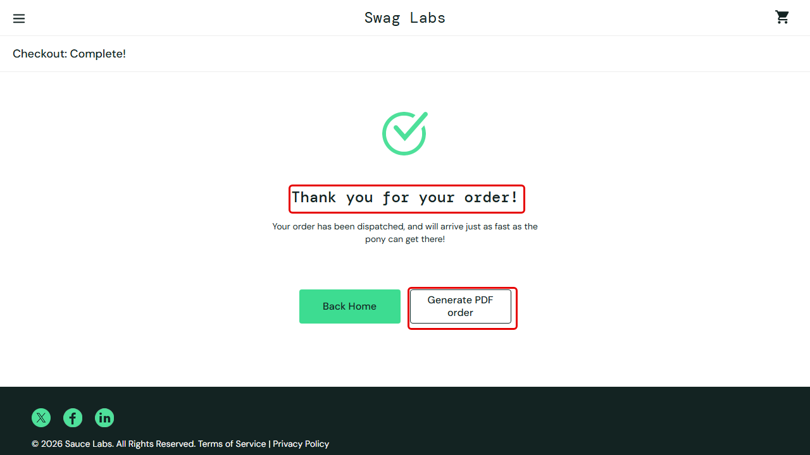

# BUG-26: tái hiện độc lập (2026-11-26)

**Mở thẳng Tổng quan là bỏ qua bước nhập thông tin, đặt được hàng không có tên, zip**

Script riêng [`tests/repro/saucedemo-checkout-screen.repro.ts`](../../../../../../tests/repro/saucedemo-checkout-screen.repro.ts) (`npm run repro -- saucedemo-checkout-screen`), **không** dùng code test: locator id / class CSS, mỗi tình huống một phiên trình duyệt mới (giỏ trống), Chromium 1280×720. Mỗi tình huống chạy 2 lần: **2/2 lần, kết quả giống nhau**. Ảnh của lần 2, khung đỏ do script vẽ để chỉ chỗ lỗi. Các bước làm bằng tay nằm trong `defects.md`.

| # | Thao tác | Kết quả thấy được | Ảnh |
|---|---|---|---|
| 1 | Thêm Backpack ở danh sách (chưa vào trang Thông tin), mở thẳng `/checkout-step-two.html` | Ở `/checkout-step-two.html`, tiêu đề `Checkout: Overview`; Sauce Labs Backpack; `Item total: $29.99`, `Tax: $2.40`, `Total: $32.39`; nút Finish: CÓ |  |
| 2 | Bấm Finish, bấm Generate PDF order | "Thank you for your order!": CÓ; số giỏ (không có); PDF: **không có `SHIP TO`**; sản phẩm Sauce Labs Backpack; Item total 29.99, Tax 2.40, Total 32.39 |  |

Kết luận: mở thẳng URL vào được Tổng quan đầy đủ (Backpack, `Total: $32.39`) mà chưa nhập tên / zip; Finish đặt hàng thành công, biên nhận PDF **không có** phần `SHIP TO`.
