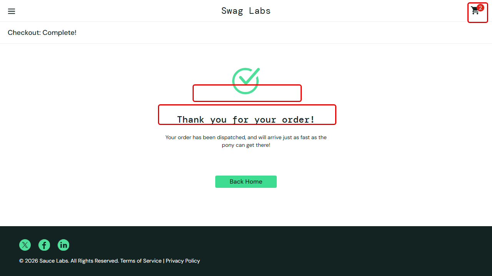

# BUG-27: tái hiện độc lập (2026-11-26)

**Mở thẳng trang Hoàn tất khi chưa đặt hàng vẫn báo đặt hàng thành công**

Script riêng [`tests/repro/saucedemo-checkout-screen.repro.ts`](../../../../../../tests/repro/saucedemo-checkout-screen.repro.ts) (`npm run repro -- saucedemo-checkout-screen`), **không** dùng code test: locator id / class CSS, mỗi tình huống một phiên trình duyệt mới (giỏ trống), Chromium 1280×720. Mỗi tình huống chạy 2 lần: **2/2 lần, kết quả giống nhau**. Ảnh của lần 2, khung đỏ do script vẽ để chỉ chỗ lỗi. Các bước làm bằng tay nằm trong `defects.md`.

| # | Thao tác | Kết quả thấy được | Ảnh |
|---|---|---|---|
| 1 | Thêm Backpack, Onesie (chưa Checkout, chưa Finish), mở thẳng `/checkout-complete.html` | Tiêu đề `Checkout: Complete!`; `Thank you for your order!`, `Your order has been dispatched, and will arrive just as fast as the pony can get there!`; số giỏ 2, `cart-contents` [4,2]; nút Generate PDF order: không |  |

Kết luận: chưa đặt hàng mà trang vẫn hiện "Thank you for your order!" và "Your order has been dispatched…", trong khi giỏ còn 2 sản phẩm (số giỏ 2).
