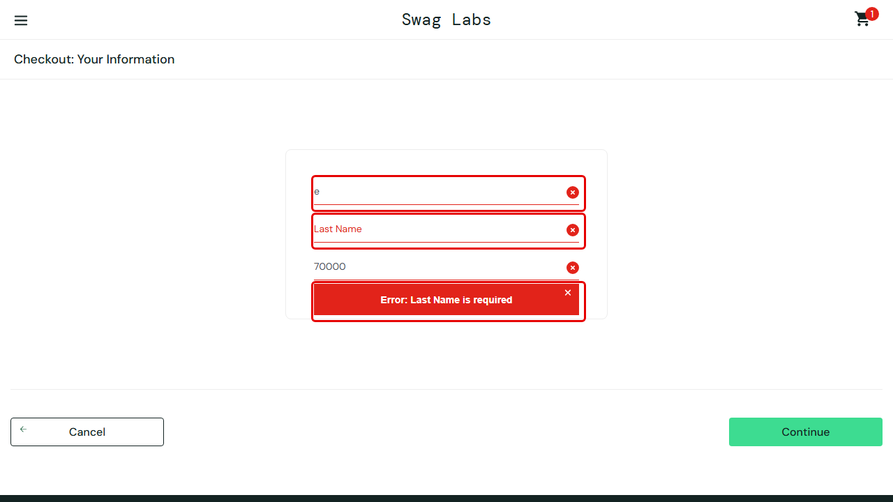

# BUG-28: tái hiện độc lập (2026-11-26)

**`problem_user`: gõ vào Last Name thì ký tự đi vào First Name, không đặt được hàng**

Script riêng [`tests/repro/saucedemo-checkout-screen.repro.ts`](../../../../../../tests/repro/saucedemo-checkout-screen.repro.ts) (`npm run repro -- saucedemo-checkout-screen`), **không** dùng code test: locator id / class CSS, mỗi tình huống một phiên trình duyệt mới (giỏ trống), Chromium 1280×720. Mỗi tình huống chạy 2 lần: **2/2 lần, kết quả giống nhau**. Ảnh của lần 2, khung đỏ do script vẽ để chỉ chỗ lỗi. Các bước làm bằng tay nằm trong `defects.md`.

| # | Thao tác | Kết quả thấy được | Ảnh |
|---|---|---|---|
| 1 | `problem_user`: First Name nhập `An`, bấm vào Last Name, **gõ từng phím** `L`, `e`, `e`; Zip `70000`; Continue | Sau khi gõ: First `e`, Last ``; thông báo `Error: Last Name is required` |  |
| 2 | Đối chứng: `standard_user`: First Name nhập `An`, bấm vào Last Name, **gõ từng phím** `L`, `e`, `e`; Zip `70000`; Continue | Sau khi gõ: First `An`, Last `Lee`; sang `/checkout-step-two.html` |  |

Kết luận: `problem_user`: mỗi phím gõ ở Last Name thay toàn bộ First Name (gõ `Lee` → First `e`), Last Name luôn trống, Continue luôn báo `Error: Last Name is required`; `standard_user` nhận đúng.
