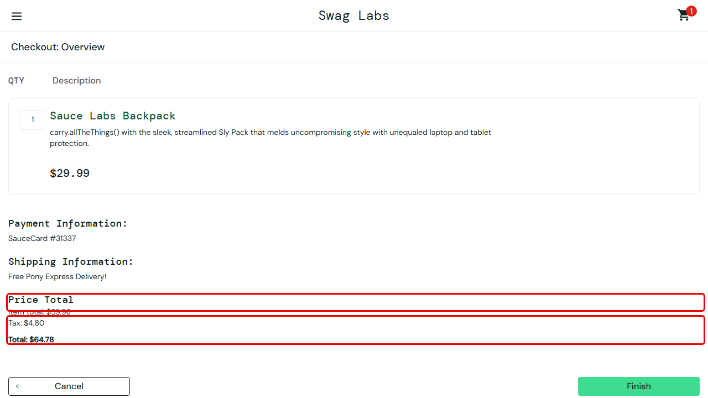
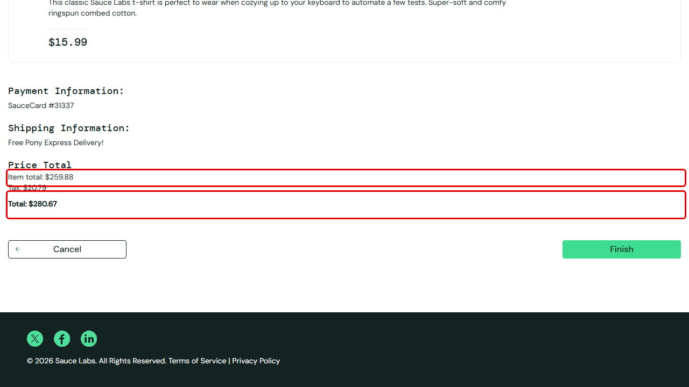
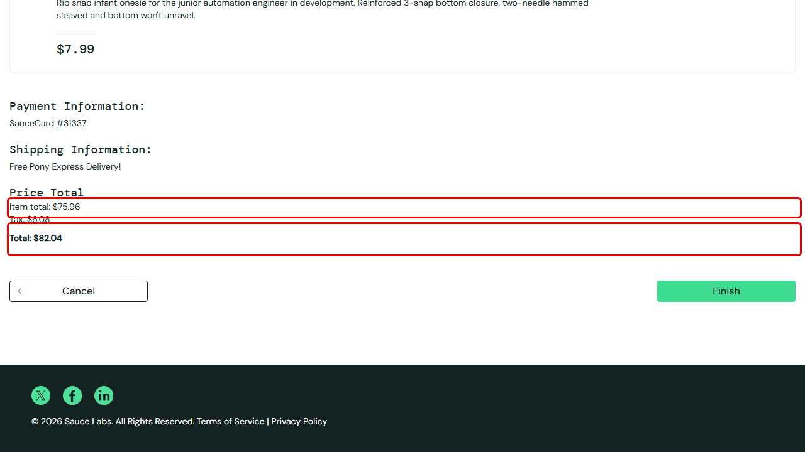

# BUG-29: tái hiện độc lập (2026-11-26)

**`problem_user`: Item total gấp đôi, Tax và Total tính theo số sai**

Script riêng [`tests/repro/saucedemo-checkout-screen.repro.ts`](../../../../../../tests/repro/saucedemo-checkout-screen.repro.ts) (`npm run repro -- saucedemo-checkout-screen`), **không** dùng code test: locator id / class CSS, mỗi tình huống một phiên trình duyệt mới (giỏ trống), Chromium 1280×720. Mỗi tình huống chạy 2 lần: **2/2 lần, kết quả giống nhau**. Ảnh của lần 2, khung đỏ do script vẽ để chỉ chỗ lỗi. Các bước làm bằng tay nằm trong `defects.md`.

| # | Thao tác | Kết quả thấy được | Ảnh |
|---|---|---|---|
| 1 | `problem_user`: Console `localStorage.setItem("cart-contents","[4]")`, mở `/checkout-step-two.html` (BUG-28 chặn trang Thông tin). Backpack ($29.99): mong đợi `Item total: $29.99`, `Tax: $2.40`, `Total: $32.39` | Giá từng dòng: $29.99; `Item total: $59.98`, `Tax: $4.80`, `Total: $64.78` |  |
| 2 | `problem_user`: Console `localStorage.setItem("cart-contents","[4,0,1,5,2,3]")`, mở `/checkout-step-two.html` (BUG-28 chặn trang Thông tin). cả 6 sản phẩm: mong đợi `$129.94`, `$10.40`, `$140.34` | Giá từng dòng: $29.99, $9.99, $15.99, $49.99, $7.99, $15.99; `Item total: $259.88`, `Tax: $20.79`, `Total: $280.67` |  |
| 3 | Đối chứng: `standard_user`: Console `localStorage.setItem("cart-contents","[4]")`, mở `/checkout-step-two.html`. mong đợi `Item total: $29.99`, `Tax: $2.40`, `Total: $32.39` | Giá từng dòng: $29.99; `Item total: $29.99`, `Tax: $2.40`, `Total: $32.39` |  |
| 4 | `problem_user`: Console `localStorage.setItem("cart-contents","[4,2]")`, mở `/checkout-step-two.html` (BUG-28 chặn trang Thông tin), Finish, Generate PDF order. Backpack + Onesie: mong đợi `$37.98`, `$3.04`, `$41.02` | Giá từng dòng: $29.99, $7.99; `Item total: $75.96`, `Tax: $6.08`, `Total: $82.04`; Finish → PDF: **không có `SHIP TO`**; sản phẩm Sauce Labs Backpack, Sauce Labs Onesie; Item total 75.96, Tax 6.08, Total 82.04 |  |

Kết luận: `problem_user`: giá từng dòng đúng nhưng Item total **gấp đôi** tổng giá (`$59.98` thay vì `$29.99`; cả 6 sản phẩm `$259.88` thay vì `$129.94`), Tax và Total tính theo số sai; PDF in `75.96`, `6.08`, `82.04` (đúng: `37.98`, `3.04`, `41.02`); `standard_user` cùng giỏ đúng.
