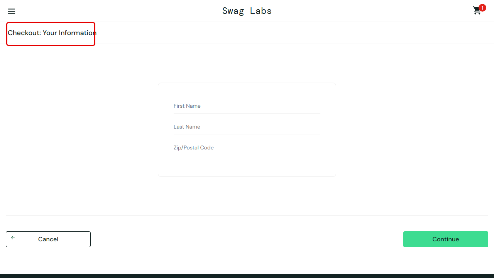
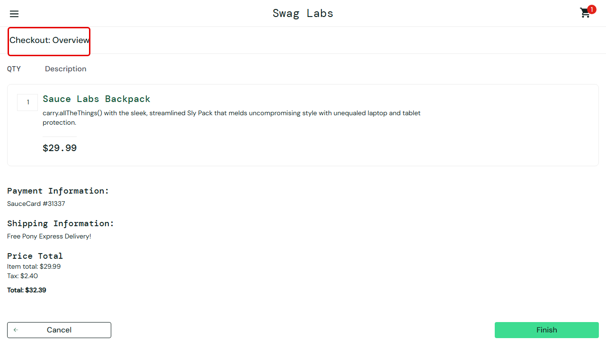
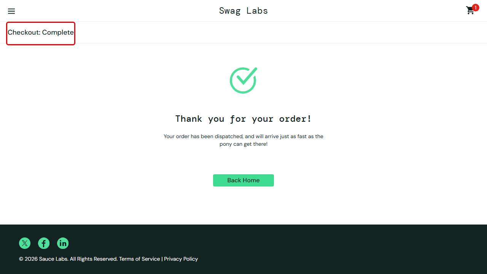
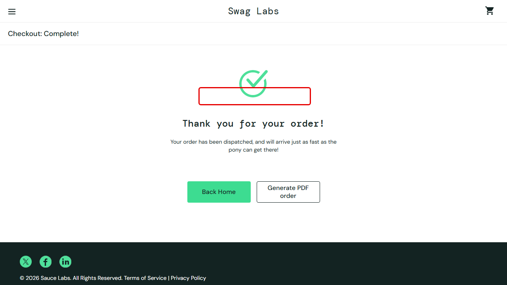

# BUG-02: tái hiện độc lập (2026-11-26)

**Biến thể SD-103: cookie tự tạo vào được cả 3 trang thanh toán và đặt được hàng**

Script riêng [`tests/repro/saucedemo-checkout-screen.repro.ts`](../../../../../../tests/repro/saucedemo-checkout-screen.repro.ts) (`npm run repro -- saucedemo-checkout-screen`), **không** dùng code test: locator id / class CSS, mỗi tình huống một phiên trình duyệt mới (giỏ trống), Chromium 1280×720. Mỗi tình huống chạy 2 lần: **2/2 lần, kết quả giống nhau**. Ảnh của lần 2, khung đỏ do script vẽ để chỉ chỗ lỗi. Các bước làm bằng tay nằm trong `defects.md`.

| # | Thao tác | Kết quả thấy được | Ảnh |
|---|---|---|---|
| 1 | Chưa đăng nhập. Trang đăng nhập, Console: `document.cookie = "session-username=standard_user"`, `localStorage.setItem("cart-contents","[4]")`; mở `/checkout-step-one.html` | Ở `/checkout-step-one.html`, thấy trang `Checkout: Your Information`, không có thông báo đăng nhập |  |
| 2 | Chưa đăng nhập. Trang đăng nhập, Console: `document.cookie = "session-username=standard_user"`, `localStorage.setItem("cart-contents","[4]")`; mở `/checkout-step-two.html` | Ở `/checkout-step-two.html`, thấy trang `Checkout: Overview`, không có thông báo đăng nhập |  |
| 3 | Chưa đăng nhập. Trang đăng nhập, Console: `document.cookie = "session-username=standard_user"`, `localStorage.setItem("cart-contents","[4]")`; mở `/checkout-complete.html` | Ở `/checkout-complete.html`, thấy trang `Checkout: Complete!`, không có thông báo đăng nhập |  |
| 4 | Như trên, mở `/checkout-step-two.html`, bấm Finish | Tổng quan Backpack, `Item total: $29.99`, `Tax: $2.40`, `Total: $32.39`; "Thank you for your order!": CÓ |  |
| 5 | Cookie `session-username=problem_user`, mở `/checkout-step-one.html` | Ở `/checkout-step-one.html`, thấy trang `Checkout: Your Information`, không có thông báo đăng nhập |  |
| 6 | Cookie `session-username=error_user`, mở `/checkout-step-one.html` | Ở `/checkout-step-one.html`, thấy trang `Checkout: Your Information`, không có thông báo đăng nhập |  |
| 7 | Cookie `session-username=visual_user`, mở `/checkout-step-one.html` | Ở `/checkout-step-one.html`, thấy trang `Checkout: Your Information`, không có thông báo đăng nhập |  |
| 8 | Cookie `session-username=performance_glitch_user`, mở `/checkout-step-one.html` | Ở `/checkout-step-one.html`, thấy trang `Checkout: Your Information`, không có thông báo đăng nhập |  |
| 9 | Đối chứng: cookie `session-username=locked_out_user`, mở `/checkout-step-one.html` | Ở `/`, **bị chặn**: `Epic sadface: You can only access '/checkout-step-one.html' when you are logged in.` |  |

Kết luận: cookie `session-username` tự tạo với tên tài khoản hợp lệ (5 tên) vào được cả 3 trang thanh toán, đặt được hàng; chỉ tên `locked_out_user` bị chặn. Giống BUG-02 ở `/inventory.html` (SD-101) và biến thể SD-102 (giỏ, chi tiết).
