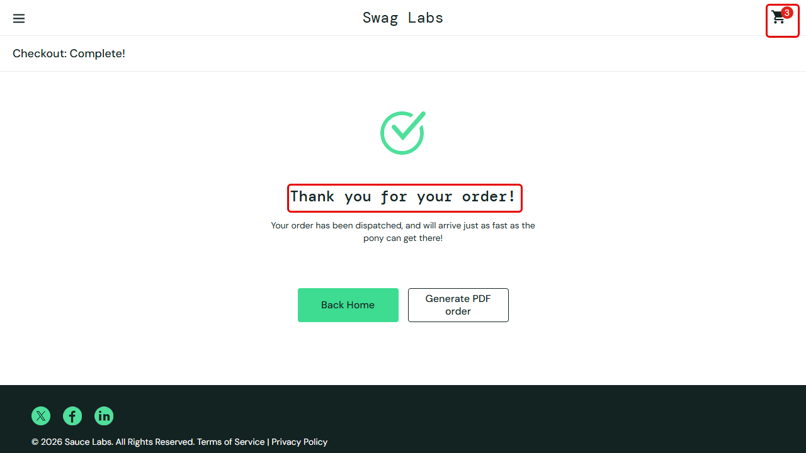
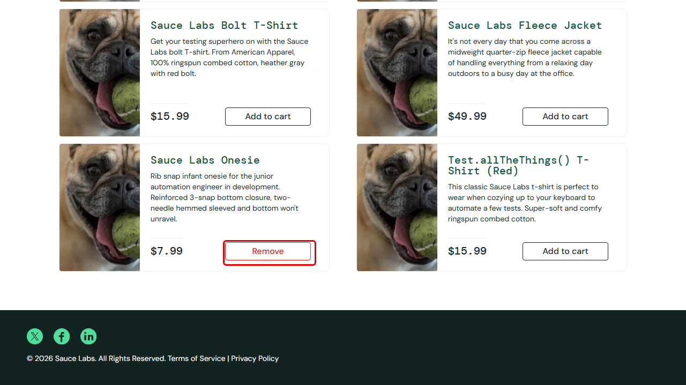
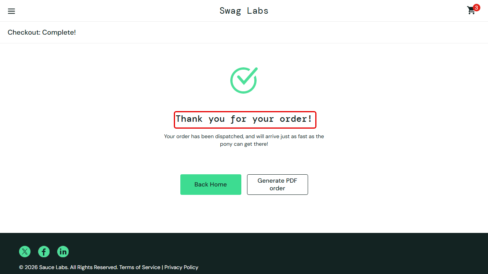

# BUG-30: tái hiện độc lập (2026-11-26)

**`problem_user`: Finish báo thành công nhưng giỏ không được làm trống, đặt lại được**

Script riêng [`tests/repro/saucedemo-checkout-screen.repro.ts`](../../../../../../tests/repro/saucedemo-checkout-screen.repro.ts) (`npm run repro -- saucedemo-checkout-screen`), **không** dùng code test: locator id / class CSS, mỗi tình huống một phiên trình duyệt mới (giỏ trống), Chromium 1280×720. Mỗi tình huống chạy 2 lần: **2/2 lần, kết quả giống nhau**. Ảnh của lần 2, khung đỏ do script vẽ để chỉ chỗ lỗi. Các bước làm bằng tay nằm trong `defects.md`.

| # | Thao tác | Kết quả thấy được | Ảnh |
|---|---|---|---|
| 1 | `problem_user`: Console `localStorage.setItem("cart-contents","[4,0,2]")`, mở `/checkout-step-two.html` (BUG-28 chặn trang Thông tin), bấm Finish | "Thank you…": CÓ; số giỏ **3**; `cart-contents` **[4,0,2]** |  |
| 2 | Bấm Back Home | 3 nút `Add to cart`, 3 nút `Remove`; số giỏ 3 |  |
| 3 | Phiên mới, như trên đến khi đặt xong; bấm **Back** của trình duyệt | Ở `/checkout-step-two.html`, 3 dòng, `Item total: $95.93999999999998`, `Tax: $7.68`, `Total: $103.62` |  |
| 4 | Bấm Finish lần 2 | "Thank you…" lần 2: CÓ |  |

Kết luận: `problem_user` Finish xong: số giỏ còn 3, `cart-contents` còn `[4,0,2]`, Back Home còn 3 nút `Remove`; Back của trình duyệt về Tổng quan còn 3 sản phẩm và đặt lại được (đơn trùng).
