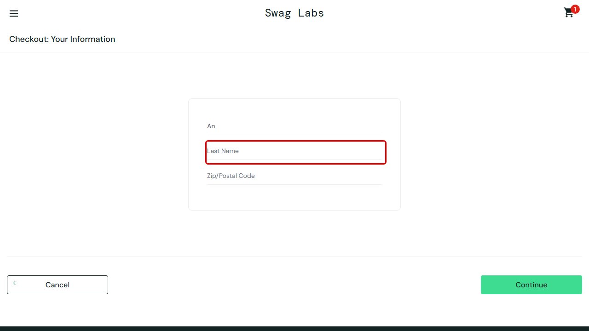

# BUG-31: tái hiện độc lập (2026-11-26)

**`error_user`: ô Last Name không nhận ký tự, mỗi phím một lỗi JavaScript và một báo lỗi gửi ra ngoài**

Script riêng [`tests/repro/saucedemo-checkout-screen.repro.ts`](../../../../../../tests/repro/saucedemo-checkout-screen.repro.ts) (`npm run repro -- saucedemo-checkout-screen`), **không** dùng code test: locator id / class CSS, mỗi tình huống một phiên trình duyệt mới (giỏ trống), Chromium 1280×720. Mỗi tình huống chạy 2 lần: **2/2 lần, kết quả giống nhau**. Ảnh của lần 2, khung đỏ do script vẽ để chỉ chỗ lỗi. Các bước làm bằng tay nằm trong `defects.md`.

| # | Thao tác | Kết quả thấy được | Ảnh |
|---|---|---|---|
| 1 | `error_user`: First `An`, bấm vào Last Name, gõ `L`, `e`, `e`; xem tab Console và Network (DevTools) | Last Name ``; 3 lỗi JavaScript `Cannot read properties of undefined (reading 'value')`; 3 request tới `submit.backtrace.io` |  |
| 2 | Đối chứng: `standard_user`: First `An`, bấm vào Last Name, gõ `L`, `e`, `e`; xem tab Console và Network (DevTools) | Last Name `Lee`; 0 lỗi JavaScript; 0 request tới `submit.backtrace.io` |  |

Kết luận: `error_user`: Last Name luôn trống, mỗi phím sinh 1 lỗi JavaScript `Cannot read properties of undefined (reading 'value')` và 1 request tới `submit.backtrace.io` (3 phím → 3 + 3); `standard_user` nhận `Lee`, không lỗi.
