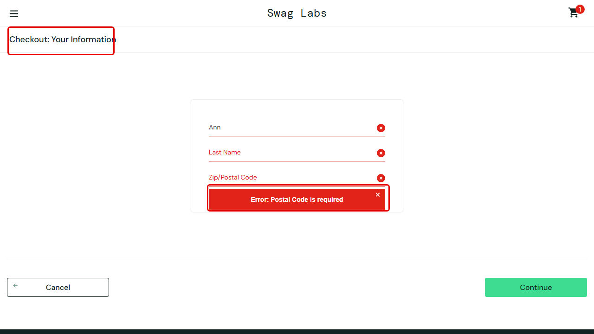
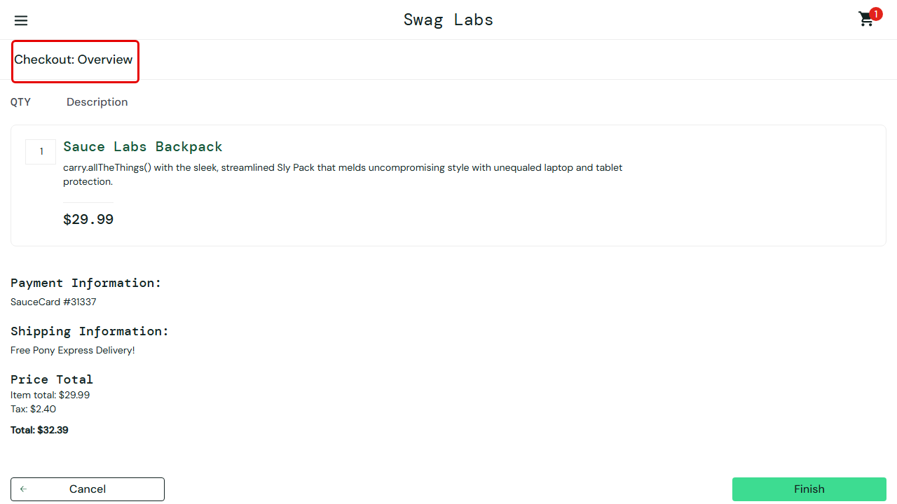

# BUG-32: tái hiện độc lập (2026-11-26)

**`error_user`: bỏ qua kiểm tra Last Name**

Script riêng [`tests/repro/saucedemo-checkout-screen.repro.ts`](../../../../../../tests/repro/saucedemo-checkout-screen.repro.ts) (`npm run repro -- saucedemo-checkout-screen`), **không** dùng code test: locator id / class CSS, mỗi tình huống một phiên trình duyệt mới (giỏ trống), Chromium 1280×720. Mỗi tình huống chạy 2 lần: **2/2 lần, kết quả giống nhau**. Ảnh của lần 2, khung đỏ do script vẽ để chỉ chỗ lỗi. Các bước làm bằng tay nằm trong `defects.md`.

| # | Thao tác | Kết quả thấy được | Ảnh |
|---|---|---|---|
| 1 | `error_user`: First `Ann`, **không chạm** Last Name, Zip `(trống)`, Continue | Thông báo `Error: Postal Code is required` |  |
| 2 | `error_user`: First `Ann`, **không chạm** Last Name, Zip `70000`, Continue | **Sang `/checkout-step-two.html`** (`Checkout: Overview`) |  |
| 3 | Đối chứng: `standard_user`: First `Ann`, **không chạm** Last Name, Zip `70000`, Continue | Thông báo `Error: Last Name is required` |  |

Kết luận: `error_user` thiếu Last Name: lúc thì báo lỗi của ô Zip (`Error: Postal Code is required`), lúc thì sang Tổng quan; `standard_user` cùng thao tác báo đúng `Error: Last Name is required`.
