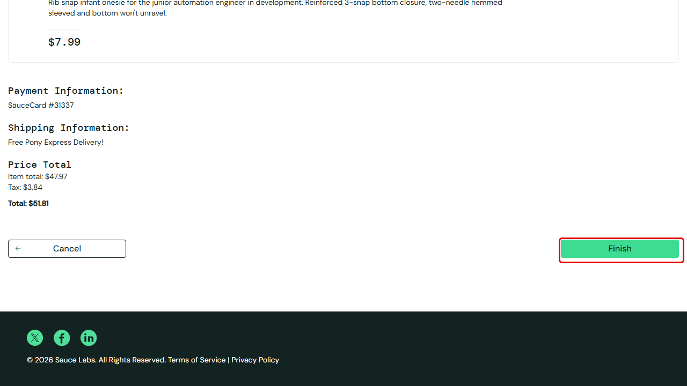

# BUG-33: tái hiện độc lập (2026-11-26)

**`error_user`: bấm Finish không có tác dụng, lỗi JavaScript**

Script riêng [`tests/repro/saucedemo-checkout-screen.repro.ts`](../../../../../../tests/repro/saucedemo-checkout-screen.repro.ts) (`npm run repro -- saucedemo-checkout-screen`), **không** dùng code test: locator id / class CSS, mỗi tình huống một phiên trình duyệt mới (giỏ trống), Chromium 1280×720. Mỗi tình huống chạy 2 lần: **2/2 lần, kết quả giống nhau**. Ảnh của lần 2, khung đỏ do script vẽ để chỉ chỗ lỗi. Các bước làm bằng tay nằm trong `defects.md`.

| # | Thao tác | Kết quả thấy được | Ảnh |
|---|---|---|---|
| 1 | `error_user`: Console `localStorage.setItem("cart-contents","[4,0,2]")`, mở `/checkout-step-two.html` (BUG-31 chặn trang Thông tin), bấm **Finish**; xem tab Console, Network | "Thank you…": không; vẫn ở `/checkout-step-two.html`; số giỏ 3, `cart-contents` [4,0,2]; 1 lỗi JavaScript `wa.cesetRart is not a function`; 1 request tới `submit.backtrace.io` |  |

Kết luận: `error_user` bấm Finish: ở lại Tổng quan, giỏ còn nguyên `[4,0,2]`, trang ném lỗi JavaScript `wa.cesetRart is not a function` và gửi 1 báo lỗi tới `submit.backtrace.io`.
