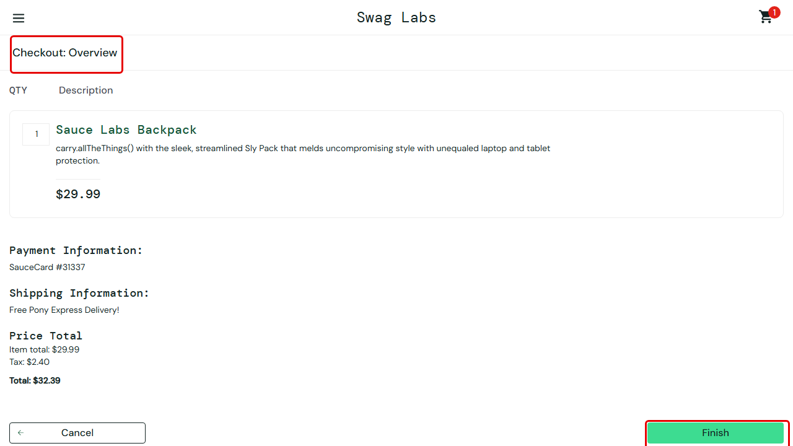
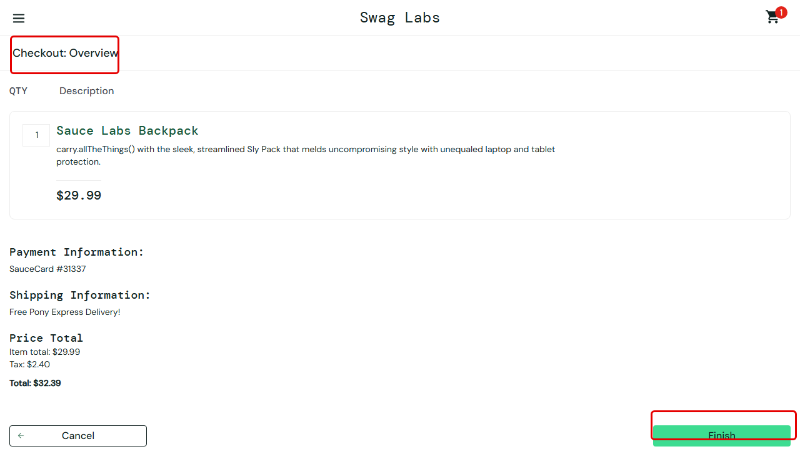

# BUG-34: tái hiện độc lập (2026-11-26)

**Ô chỉ có khoảng trắng / ký tự tab được coi là đã nhập**

Script riêng [`tests/repro/saucedemo-checkout-screen.repro.ts`](../../../../../../tests/repro/saucedemo-checkout-screen.repro.ts) (`npm run repro -- saucedemo-checkout-screen`), **không** dùng code test: locator id / class CSS, mỗi tình huống một phiên trình duyệt mới (giỏ trống), Chromium 1280×720. Mỗi tình huống chạy 2 lần: **2/2 lần, kết quả giống nhau**. Ảnh của lần 2, khung đỏ do script vẽ để chỉ chỗ lỗi. Các bước làm bằng tay nằm trong `defects.md`.

| # | Thao tác | Kết quả thấy được | Ảnh |
|---|---|---|---|
| 1 | cả 3 ô 1 khoảng trắng: nhập (dán) First / Last / Zip = `" "` / `" "` / `" "`, bấm Continue; rồi Finish, Generate PDF order | ở `/checkout-step-two.html` (`Checkout: Overview`); Finish → "Thank you…": CÓ; PDF: SHIP TO **không có chữ** (2 đoạn, chỉ khoảng trắng); sản phẩm Sauce Labs Backpack; Item total 29.99, Tax 2.40, Total 32.39 |  |
| 2 | Last 3 khoảng trắng: nhập (dán) First / Last / Zip = `"An"` / `"   "` / `"70000"`, bấm Continue | ở `/checkout-step-two.html` (`Checkout: Overview`) |  |
| 3 | Zip 1 ký tự tab: nhập (dán) First / Last / Zip = `"An"` / `"Le"` / `"\t"`, bấm Continue | ở `/checkout-step-two.html` (`Checkout: Overview`) |  |
| 4 | Đối chứng: First trống: nhập (dán) First / Last / Zip = `""` / `"Le"` / `"70000"`, bấm Continue | thông báo `Error: First Name is required`, ở `/checkout-step-one.html` (`Checkout: Your Information`) |  |

Kết luận: ô chỉ có khoảng trắng hoặc ký tự tab không bị báo `… is required`, trang sang Tổng quan và đặt được hàng (PDF `SHIP TO` không có chữ); ô trống thật thì báo lỗi đúng.
