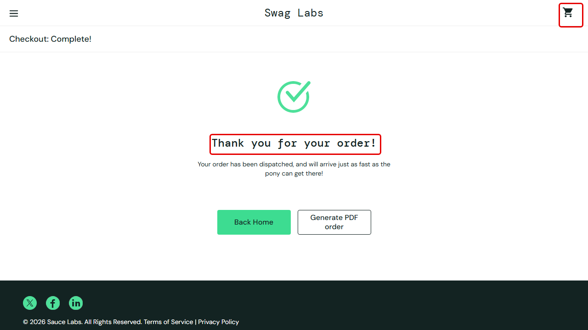
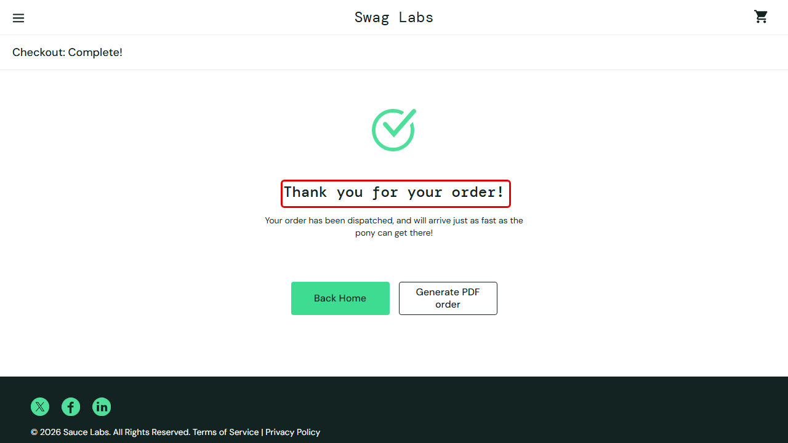
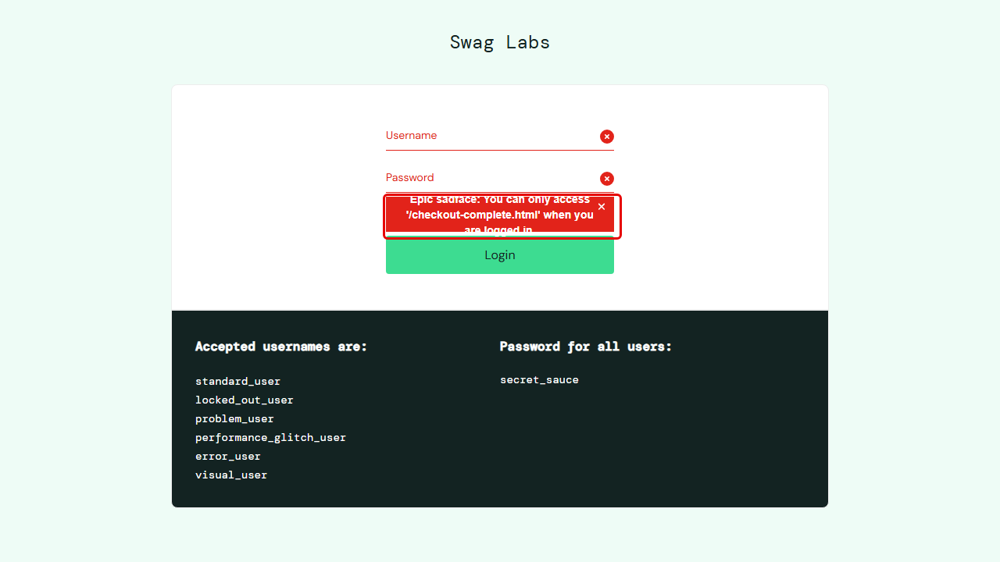

# BUG-35: tái hiện độc lập (2026-11-26)

**Finish tạo đơn từ Tổng quan đã cũ, không kiểm giỏ / phiên hiện tại**

Script riêng [`tests/repro/saucedemo-checkout-screen.repro.ts`](../../../../../../tests/repro/saucedemo-checkout-screen.repro.ts) (`npm run repro -- saucedemo-checkout-screen`), **không** dùng code test: locator id / class CSS, mỗi tình huống một phiên trình duyệt mới (giỏ trống), Chromium 1280×720. Mỗi tình huống chạy 2 lần: **2/2 lần, kết quả giống nhau**. Ảnh của lần 2, khung đỏ do script vẽ để chỉ chỗ lỗi. Các bước làm bằng tay nằm trong `defects.md`.

| # | Thao tác | Kết quả thấy được | Ảnh |
|---|---|---|---|
| 1 | (1) 2 tab: giỏ Backpack + Onesie; tab 1 và tab 2 cùng đi tới Tổng quan (`An` / `Le` / `70000`); Finish ở **tab 1** | Tab 1 "Thank you…": CÓ; `cart-contents` sau đó: (không có khóa); tab 2 vẫn hiện 2 dòng, `Item total: $37.98`, `Tax: $3.04`, `Total: $41.02` |  |
| 2 | Bấm Finish ở **tab 2** (giỏ đã trống) | Tab 2 "Thank you…" (đơn thứ 2): CÓ; PDF: SHIP TO `An Le / 70000`; sản phẩm Sauce Labs Backpack, Sauce Labs Onesie; Item total 37.98, Tax 3.04, Total 41.02 |  |
| 3 | (2) Giỏ Backpack + Onesie, ở Tổng quan: ☰ → **Reset App State**, đóng menu, bấm Finish | Trước Finish: `cart-contents` (không có khóa), trang vẫn 2 dòng (BUG-05); "Thank you…": CÓ; PDF: SHIP TO `An Le / 70000`; sản phẩm Sauce Labs Backpack, Sauce Labs Onesie; Item total 37.98, Tax 3.04, Total 41.02 |  |
| 4 | (4) Tab 1: giỏ Backpack, đi tới Tổng quan; tab 2: danh sách, **thêm Onesie**; bấm Finish ở tab 1 | `cart-contents` trước Finish: [4,2]; "Thank you…": CÓ; PDF: SHIP TO `An Le / 70000`; sản phẩm Sauce Labs Backpack; Item total 29.99, Tax 2.40, Total 32.39; `cart-contents` sau Finish: (không có khóa) |  |
| 5 | (5) Tab 1: giỏ Backpack + Onesie, đi tới Tổng quan; tab 2: trang giỏ, **bỏ Onesie**; bấm Finish ở tab 1 | `cart-contents` trước Finish: [4]; "Thank you…": CÓ; PDF: SHIP TO `An Le / 70000`; sản phẩm Sauce Labs Backpack, Sauce Labs Onesie; Item total 37.98, Tax 3.04, Total 41.02 |  |
| 6 | (6) Tab 1: giỏ Backpack + Onesie, đi tới Tổng quan; tab 2: ☰ → **Logout**; bấm **Finish** ở tab 1 | `cart-contents` trước khi bấm: [4,2]; sau khi bấm ở `/`, thông báo `Epic sadface: You can only access '/checkout-complete.html' when you are logged in.`; `cart-contents` sau: **(không có khóa)** |  |
| 7 | Đối chứng (6): như trên nhưng bấm **Cancel** ở tab 1 | `cart-contents` trước khi bấm: [4,2]; sau khi bấm ở `/`, thông báo `Epic sadface: You can only access '/inventory.html' when you are logged in.`; `cart-contents` sau: **[4,2]** |  |

Kết luận: Finish đặt đơn theo trang Tổng quan đang hiện, không theo giỏ / phiên hiện tại: (1) tab 2 đặt được đơn thứ 2 đủ 2 sản phẩm sau khi tab 1 đã đặt; (2) giỏ đã Reset vẫn đặt được; (4) đơn chỉ có Backpack (`Total 32.39`) rồi Onesie thêm ở tab khác bị xóa khỏi giỏ; (5) đơn có cả Onesie đã bỏ (`Total 41.02`); (6) Finish bị chặn đúng về trang đăng nhập nhưng giỏ bị xóa, còn Cancel trong cùng tình huống thì giỏ còn `[4,2]`.
