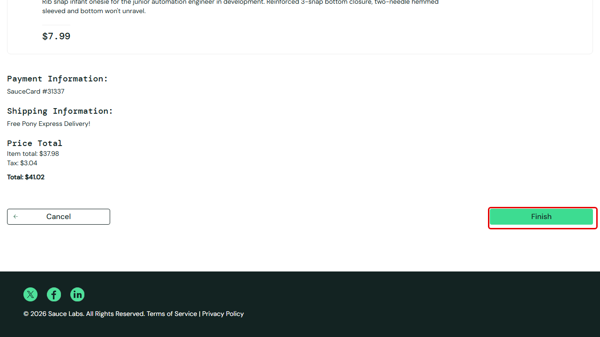
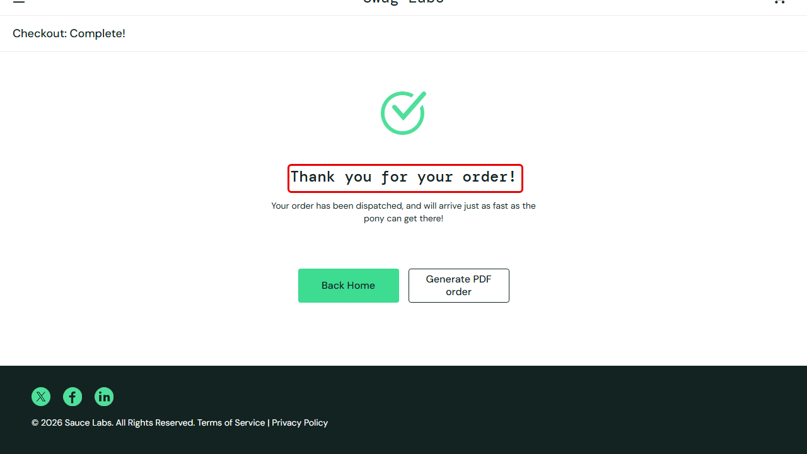

# BUG-36: tái hiện độc lập (2026-11-26)

**Bấm đúp Continue / Finish chạy 2 lần: phải bấm Back 2 lần mới về trang trước**

Script riêng [`tests/repro/saucedemo-checkout-screen.repro.ts`](../../../../../../tests/repro/saucedemo-checkout-screen.repro.ts) (`npm run repro -- saucedemo-checkout-screen`), **không** dùng code test: locator id / class CSS, mỗi tình huống một phiên trình duyệt mới (giỏ trống), Chromium 1280×720. Mỗi tình huống chạy 2 lần: **2/2 lần, kết quả giống nhau**. Ảnh của lần 2, khung đỏ do script vẽ để chỉ chỗ lỗi. Các bước làm bằng tay nằm trong `defects.md`.

| # | Thao tác | Kết quả thấy được | Ảnh |
|---|---|---|---|
| 1 | Đối chứng: như trên nhưng bấm Continue **1 lần**, rồi Back 1 lần | `history.length` tăng 1; Back lần 1: trang Thông tin |  |
| 2 | Biến thể 1: trang Thông tin đủ `An` / `Le` / `70000`, **bấm đúp** Continue, rồi bấm Back 1 lần | `history.length` tăng 2; Back lần 1: **vẫn Tổng quan** |  |
| 3 | Bấm Back lần 2 | Về trang Thông tin |  |
| 4 | Biến thể 2: Tổng quan giỏ Backpack + Onesie, **bấm đúp** Finish, rồi Back 1 lần | `history.length` tăng 2; số giỏ (không có), `cart-contents` (không có khóa); PDF: SHIP TO `An Le / 70000`; sản phẩm Sauce Labs Backpack, Sauce Labs Onesie; Item total 37.98, Tax 3.04, Total 41.02; Back lần 1: **vẫn trang Hoàn tất** |  |
| 5 | Bấm Back lần 2 | Về `/checkout-step-two.html`, 0 dòng sản phẩm, `Item total: $0`, `Tax: $0.00`, `Total: $0.00` |  |

Kết luận: bấm đúp Continue hoặc Finish làm `history.length` tăng 2 (bấm 1 lần tăng 1), Back lần 1 vẫn ở cùng trang, phải Back lần 2 mới về trang trước (sau Finish: về Tổng quan rỗng). Đơn không bị nhân đôi: giỏ trống một lần, PDF đúng 2 sản phẩm `41.02`.
