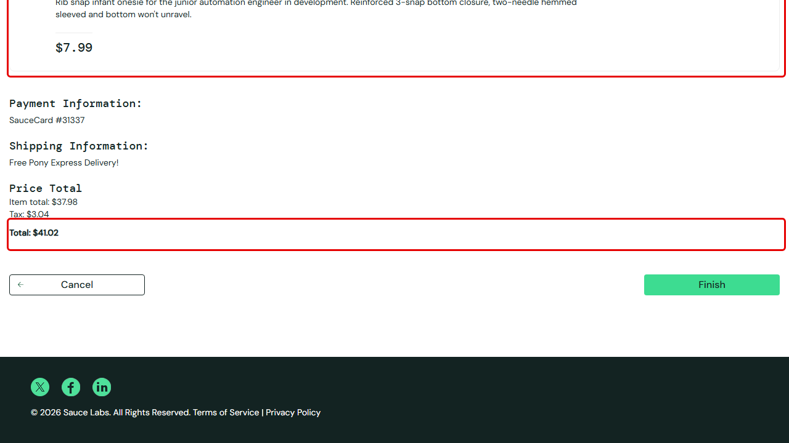

# BUG-05: tái hiện độc lập (2026-11-26)

**Biến thể SD-103: Reset App State ở Tổng quan xóa giỏ nhưng trang vẫn liệt kê sản phẩm và số tiền**

Script riêng [`tests/repro/saucedemo-checkout-screen.repro.ts`](../../../../../../tests/repro/saucedemo-checkout-screen.repro.ts) (`npm run repro -- saucedemo-checkout-screen`), **không** dùng code test: locator id / class CSS, mỗi tình huống một phiên trình duyệt mới (giỏ trống), Chromium 1280×720. Mỗi tình huống chạy 2 lần: **2/2 lần, kết quả giống nhau**. Ảnh của lần 2, khung đỏ do script vẽ để chỉ chỗ lỗi. Các bước làm bằng tay nằm trong `defects.md`.

| # | Thao tác | Kết quả thấy được | Ảnh |
|---|---|---|---|
| 1 | Đối chứng: thêm Backpack, Onesie; trang **Thông tin**: ☰ → Reset App State | Số giỏ (không có); `cart-contents` (không có khóa); trang Thông tin có 0 dòng sản phẩm |  |
| 2 | Thêm Backpack, Onesie; đi tới **Tổng quan**; ☰ → Reset App State, đóng menu | Số giỏ (không có); `cart-contents` (không có khóa); trang **vẫn 2 dòng** (Sauce Labs Backpack, Sauce Labs Onesie), `Item total: $37.98`, `Tax: $3.04`, `Total: $41.02` |  |
| 3 | Tải lại trang Tổng quan | 0 dòng, `Item total: $0`, `Tax: $0.00`, `Total: $0.00` |  |

Kết luận: Reset ở Tổng quan xóa giỏ (`cart-contents` mất, không còn số giỏ) nhưng trang vẫn hiện 2 sản phẩm và `Total: $41.02` cho tới khi tải lại; bấm Finish lúc này là BUG-35 (2).
