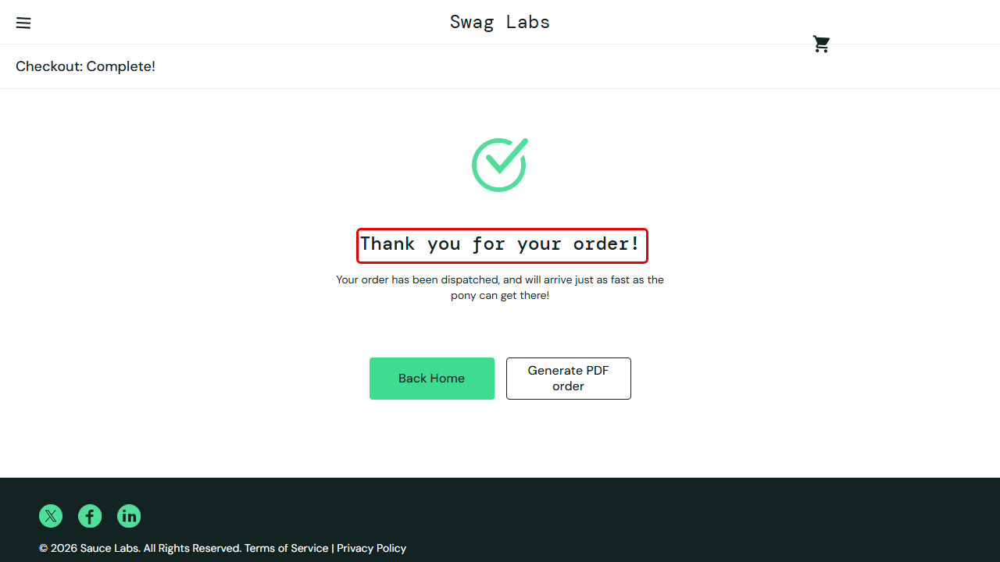
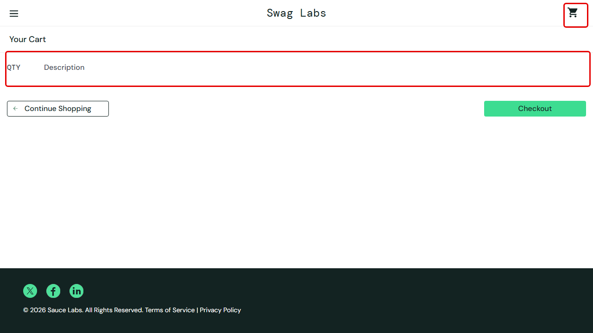
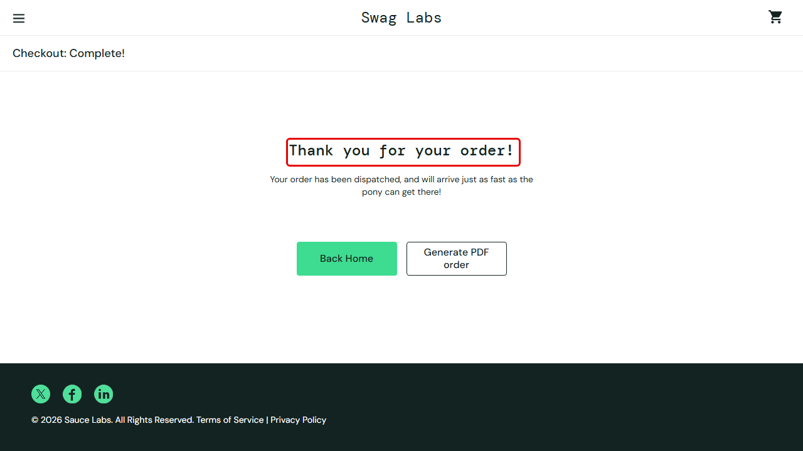
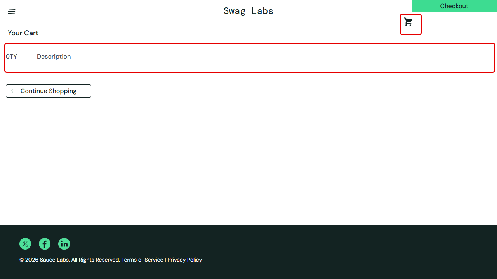

# BUG-07: tái hiện độc lập (2026-11-26)

**Biến thể SD-103: người đăng nhập sau đặt hàng bằng giỏ của người trước và làm trống giỏ đó**

Script riêng [`tests/repro/saucedemo-checkout-screen.repro.ts`](../../../../../../tests/repro/saucedemo-checkout-screen.repro.ts) (`npm run repro -- saucedemo-checkout-screen`), **không** dùng code test: locator id / class CSS, mỗi tình huống một phiên trình duyệt mới (giỏ trống), Chromium 1280×720. Mỗi tình huống chạy 2 lần: **2/2 lần, kết quả giống nhau**. Ảnh của lần 2, khung đỏ do script vẽ để chỉ chỗ lỗi. Các bước làm bằng tay nằm trong `defects.md`.

| # | Thao tác | Kết quả thấy được | Ảnh |
|---|---|---|---|
| 1 | Chiều 1: `standard_user` thêm Backpack, đi tới Tổng quan, Logout; `visual_user` đăng nhập, mở giỏ, Checkout → `Vy / Tran / 10000` → Continue → Finish | Giỏ của `visual_user`: Sauce Labs Backpack; `visual_user` đặt hàng: CÓ |  |
| 2 | `standard_user` đăng nhập lại, mở giỏ | Số giỏ (không có); giỏ: **(trống)** |  |
| 3 | Chiều 2: `visual_user` thêm Onesie, Logout; `standard_user` đăng nhập, mở giỏ, Checkout → `An / Le / 70000` → Continue → Finish | Giỏ của `standard_user`: Sauce Labs Onesie; `standard_user` đặt hàng: CÓ |  |
| 4 | `visual_user` đăng nhập lại, mở giỏ | Số giỏ (không có); giỏ: **(trống)** |  |

Kết luận: cả 2 chiều: người đăng nhập sau thấy giỏ của người trước, đặt hàng được bằng giỏ đó, và người trước đăng nhập lại thấy giỏ trống.
