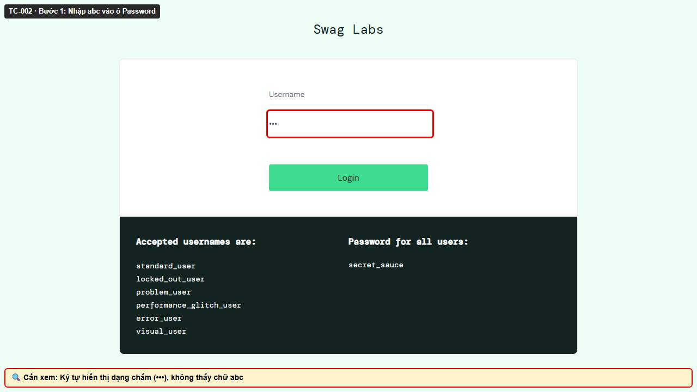

# TC-002 ô Password ẩn ký tự khi nhập

- **Kết quả**: ✅ Passed
- **Tags**: @AC-1
- **Thời điểm**: 2026-11-24T09:45:05.717Z
- **Video**: [video.webm](video.webm)

| Bước | Thao tác | Cần xem | Ảnh |
|---|---|---|---|
| 1 | Nhập abc vào ô Password | Ký tự hiển thị dạng chấm (•••), không thấy chữ abc |  |
