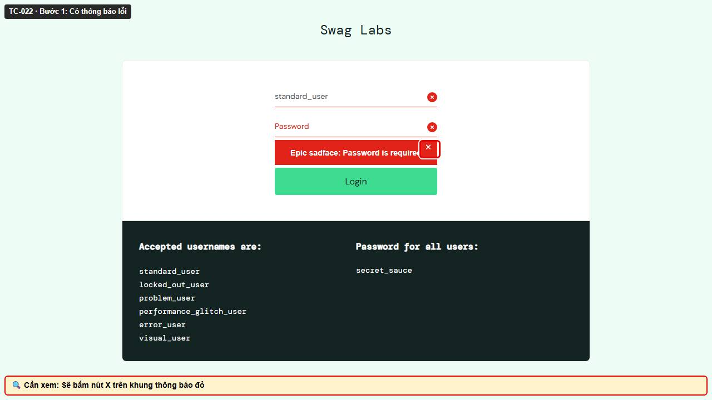
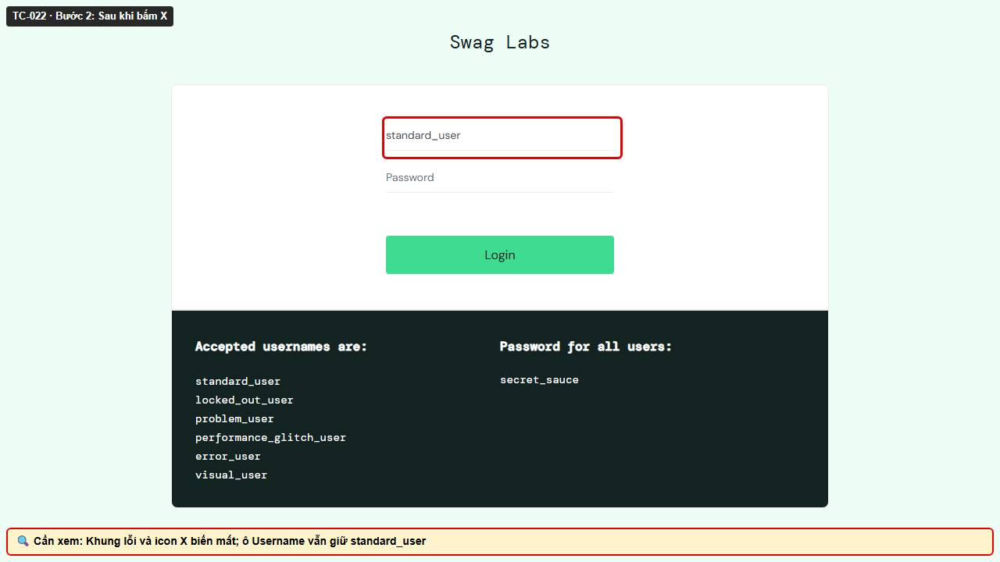

# TC-022 đóng thông báo lỗi bằng nút X

- **Kết quả**: ✅ Đúng như mong đợi · status=`passed`
- **Tags**: @AC-3
- **Thời điểm**: 2026-11-24T09:45:07.990Z
- **Video**: [video.webm](video.webm)

| Bước | Thao tác | Cần xem | Ảnh |
|---|---|---|---|
| 1 | Có thông báo lỗi | Sẽ bấm nút X trên khung thông báo đỏ |  |
| 2 | Sau khi bấm X | Khung lỗi và icon X biến mất; ô Username vẫn giữ standard_user |  |
