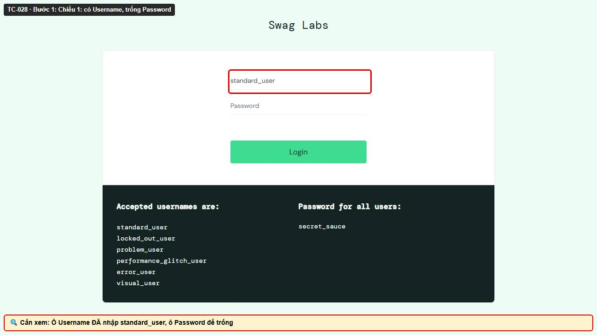
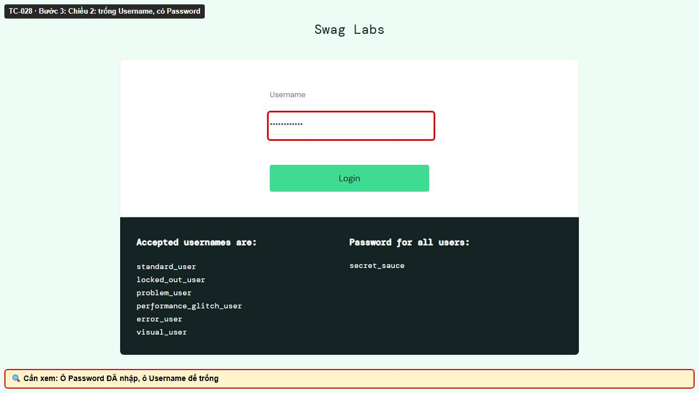
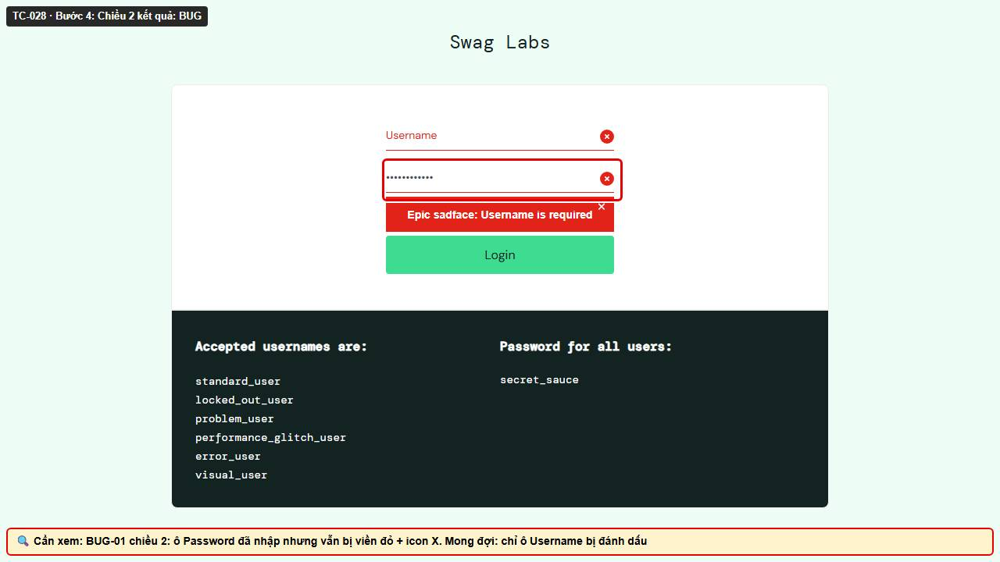

# TC-028 chỉ ô bị thiếu mới bị đánh dấu lỗi (cả 2 chiều)

- **Kết quả**: ❌ Failed · Bug: BUG-01
- **Nhóm**: AC-3: Empty fields (decision table)
- **Tags**: @AC-3 @BUG-01
- **Thời điểm**: 2026-11-25T12:27:30.637Z
- **Video**: [video.webm](video.webm)

| Bước | Thao tác | Cần xem | Ảnh |
|---|---|---|---|
| 1 | Chiều 1: có Username, trống Password | Ô Username ĐÃ nhập standard_user, ô Password để trống |  |
| 2 | Chiều 1 kết quả: BUG | BUG-01 chiều 1: ô Username đã nhập nhưng vẫn bị viền đỏ + icon X. Mong đợi: chỉ ô Password bị đánh dấu |  |
| 3 | Chiều 2: trống Username, có Password | Ô Password ĐÃ nhập, ô Username để trống |  |
| 4 | Chiều 2 kết quả: BUG | BUG-01 chiều 2: ô Password đã nhập nhưng vẫn bị viền đỏ + icon X. Mong đợi: chỉ ô Username bị đánh dấu |  |
