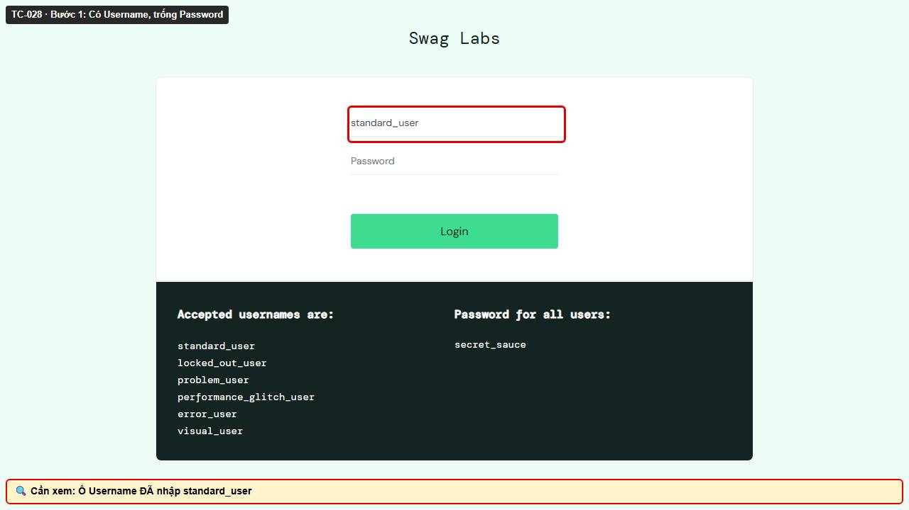

# TC-028 chỉ ô bị thiếu mới bị đánh dấu lỗi

- **Kết quả**: ❌ Failed · Bug: BUG-01
- **Tags**: @AC-3 @BUG-01
- **Thời điểm**: 2026-11-24T10:23:24.744Z
- **Video**: [video.webm](video.webm)

| Bước | Thao tác | Cần xem | Ảnh |
|---|---|---|---|
| 1 | Có Username, trống Password | Ô Username ĐÃ nhập standard_user |  |
| 2 | Kết quả: BUG | BUG-01: ô Username đã nhập đúng nhưng vẫn bị viền đỏ + icon X. Mong đợi: chỉ ô Password bị đánh dấu |  |
