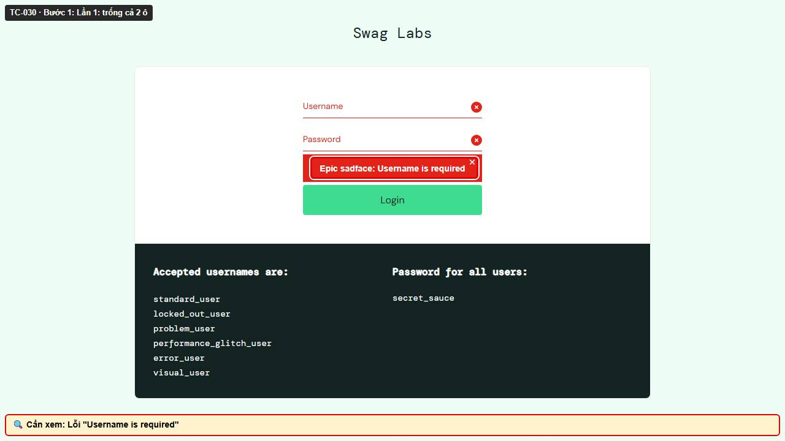
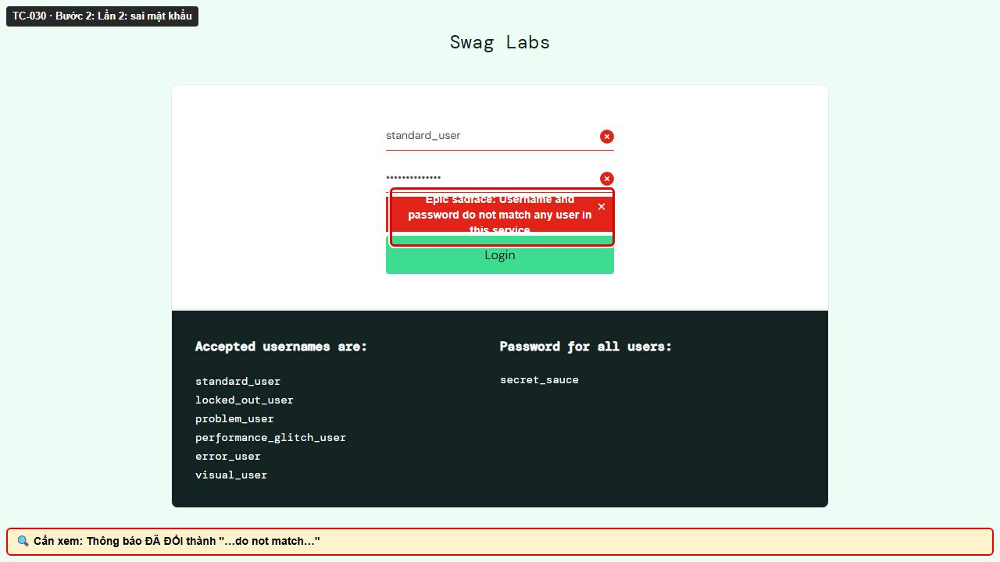
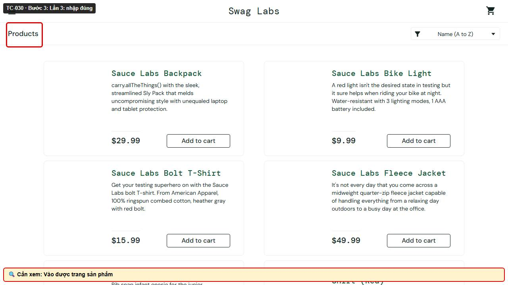

# TC-030 thử lại sau lỗi: thông báo cập nhật, nhập đúng thì vào được

- **Kết quả**: ✅ Passed
- **Tags**: @AC-2 @AC-4
- **Thời điểm**: 2026-11-24T09:45:10.687Z
- **Video**: [video.webm](video.webm)

| Bước | Thao tác | Cần xem | Ảnh |
|---|---|---|---|
| 1 | Lần 1: trống cả 2 ô | Lỗi "Username is required" |  |
| 2 | Lần 2: sai mật khẩu | Thông báo ĐÃ ĐỔI thành "…do not match…" |  |
| 3 | Lần 3: nhập đúng | Vào được trang sản phẩm |  |
