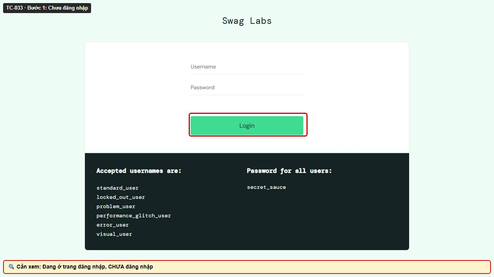
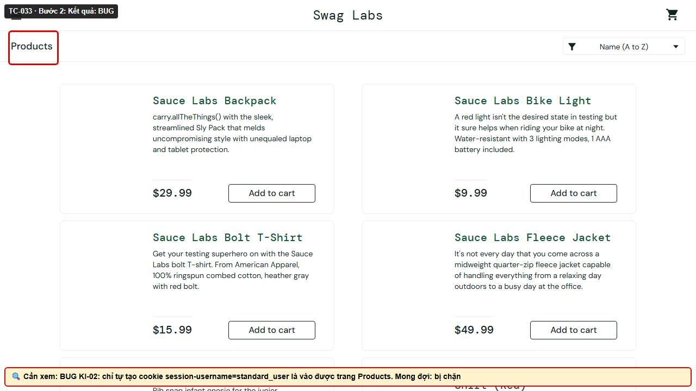

# TC-033 cookie phiên tự tạo không được vào trang bên trong

- **Kết quả**: ✅ Đúng như mong đợi · status=`failed` (bug đã biết: test được dự kiến FAIL)
- **Tags**: @AC-6 @KI-02 @security
- **Thời điểm**: 2026-11-24T09:45:18.785Z
- **Video**: [video.webm](video.webm)

| Bước | Thao tác | Cần xem | Ảnh |
|---|---|---|---|
| 1 | Chưa đăng nhập | Đang ở trang đăng nhập, CHƯA đăng nhập |  |
| 2 | Kết quả: BUG | BUG KI-02: chỉ tự tạo cookie session-username=standard_user là vào được trang Products. Mong đợi: bị chặn |  |
