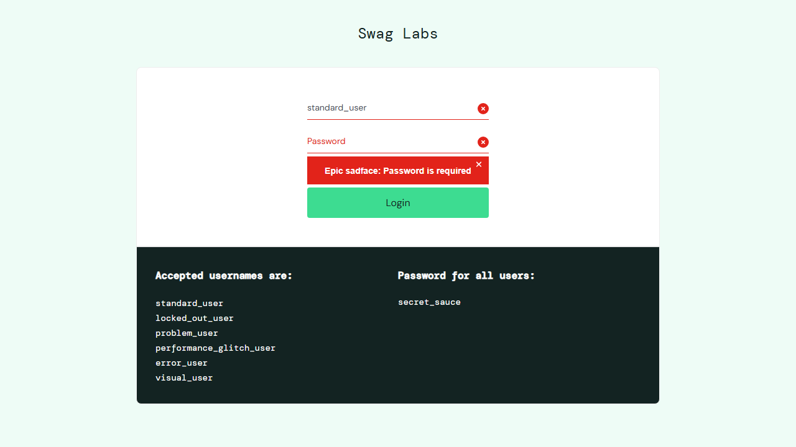

# BUG-01: tái hiện bằng tay (2026-11-24)

Trình duyệt sạch (context mới cho mỗi lần thử), dùng locator khác code test (`#user-name`, `#password`, `#login-button`).

| # | Thao tác | Thông báo | Class ô Username | Class ô Password | Ảnh |
|---|---|---|---|---|---|
| 1 | Chỉ nhập Username, bấm Login | `Password is required` | `error` ❌ (không nên có) | `error` ✅ |  |
| 2 | Chỉ nhập Password, bấm Login | `Username is required` | `error` ✅ | `error` ❌ (không nên có) |  |

Kết luận: lỗi xảy ra **cả hai chiều**. Với mọi lỗi "required", cả 2 ô đều bị tô đỏ.

> **Sửa 2026-11-25**: bản đầu ghi class `input_error`. Thực tế ô nào cũng luôn có sẵn `input_error`; dấu hiệu lỗi là class `error` + icon ✕. Bảng trên đã sửa theo đúng class.
