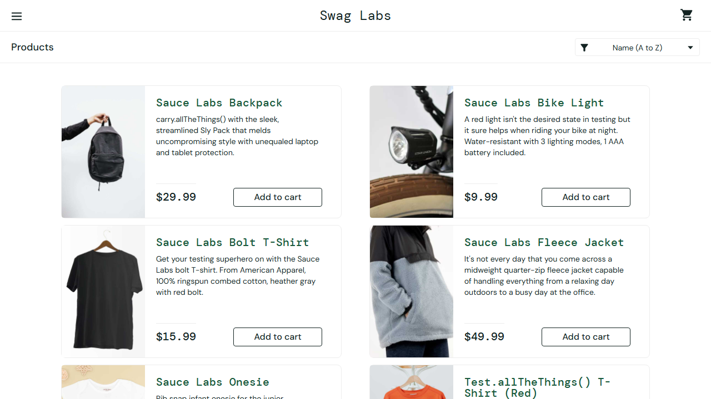
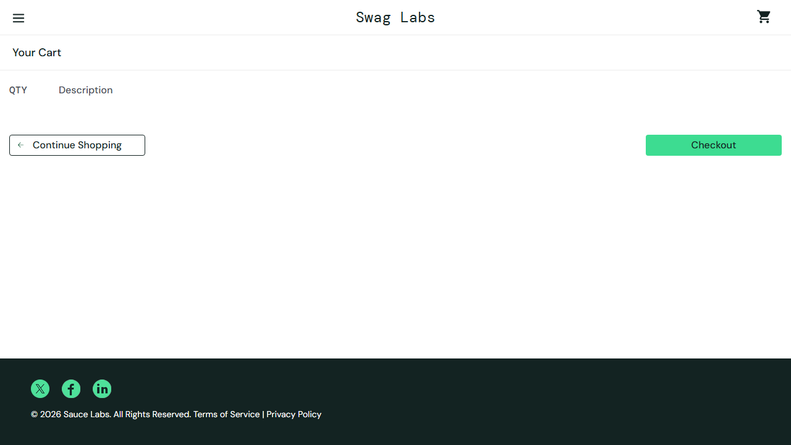
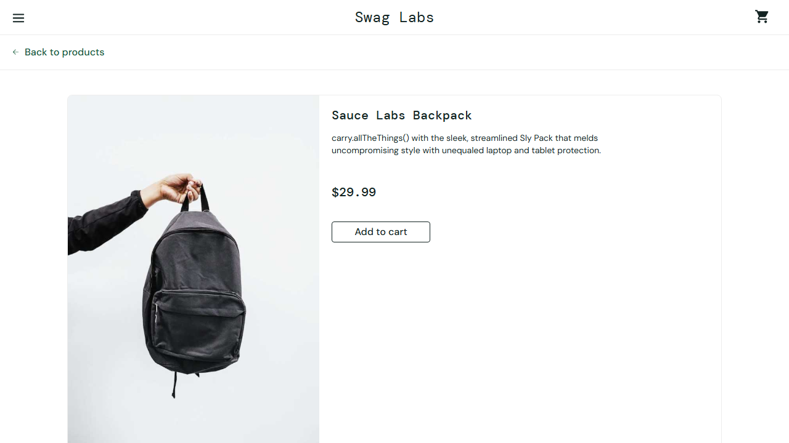
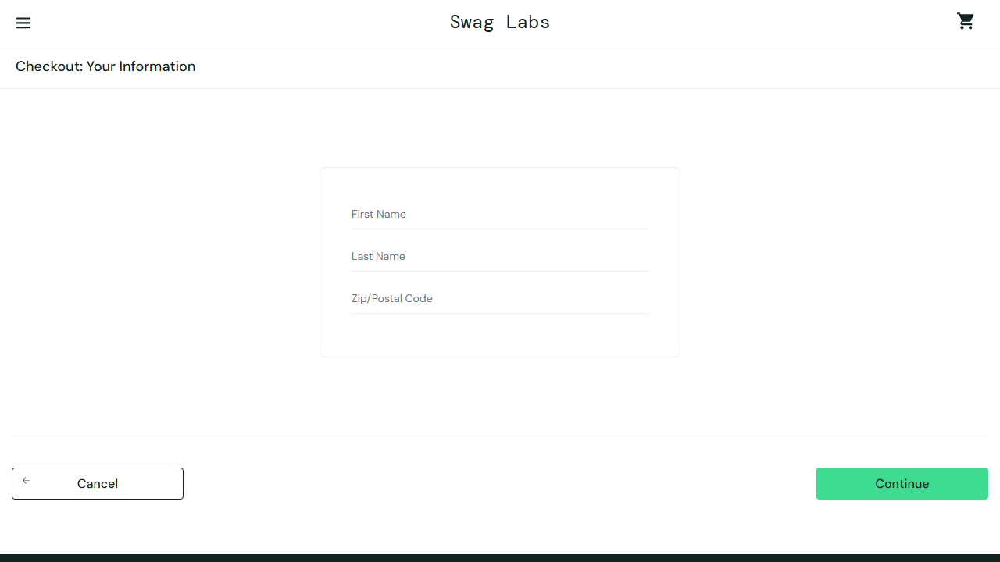

# BUG-02: tái hiện bằng tay (2026-11-24)

Trình duyệt sạch, không đăng nhập. Chỉ chạy `document.cookie = "session-username=standard_user"` ở trang `/`, rồi mở trực tiếp từng trang:

| # | Trang | Kết quả | Ảnh |
|---|---|---|---|
| 1 | `/inventory.html` | ❌ Vào được, thấy 6 sản phẩm |  |
| 2 | `/cart.html` | ❌ Vào được |  |
| 3 | `/inventory-item.html?id=4` | ❌ Vào được |  |
| 4 | `/checkout-step-one.html` | ❌ Vào được form thanh toán |  |

qa-reviewer kiểm chứng thêm `/checkout-step-two.html`, `/checkout-complete.html`: cũng vào được. Cookie có `httpOnly: false`, tức là JavaScript đọc và ghi được.
