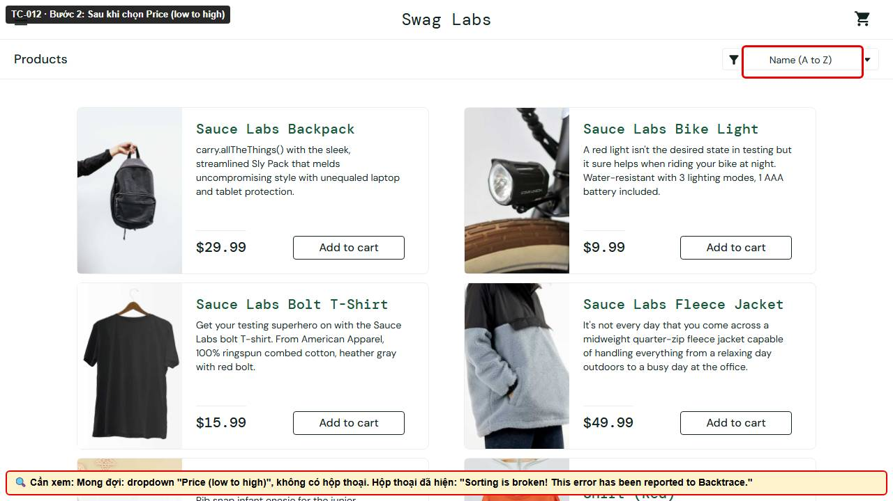

# TC-012 error_user: sắp xếp hoạt động với cả 3 kiểu, không báo lỗi

- **Kết quả**: ❌ Failed · Bug: BUG-12
- **Nhóm**: Màn hình 1: Danh sách sản phẩm (/inventory.html)
- **Tags**: @AC-2 @list @BUG-12
- **Thời điểm**: 2026-11-25T08:12:52.044Z
- **Video**: [video.webm](video.webm)

| Bước | Thao tác | Cần xem | Ảnh |
|---|---|---|---|
| 1 | Sau khi chọn Name (Z to A) | Mong đợi: dropdown "Name (Z to A)", không có hộp thoại. Hộp thoại đã hiện: "Sorting is broken! This error has been reported to Backtrace." |  |
| 2 | Sau khi chọn Price (low to high) | Mong đợi: dropdown "Price (low to high)", không có hộp thoại. Hộp thoại đã hiện: "Sorting is broken! This error has been reported to Backtrace." |  |
| 3 | Sau khi chọn Price (high to low) | Mong đợi: dropdown "Price (high to low)", không có hộp thoại. Hộp thoại đã hiện: "Sorting is broken! This error has been reported to Backtrace." |  |
