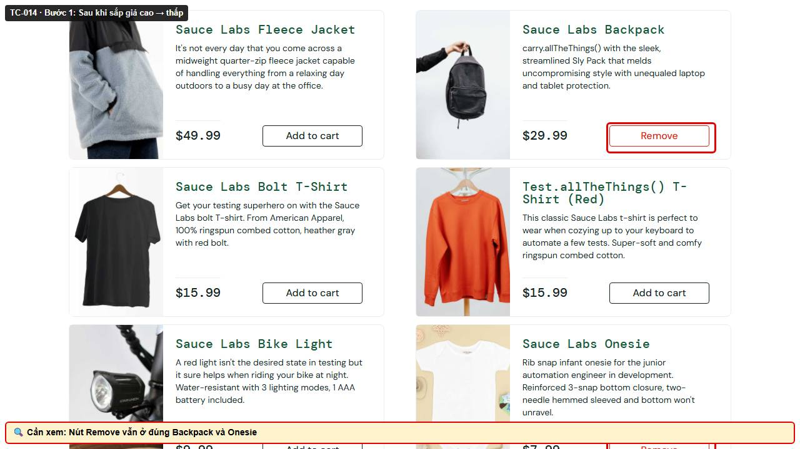

# TC-014 sắp xếp khi giỏ có hàng: nút Remove đi theo đúng sản phẩm

- **Kết quả**: ✅ Passed
- **Nhóm**: Màn hình 1: Danh sách sản phẩm (/inventory.html)
- **Tags**: @AC-2 @AC-3 @list
- **Thời điểm**: 2026-11-25T08:12:38.468Z
- **Video**: [video.webm](video.webm) (quay ở lần chạy ngày 2026-11-25, không quay lại vì test pass)

| Bước | Thao tác | Cần xem | Ảnh |
|---|---|---|---|
| 1 | Sau khi sắp giá cao → thấp | Nút Remove vẫn ở đúng Backpack và Onesie |  |
