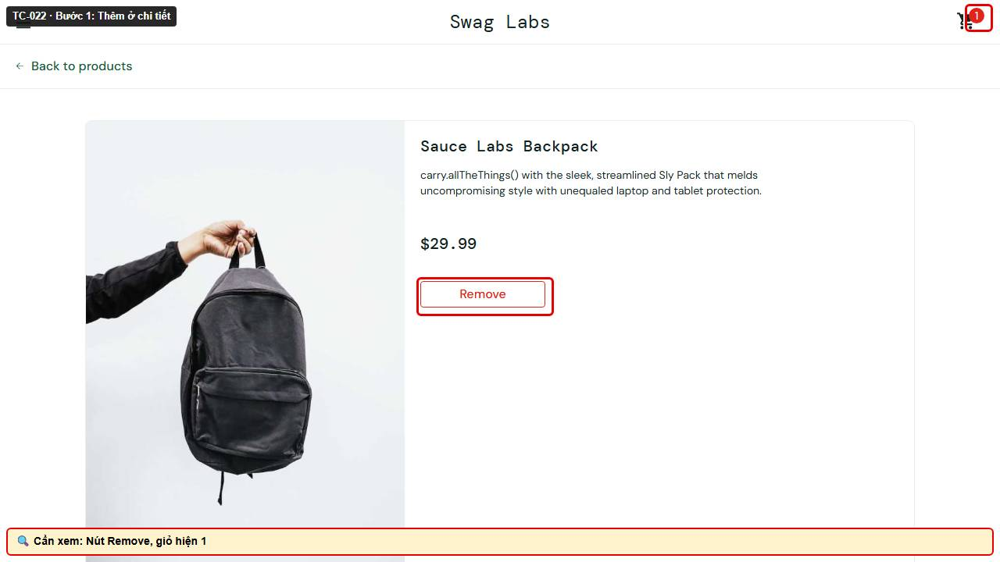
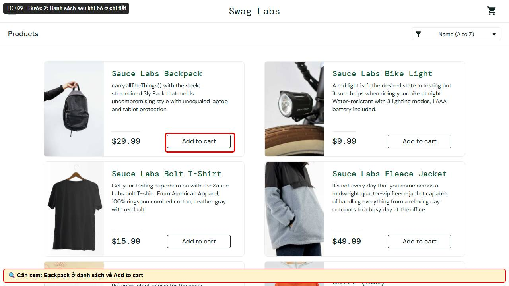

# TC-022 thêm / bỏ ở trang chi tiết đồng bộ với danh sách

- **Kết quả**: ✅ Passed
- **Nhóm**: Màn hình 2: Chi tiết sản phẩm (/inventory-item.html?id=<n>)
- **Tags**: @AC-3 @AC-4 @AC-5 @list @detail
- **Thời điểm**: 2026-11-25T08:12:41.492Z
- **Video**: [video.webm](video.webm) (quay ở lần chạy ngày 2026-11-25, không quay lại vì test pass)

| Bước | Thao tác | Cần xem | Ảnh |
|---|---|---|---|
| 1 | Thêm ở chi tiết | Nút Remove, giỏ hiện 1 |  |
| 2 | Danh sách sau khi bỏ ở chi tiết | Backpack ở danh sách về Add to cart |  |
