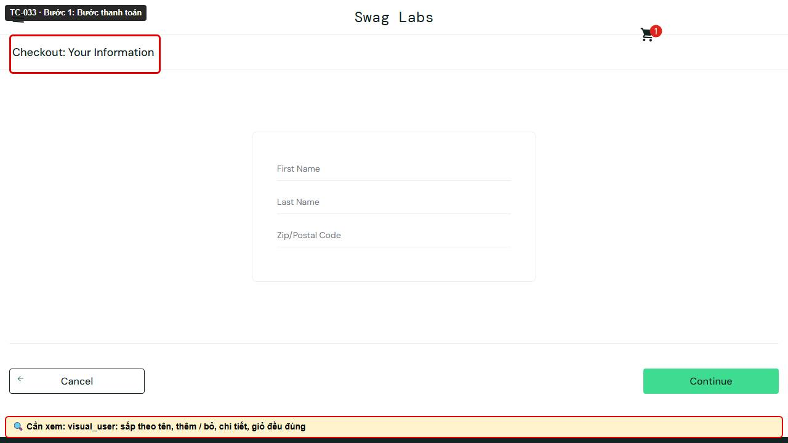

# TC-033 visual_user: các thao tác không lỗi vẫn đúng (sắp xếp, thêm / bỏ, mở chi tiết, trang giỏ)

- **Kết quả**: ✅ Passed
- **Nhóm**: Chung: nhiều màn hình (tài khoản, giỏ, menu, kiểm soát truy cập)
- **Tags**: @AC-2 @AC-3 @AC-4 @AC-5 @AC-6 @list @detail @cart
- **Thời điểm**: 2026-11-25T08:13:05.442Z
- **Video**: [video.webm](video.webm) (quay ở lần chạy ngày 2026-11-25, không quay lại vì test pass)

| Bước | Thao tác | Cần xem | Ảnh |
|---|---|---|---|
| 1 | Bước thanh toán | visual_user: sắp theo tên, thêm / bỏ, chi tiết, giỏ đều đúng |  |
