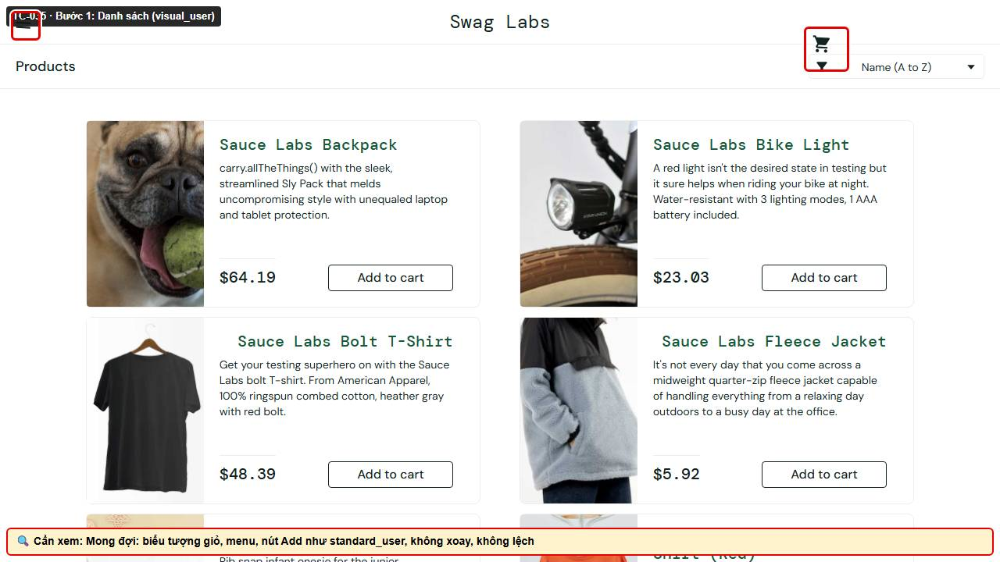
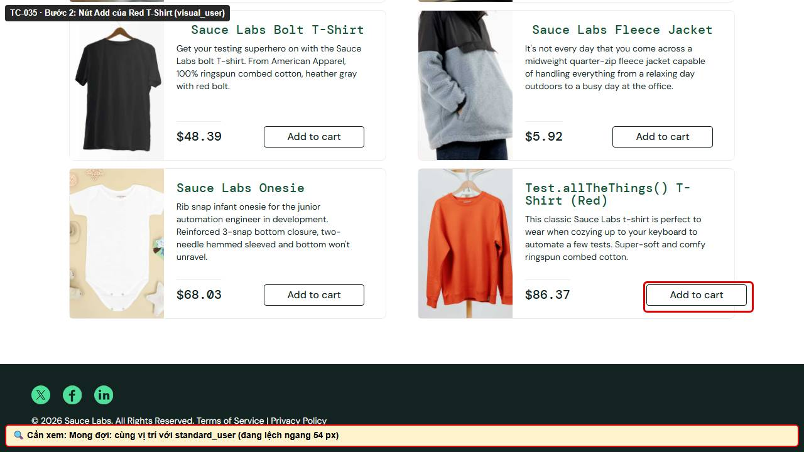
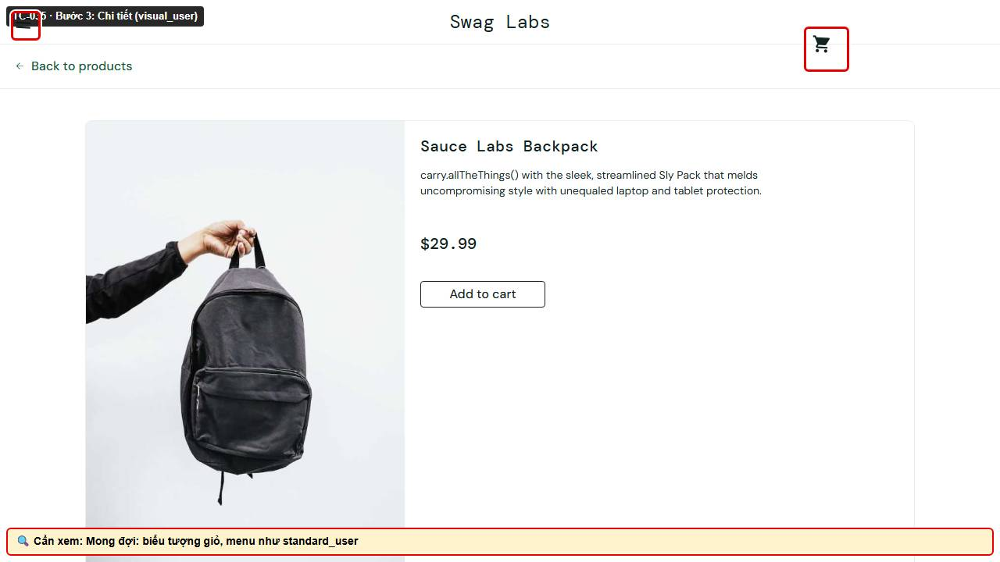
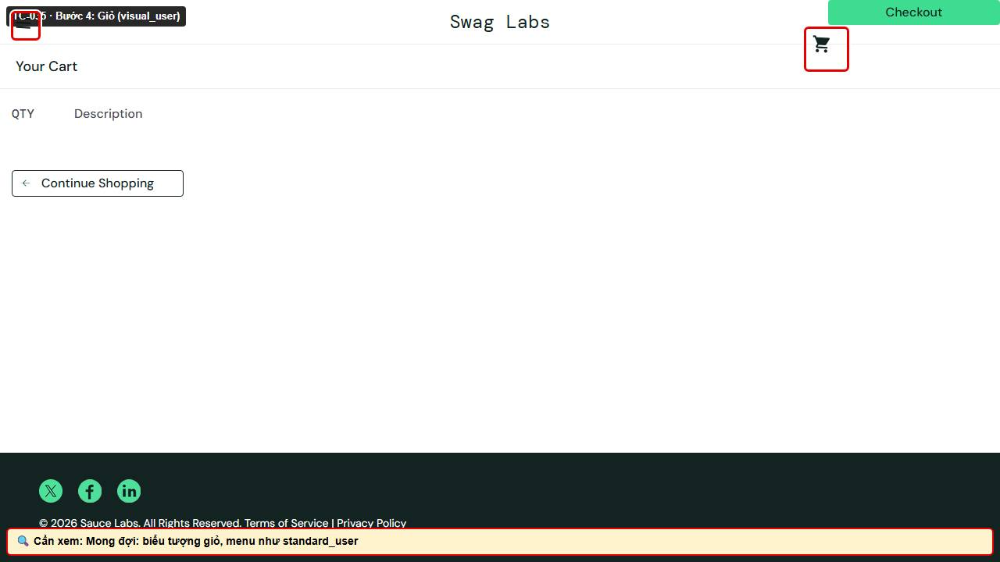

# TC-035 visual_user: bố cục giống standard_user ở cả 3 màn hình

- **Kết quả**: ❌ Failed · Bug: BUG-16
- **Nhóm**: Chung: nhiều màn hình (tài khoản, giỏ, menu, kiểm soát truy cập)
- **Tags**: @AC-1 @AC-3 @AC-6 @list @detail @cart @BUG-16
- **Thời điểm**: 2026-11-25T08:12:56.452Z
- **Video**: [video.webm](video.webm)

| Bước | Thao tác | Cần xem | Ảnh |
|---|---|---|---|
| 1 | Danh sách (visual_user) | Mong đợi: biểu tượng giỏ, menu, nút Add như standard_user, không xoay, không lệch |  |
| 2 | Nút Add của Red T-Shirt (visual_user) | Mong đợi: cùng vị trí với standard_user (đang lệch ngang 54 px) |  |
| 3 | Chi tiết (visual_user) | Mong đợi: biểu tượng giỏ, menu như standard_user |  |
| 4 | Giỏ (visual_user) | Mong đợi: biểu tượng giỏ, menu như standard_user |  |
